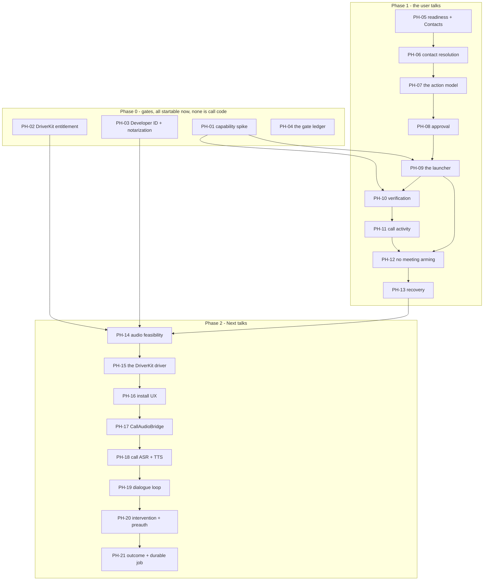

# Next Notes Phone Calls: start here

**Model alignment, 2026-09-30:** follow the
[independent-role/shared-file contract](../../in-progress/SHARED-BRAIN/00-README.md).
Phone tools continue through the existing Agent role/manifest and permission
boundary. Module splitting does not require a dedicated Phone LLM/download/runtime.
Reuse exact verified files; consent for an Agent request is not consent for another
workload's transcript. No call task or gate is marked implemented here.

This folder is an implementation roadmap for making calls from the app, in two versions. It is meant
to be executed task by task by a coding agent with **no access to the conversation that produced
it**. Everything you need is in these files, in the repo, and in the roadmaps it depends on.

Read this file completely before you touch any task. Then read `AGENTS.md` at the repo root. Its
rules override your habits.

---

## 1. What this is, and the one thing to understand first

**V1 — Next starts the call, the user talks.** Contact resolution, an approval card, `tel:`, a
receipt. Weeks of ordinary work on an Action Runtime that already exists.

**V2 — Next conducts the call.** Bidirectional audio into the macOS phone-call path, streaming ASR
and TTS, barge-in, turn taking, hold, IVR, mid-call user intervention. Its feasibility rests on an
Apple entitlement the app **cannot currently hold**, and on audio routing nobody has proven.

```text
V1:  "Call Sarah."  →  confirm the number  →  approve  →  tel:  →  the user talks
V2:  "Call the dentist and ask about Thursday."  →  approve  →  Next talks, listens, ends the call
```

**The sequencing is the strategy: first make Next a safe remote dialer, then a full autonomous
caller.** That keeps the user value high while isolating the hardest dependency.

## 2. Why this lives in `roadmap/todo/`, not `in-progress/`

Same reason as the iMessage folder. **All four Phase 0 tasks** cannot be done by an agent, and
**V1 cannot start before PH-01 closes** because `tel:` from a background app is the risk the
predecessor's §0.5 predicted and nobody has measured. Putting a roadmap that cannot move into
`in-progress/` dilutes what that directory means.

**Move this folder to `roadmap/in-progress/` when the V1 phase gate closes.**

## 3. The gates. Start PH-02 and PH-03 today; they are not phone work.

| Gate | Task | What it needs | What it decides | Blocks |
|---|---|---|---|---|
| **G1 — capability spike** | PH-01 | a human, an iPhone nearby, Contacts, ~1 day | whether `tel:` works from a **background** app, and which call states are honestly observable | all of V1 |
| **G2 — DriverKit entitlement** | PH-02 | Apple, by email. Weeks to months, unknowable | whether V2 is possible at all | V2 only |
| **G3 — Developer ID and notarization** | PH-03 | an Apple Developer account | whether a `.dext` can be **signed and distributed** | V2 only |
| **G4 — legal review (V2 only)** | PH-04 | a lawyer | calling, recording and automated-disclosure rules per supported market | V2 release — **nobody can close this with code** |

**G3 is the one the predecessor missed entirely, and it is the most important thing in this
section.** `Resources/NextNotes.entitlements` is ad-hoc-signed by default and AGENTS.md records
that notarization and signing are not built. An ad-hoc signature produces a different designated
requirement on every build, so:

- the dext cannot be stably signed on this machine today;
- it cannot be notarized, so it cannot be distributed;
- and the entitlement it needs is attached to a certificate the project does not have.

**Any one of G1–G4 failing ends V2 on this architecture.** G3 is valuable independently of calls —
it unblocks the app's own release — so it is worth doing even if V2 never happens.

## 4. What exists to build on (verified 2026-09-25 against `78cebc9`)

### 4.0 Read this first: two kinds of "exists"

A sub-agent audit on 2026-09-25 found the 2026-09-25 draft of this table wrong in one important way,
and the distinction is worth more than any other line in this section:

| Kind | What it means | What happens if you get it wrong |
|---|---|---|
| **PRESENT** | in `Sources/` today, re-grepped | nothing — read it |
| **PLANNED** | a **named contract in `roadmap/in-progress/AGENT-OVERHAUL`** on a row that is still `todo` | **you go looking for a channel that is not there, and then you build a second one** |

**`OutputScheduler`, `TaskBridge`, `TaskRecord`, `TaskDurability`, `TaskEvent`, `TaskDelivery`,
`AgentBackendKind`'s task-side use, and `AgentCapabilityManifest` are PLANNED, not present.**
Verified 2026-09-25: `grep -rl TaskBridge Sources/NextNotes` → **0 files**; AO's ledger carries it 8
times, as `P3-03a`/`P3-03b`, both `todo`. `OutputScheduler` → 0 files, `P3-04a`/`P3-04b`, `todo`.
`AgentCapabilityManifest` → one **comment** at `Agent/Speech/AgentSpeechPolicy.swift:591`, not a type;
`P1-03`, `todo`.

They are the right names, and this roadmap is written against them on purpose. **They are a
dependency, not a foundation.** PH-07 needs `P1-03`; PH-08's remote half needs IM-13; PH-21 needs
`P6`. Everything in Phase 0 and most of Phase 1 needs none of them.

### 4.1 Present in the tree today

| Need | Exists | Where |
|---|---|---|
| The safety path every call must take | `ActionIntent` :97 → `PreparedAction` :226 → `PermissionBroker` :13 → `ActionOrchestrator` :382 → `ActionReceipt` :285 → `verifyResult` :638 | `Agent/ActionRuntime.swift` |
| Risk grading, already refusing auto-run for a send | `AgentRisk` (8 cases); `PermissionPolicy.allowsAutomatically` is `false` for `.write/.send/.purchase/.destructive/.privileged` | `Agent/AgentModels.swift:10`, `Permissions/PermissionPolicy.swift:114` |
| The turn entry point, and the source enum | `handle(_:source:)` `:258`; `AgentUtteranceSource` | `Agent/RealtimeAgent.swift:4-8` |
| **The island already has a call state** | `IslandState.Kind.callQuestion(MeetingEvent)` | `UI/Island/IslandState.swift:82` |
| **The app already detects calls** | `CallDetector`, `CallPolicy` (`isCall` = input **and** output held), `AudioProcessOwner.outermostAppPath` | `Meetings/CallPolicy.swift:54, 114`, `Meetings/AudioProcessOwner.swift:19` |
| The full-duplex audio layer V2 reuses | `RealtimeAudioSession` (1,018; `duckedVolume = 0.65` `:49`, barge-in budgeted by `bargeInFailures()` `:516`) | `Agent/RealtimeAudioSession.swift` |
| Echo cancellation V2 reuses | `AcousticEchoProcessor` (1,626), SpeexDSP AEC + `--acoustic-aec3` | `Agent/AcousticEchoProcessor.swift` |
| Turn capture, EOU, and the streaming stack V2 reuses | `AgentCaptureController`, `LocalVoiceTurnDetector` (FluidAudio `StreamingEouAsrManager(chunkSize: .ms160, eouDebounceMs: 320)`), `StreamingSpeechBuffer` | `Activation/`, `Agent/Speech/` |
| Local neural TTS V2 reuses | `PocketAgentVoice` (`PocketTtsManager(precision: .int8)`), `KokoroAgentVoice` (`af_heart`, **refuses to run on macOS 26.4–26.5** — CoreML crashes in Apple BNNS) | `Speech/` |
| An honest unanswerable readiness row | the system-audio grant pattern: `hasHeardSystemAudio`, "one non-silent buffer is the only proof" | `Support/Permissions.swift:42` |
| Contacts | **nothing.** `CNContact` appears nowhere. New framework, new TCC row, shared with the iMessage folder | — |
| Telephony | **nothing.** `tel:`, `Phone.app`, `AudioDriverKit`, `AVCaptureSession` all 0 hits. `AVCaptureDevice` appears 6 times, **all of them permission probes** | — |
| The result type a call outcome should extend | `AgentTaskOutcome` | `Agent/Tasks/AgentTaskManager.swift:336` |

### 4.2 PLANNED — dependencies, not foundations

| Type | Where | State | Needed for |
|---|---|---|---|
| `AgentCapabilityManifest` | AO **P1-03** | `todo` | PH-07 — `phone.*` cannot be registered without it |
| `OutputScheduler`, `AgentDeliveryMode`, `TaskDelivery` | AO **P3-04a/b** | `todo` | PH-11, PH-21 — a call's result reaches a person only this way |
| `TaskBridge`, `TaskID`, `TaskEvent.needsInput` | AO **P3-03a/b** | `todo` | PH-11, PH-20 |
| `TaskRecord`, `TaskDurability` | AO **P6** | `todo` | PH-21 — a call is a durable task |
| `RemotePreparedAction` | `NextNotes-iMessage` **IM-13** | `todo` | PH-08's remote half |
| `ActionOriginContext` | `NextNotes-iMessage` **IM-12** | `todo` | PH-08 |

**`AgentResultFact` does not exist** — the 2026-09-25 draft of this roadmap cited it in PH-21 as "the
spine's existing type". It has **0 hits** in `Sources/`. The real type is `AgentTaskOutcome`
(`Agent/Tasks/AgentTaskManager.swift:336`), and PH-21 is corrected to name it.

### 4.3 Also corrected

The draft cited `Speech/StreamingSpeechBuffer.swift`, `Speech/PocketAgentVoice.swift` and
`Speech/KokoroAgentVoice.swift`. There is no `Sources/NextNotes/Speech/` — the directory is
`Sources/NextNotes/Agent/Speech/`. All three are now correct above.

## 5. The three findings that shape this roadmap

These came out of reading the code, and each one is load-bearing.

### 5.1 The call detector will see Next's own call, and will arm a meeting

`Meetings/CallDetector.swift` and `CallPolicy.isCall` **already work**: they read
`kAudioProcessPropertyIsRunningInput` / `…IsRunningOutput` and arm a meeting when both are held by
something that is not us and not on the denylist.

So when `PhoneCallController` places a call through Phone.app, the detector **will** see it and
**will** arm a meeting — recording the user's phone call through the meeting pipeline, with
diarization, notes generation and both tracks written to `audio.caf`, without anyone asking.

**V1.8's "a phone call is not a meeting recording" is therefore a code change, not a setting.**
`PhoneCallController` marks a call it launched and `CallPolicy` consults that marker before arming.
The symptom if it is missed is not "a feature is off" — it is a phone call silently becoming a
Meeting in the list, which reads as data loss.

This must be coordinated with `DICTATION-MEETINGS-LIMITS` **M-11** ("one recording per real meeting:
call near an event starts it"), which is `todo` and owns that decision. M-11 decides when a call
*should* arm; PH-12 plugs an agent-launched call into its answer. **Do not edit `CallPolicy` while
M-11 is in flight.**

### 5.2 A DriverKit driver is a second binary, not a source folder

The predecessor's layout put four `.cpp` files under
`Sources/NextNotes/Phone/Audio/AudioDriver/`. **That cannot work.** An AudioDriverKit driver ships as
its own `.dext` inside a `.systemextension`, installed by the app and approved by the user in System
Settings. It means a new SwiftPM target, a new bundle, a second product in the Makefile's `install`
(which today stages one `.app` and swaps it under `install.lock`), a new `codesign` invocation, and
a new verification step. "Add four files" and "add a second signed, installed, notarized,
user-approved binary to the distribution" are different projects, and the predecessor's plan budgeted
the first while describing the second.

Corrected in `03-PHASE-2-V2-AUDIO.md`.

### 5.3 Sending `tel:` from a background app has a measured precedent for failing

`NSWorkspace.shared.open(URL(string: "tel:…"))` is public and fine. What the predecessor did not
anticipate: **Next Notes is, by design, a background app during an agent turn** — the HUD is a
non-activating panel and focus never leaves the user's field. And this repo has already measured that
macOS's cooperative activation resists exactly that:

> `NSRunningApplication.activate()` is refused often enough to be useless alone, because macOS's
> cooperative activation resists a *background* app raising another — and Next Notes is always
> background during a dictation, by design.

The mitigation that shipped for dictation is **two mechanisms plus polling**: `activate()` **and**
`kAXFrontmostAttribute` through the Accessibility grant, both followed by polling, because a `⌘V`
arriving mid-raise lands somewhere else. A `tel:` launch is the same shape, so PH-09 carries the same
treatment, and V1.6's verification levels distinguish "the OS accepted my request" from "a call UI
is on screen."

## 6. What this roadmap must not become

- **Not a second approval matcher.** Remote approval is IM-13's `RemotePreparedAction`, and
  `phone.place_call` is one of its `RemoteActionKind` cases. It is declared by IM-13 and submitted
  by PH-08.
- **Not a second tool catalogue.** `phone.*` registers with AO **P1-03**'s
  `AgentCapabilityManifest`, with its canonical id and **no alias** — `RealtimeToolSelection` checks
  the raw name before the registry resolves it, so a registered alias loses the rest of the plan.
- **Not a fourth receipt store.** `ActionReceipt` already records a `PreparedAction` and its
  verification. `PhoneCallReceipt` is that receipt's payload, not a parallel persistence.
- **Not a second delivery channel.** A call's result goes out through `OutputScheduler` / the
  ledger, and a phone worker never speaks to the user — the rule that matters most here, because the
  audio is already in the room.
- **Not a browser-telephony product.** No SIP, no cloud provider, no number buying, no carrier
  credentials, no local server. The call path is Apple's.

---

## 7. File map

| File | What it holds | Author status |
|---|---|---|
| `00-README.md` | This file: gates, workflow, rules, task ids, dependencies, glossary, limits | written 2026-09-25 |
| `STATUS.md` | The ledger. Update after every task | written 2026-09-25 |
| `01-PHASE-0-GATES.md` | PH-01…PH-04: the capability spike, the entitlement, Developer ID, the ledger. **No call code.** | written 2026-09-25 |
| `02-PHASE-1-V1.md` | PH-05…PH-13: readiness, contacts, the action model, approval, the launcher, verification, activity, the call-detector marker, recovery | written 2026-09-25 |
| `03-PHASE-2-V2-AUDIO.md` | PH-14…PH-21: the audio feasibility gate, the driver, install UX, the audio bridge, the dialogue loop, the outcome | written 2026-09-25 |
| `REVIEW-LOG.md` | The audit, what was checked, known open issues | written 2026-09-25 |

Inside a phase file, each task's **Depends on** line is authoritative; §9's graph is a summary.

**The `roadmap/` folder is git-ignored. Never commit anything under it.** Test reports go in
`Tests/Reports/`. The predecessor was `roadmap/todo/NextNotes_Phone_Call_V1_V2_Roadmap.md`, 1,796
lines, now **deleted**; `REVIEW-LOG.md` §1 records what changed.

---

## 8. The per-task workflow

Identical to `NextNotes-iMessage/00-README.md` §7 and to AGENT-OVERHAUL `00-README.md` §5, and it
restates the same thirteen steps AO's `00-README.md` §5 lists (the iMessage folder's §7 is a
twelve-step copy of it): read the task and its files · **re-verify every anchor by
grepping the symbol** · red-first self-test, registered in three places · `make build` ·
`make install OPEN=0` · confirm RED · implement · build and install · GREEN ·
regressions · update `STATUS.md` · one commit per task, `git add <paths>`, **never `git add -A`**,
never push, never amend someone else's commit, never commit under `roadmap/`.

**Shared files are single-writer.** `NextNotesApp.swift`, `Scripts/acceptance.sh` and `AGENTS.md` get
one line per new flag, batched by the orchestrator. `AGENTS.md` also has an uncommitted change from
2026-09-25 that AGENT-OVERHAUL's P0-12 owns; do not reset it.

**Two files in V1 are actively owned by another workstream:** `Meetings/CallPolicy.swift` (by
DICTATION-MEETINGS-LIMITS M-11) and `Support/Permissions.swift` + `UI/Settings/AgentSettingsTab.swift`
(shared with the iMessage folder). Coordinate; never revert a file you did not change.

### The build lock

**One SwiftPM scratch path, one `install.lock`, ~5 GB of build cache, and two other workstreams
building this same tree.** Concurrent `swift-build` runs into
`~/Library/Caches/NextNotesBuild/scratch` corrupt each other, and a self-test that starts while
another workstream installs reports `codesign verification failed` and looks like a code failure.

```bash
L=~/Library/Caches/NextNotesBuild/work.lock
until mkdir "$L" 2>/dev/null; do sleep 3; done   # mkdir is atomic on APFS
echo "holder: $$ started $(date +%T)" > "$L/owner"
# ... make build · make install OPEN=0 · Scripts/run-selftest.sh ... ...
rm -rf "$L"                                       # release
```

Hold it for the shortest possible span and release it in a `trap`. **Writing and reading files needs
no lock** — only build, install and self-test do. A lock held longer than 20 minutes should have its
`owner` file read before it is assumed live. `make build` is the only supported build; never bare
`swift build`.

The full protocol is in `NextNotes-iMessage/00-README.md` §8.2. **It only serialises parties that take
it** — both in-progress workstreams must be told to, or it protects nothing.

**What every change is judged by**
- Efficiency, speed and full-duplex conversation come first. The full statement is AGENTS.md
  "What we optimize for"; read it again before a task changes a path the user waits on.
- Do not add a sequential await, a fixed sleep, a debounce or a second confirmation to a path
  the user's turn sits on, and do not serialise audio and interaction — "it is safer" is not a
  reason. A task that needs an exception says so in its commit and `STATUS.md`.
- Do not add a store, ledger, queue, channel or tool manifest. Prefer the existing seam and the
  smaller diff; the single-owner paragraph in AGENTS.md is the check before adding a layer.
- Safety lives at the irreversible boundary, not in the path of everything: a read runs itself,
  a write waits for one approval. More ceremony than that makes the app feel slow, not safe.
- The person using this is not technical: no flow may ask for an API key, a terminal command or
  a config file when the app can do it for them, and copy stays in the user's own words
  (`--selftest-ui-strings` is the floor, not the goal).

---

## 9. Task IDs and the dependency graph

**These ids are fixed. Never renumber them.** Lettered subtasks (`PH-08a`) are allowed and each gets
its own `STATUS.md` row.

### Phase 0 — the gates (`01-PHASE-0-GATES.md`)

| ID | Title |
|---|---|
| PH-01 | Capability spike: `tel:` from a background app, and which call states are observable |
| PH-02 | DriverKit entitlement request (Apple; V2 only) |
| PH-03 | Developer ID in CI and a notarization path (shared with the app's release; V2 only) |
| PH-04 | The gate ledger: the honest state of G1–G4, re-checkable |

### Phase 1 — V1, the user talks (`02-PHASE-1-V1.md`)

| ID | Title |
|---|---|
| PH-05 | Readiness snapshot and the Contacts permission — one framework, one prompt, shared with iMessage |
| PH-06 | Contact resolution, number normalization, disambiguation, and the emergency block |
| PH-07 | The action model: `phone.prepare_call` / `place_call` / `cancel_call` in the manifest |
| PH-08 | Approval, local and remote — the remote half is IM-13, not a second matcher |
| PH-09 | The launcher: `tel:`, the two-mechanism raise, and the agent-launched marker |
| PH-10 | Verification levels and the `ActionReceipt` payload |
| PH-11 | Call activity: the island's existing `callQuestion` state, and the Activity row |
| PH-12 | An agent-launched call does not arm a meeting (coordinate M-11) |
| PH-13 | V1 recovery, and a second call is never launched twice |

### Phase 2 — V2, Next talks (`03-PHASE-2-V2-AUDIO.md`)

All gated on G2 **and** G3 **and** PH-14's audio feasibility.

| ID | Title |
|---|---|
| PH-14 | The audio feasibility gate — the most important V2 task |
| PH-15 | The DriverKit driver: a new target, a new bundle, the build and the install |
| PH-16 | Install UX: four states, not a boolean |
| PH-17 | `CallAudioBridge`: a second low-latency path that does not touch the voice session |
| PH-18 | Phone ASR and TTS on the existing engines, telephone-band |
| PH-19 | The dialogue loop, disclosure, barge-in, hold, IVR |
| PH-20 | User intervention, preauthorization, and consequential actions |
| PH-21 | Transcript, structured outcome, durable job, and the no-blind-redial policy |



Soft, not edges: PH-07 needs AO **P1-03** (the manifest) — do not start it before that row exists, or
there are two tool catalogues. PH-08's remote half needs IM-13. PH-21 needs AO **P6** (durable tasks).
PH-12 must be sequenced **with** DICTATION-MEETINGS-LIMITS M-11, not around it.

---

## 10. Self-test flags

| Flag | Created by (extended by) | Final marker | Tier |
|---|---|---|---|
| `--selftest-phone-readiness` | PH-05 | `PHONE_READINESS_OK` / `PHONE_READINESS_FAILED: <reason>` | INTEGRATION |
| `--selftest-phone-contact` | PH-06 | `PHONE_CONTACT_OK: <n> cases` / `PHONE_CONTACT_FAILED: <case>: <reason>` | INTEGRATION |
| `--selftest-phone-prepare` | PH-07 (PH-06's emergency block is asserted here too) | `PHONE_PREPARE_OK` / `PHONE_PREPARE_FAILED: <reason>` | CORE |
| `--selftest-phone-policy` | PH-07 | `PHONE_POLICY_OK: <n> bands` / `PHONE_POLICY_FAILED: <band>: <reason>` | CORE |
| `--selftest-phone-receipt` | PH-10 | `PHONE_RECEIPT_OK` / `PHONE_RECEIPT_FAILED: <reason>` | CORE |
| `--selftest-phone-meeting` | PH-12 | `PHONE_MEETING_OK` / `PHONE_MEETING_FAILED: a call armed a meeting` | CORE |
| `--selftest-phone-spike` | PH-01 | `PHONE_SPIKE_OK: <n>/<n> cases` / `PHONE_SPIKE_ABSENT: no paired device` | physical, by hand |
| `--selftest-call-audio` · `--selftest-call-loop` · `--selftest-call-bargein` · `--selftest-call-hold` · `--selftest-call-intervention` · `--selftest-call-recovery` | PH-17…PH-21 | `CALL_AUDIO_OK` / `CALL_LOOP_OK` / … `_FAILED` | CORE at Phase 2 exit |

**`--selftest-phone-meeting` is the one that will catch a regression the other six cannot**: it
drives `PhoneCallController` and `CallPolicy` and asserts **no meeting is armed**.

Two flags will be **red on a locked screen**, exactly as AGENT-OVERHAUL's `--selftest-computer-actions`
is red today for a documented environment reason. That is the correct state; a green lie is worse
than a known red.

`--via-open` is required for any flag needing the Contacts grant and for the live call probes — TCC
keys a grant to the *responsible* process, and a terminal launch is denied the grant the app holds.

---

## 11. Limits we keep on purpose

A task that needs to change one must say so, cite evidence, and record it in `STATUS.md`.

| Area | Limit | Where | Why |
|---|---|---|---|
| Ambiguity | a contact with two numbers is **always** disambiguated | PH-06 | silently choosing between a mobile and a work line is a real cost to a person |
| Emergency | classified in `prepare_call`, **before** an `ActionIntent` exists | PH-06 | in `place_call`, a user can be asked to approve a call to an emergency number |
| Identity | the agent never claims to be the human, and the disclosure is enforced not suggested | PH-19 | a bot calling under a person's identity in several jurisdictions is a legal question, and the roadmap cannot answer it |
| Disclosure | configurable wording, mandatory meaning | PH-19 | same |
| Verification | `.unverifiable` is a first-class answer; "Call connected" is never claimed without a signal | PH-10 | `RequestDispatched` is not `Connected`, the same way a permission probe is not a permission |
| Recording | **no raw call audio stored by default**; a transcript follows the call-history setting | PH-21 | live audio processing ≠ persistent recording, and the two must not blur |
| Restart | **never automatically redial** | PH-21 | a consequential conversation must not be duplicated |
| Nonce | one call per request; a retry is a new approval | PH-13 | the same reason an email is not retried blindly |
| Worker limits | 2 foreground, 3 background, depth 1 | AO P6-10 | the V2 worker draws on the same budget as everything else |
| V2 scope | IVR/DTMF is **not** a V2 blocker, and if there is no public DTMF path it is marked unsupported rather than automated through UI clicks | PH-19 | UI-clicking an IVR is the kind of brittleness §13 of the predecessor forbids |

---

## 12. Safety policy (V2)

**Initially allowed:** restaurants · stores · service businesses · appointment scheduling · known
personal contacts · customer support · shipping and status inquiries · general business information.

**Stronger confirmation:** bank · insurance · medical office · government · school · utility
provider · account changes.

**Initially blocked:** emergency services · calls whose primary purpose is a high-risk financial
transaction · premium-rate numbers · identity-verification impersonation · legal attestations ·
anything asking the agent to misrepresent itself as the user.

**Before launching any number:** normalize → classify emergency / short code / premium → policy.
Emergency calls must be made by the person.

**And a limit on what this roadmap can decide for itself:** calling, recording and disclosure rules
are jurisdiction-specific. **Legal review is a release gate on V2**, not a task this roadmap can
close. PH-04 records it as a gate with an owner, because an agent cannot obtain it.

---

## 13. Glossary

| Term | Meaning here |
|---|---|
| **the system call path** | `tel:` → Phone.app → Continuity → the iPhone. The user's own cellular identity; no caller-ID spoofing |
| **`PhoneCallState`** | the state. **Not** the same as `PhoneCallVerification` — the state is what happened, the verification is how it is known (`observed` / `inferred` / `unknown`) |
| **agent-launched marker** | the flag `PhoneCallController` sets so `CallPolicy` does not arm a meeting. §5.1; the single highest-value line in V1 |
| **the four readiness states** | V2 only: not requested · requested, awaiting System Settings approval · approved · denied. A boolean is a lie here |
| **WorkClass rung** | a call-audio lane at P0 **alongside** `realtimeASR`, not above it. `Core/Compute/ComputeScheduler.swift` |
| **remote origin** | `ActionOriginContext` (IM-12), never a new `ActionAuthority` case |
| **`RemotePreparedAction`** | IM-13's frozen, expiring, exact-match approval. `phone.place_call` is one of its kinds |

---

## 14. Sizing

| Item | Prod | Test | Note |
|---|---|---|---|
| Phase 0 (four gates) | 300 | 150 | human time: ~1 day, plus weeks of external latency for G2/G3 |
| Phase 1 — V1 | 3,300 | 2,500 | PH-12 is ~200 lines and is the highest-value of them |
| Phase 2 — V2 | 9,100 | 4,200 | **conditional on G2 + G3 + PH-14.** ~3,000 of the prod lines are the driver's build, packaging and install, not features |
| **Total** | **~12,700** | **~6,850** | **~19,500 lines, 11% of the tree** |

V2's cost is not proportional to its feature count: a second signed, installed, notarized binary is
a distribution change, and PH-15 is the bulk of the work while being the least interesting.

---

## 15. Definition of done

**V1:** a nontechnical user enables Phone Calls, grants Contacts if asked, says or texts *Call
Sarah*, sees and hears the exact contact and number, approves, and the Mac initiates the cellular
call through their normal Apple/iPhone setup. They conduct the conversation normally, see the call as
a completed Next Notes action **with a verification level that matches what was observed**, never
find it in their Meetings list unless they asked, and never configure SIP, Twilio or another
telephony provider.

**V2:** the user says *call the dentist and find out if they have an appointment Thursday after 2 PM,
don't book anything yet*, Next confirms and asks, the user says yes, and a Phone Execution Agent
places the call through the user's iPhone line, introduces itself as an automated assistant, handles
hold and interruption, gathers availability, ends the call, and returns a structured outcome —
*"The dentist has Thursday at 2:30 PM and 4:45 PM. I didn't book either. Want me to book one?"*
The main agent stays available throughout. No cloud telephony, no SIP, no external server.
