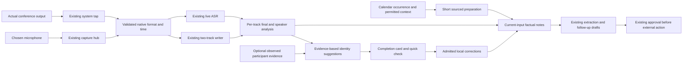

# Complete meeting pipeline roadmap

**Owner direction: 13 October 2026. Status: investigation and design before product implementation.** This replaces an AirPods-only interpretation with device-independent audio, participant identity, useful preparation, proactive correction and end-to-end meeting quality. The existing reliability roadmap remains open. No production behavior, account/grant, device setting, model choice or installation changes in this planning cycle.

## 1. The product contract

Next Notes should prepare a meeting before it starts, record both sides correctly on the person's chosen devices, stay responsive, preserve a trustworthy timeline, produce useful factual notes, and offer a short review when something needs the person's knowledge. A person should not have to discover speaker menus, trigger identification, rename the event and regenerate notes separately.

Every OS-exposed supported input/output must obey the same audio contract; brand-specific sample-rate or timestamp multipliers are prohibited. Universal support means device classes and actual formats are systematically exercised. A disconnected device, denied grant, broken third-party driver, protected source or sleeping computer cannot supply sound; these produce prompt, truthful degraded outcomes, never an apparently complete recording. Device availability is an acceptance dependency, not a pass by analogy.

Recording must start under existing permission/recording choices without waiting for a calendar lookup, model load, provider request, user speaker confirmation or background notes. Microphone/model/speaker remain full duplex. The current single microphone hub, two meeting tracks, ASR queue, Meeting/context store, usage log and task/receipt approval model remain the seams. New evidence/version fields may be added only to those records when a demonstrated contract needs them; no parallel recording service, identity ledger or repair queue is proposed.

## 2. What this investigation establishes

| Evidence | Verdict and exact limit |
|---|---|
| Earlier helper allocation | 7 October recursion caused 10.904 GB footprint; 422ba5f repaired startup ownership. This does not explain every later failure. |
| Latest long calls | Two newer calls have saved-system omissions of 22,782,827/18,220,683 frames, half-duration live system clocks, rejected system final replacement and no final speaker labels. Remaining 38m CAF Others is digitally zero after first few seconds. Live remote speech remains. |
| Resources | Retained newer-call sampled peaks 1.027/0.802GB; zero queue drops is not saved-audio coverage. These are sampled observations, not a whole-machine/ASR+voice operating envelope. |
| Notes | Current three outputs contain 27 selected material omissions plus request-direction, attribution, tense, question-resolution and stronger-claim errors. Counts overlap and are not an accuracy percentage. Current cloud first-loss raw replies are absent; old local comparisons cannot explain their producer. |
| Installed build | 0.2.24 SHA 503e0e40/UUID 61DC74FF passes strict/deep signature. Installing-peer 1067 and matching source snapshots supply bounded provenance; complete independent build manifest remains unavailable. 1,179 source/resource files invariant during current tests. |
| Native existing baseline |22 distinct focused flags exercised;20 initially fully green, finals first ABSENT because path omitted, isolation mixed with inherited nested tool-loop failure. Explicit existing fixture-path rerun gives MEETING_FINALS_OK, so 21 distinct flags now have green scoped evidence; isolation remains mixed. All owned processes joined and 20 original owner files stayed unchanged. |
| Native fixture speech | Actual three existing language files run live/final ASR: final word recall 0.929/0.872/0.963; wrong-language share 0. Test 98.967s wall includes preparation; sampled owned peak 145,131,464B. Passed regression is not perfect recognition, device capture or voice overlap. Logged ratioinf is the wrong-language-share ratio with a zero denominator; it is retained, never claimed a speed win. |
| Native borrowed-buffer boundary | Authored correct interleaved stereo accepted 512 frames; three mismatched planar/multi-buffer layouts rejected. These tested layouts do not support a claim that this constructor silently takes half their frames. Valid ABL under deliberately stale 48k declaration versus authored 24k native clock is accepted and represents half duration. This proves a boundary hazard, not that the real incident supplied that rate. |
| Current HAL inventory | Four exposed endpoints include built-in default 48k mono input/stereo output and virtual/other routes. No Bluetooth/USB endpoint was observed in this inventory. No device/tap/capture was started or changed. Device properties do not reveal the app's private aggregate IOProc format. |
| Historical private corpus | Attempted same 15-fixture native topic replay refused before cases because its old/private/tmp corpus no longer exists. Historical 185 component proof remains historical; current signed default 50 dedup+113 topic checks pass. No easier reconstructed corpus credited. |

The first faulty native producer is still unproved. Current cumulative-sample clocks propagate half-cadence input into five-second writer padding/trimming. The observed frame loss closely matches that arithmetic, but upstream HAL stream selection, stale format/rate, conversion and callback omission need actual app-boundary observations. Do not stretch saved time by two, remove the partial marker, mix mic into Others or lower speech thresholds to conceal it.

Source-visible contracts also need reproduction: microphone worker replacement can abandon accepted pending packets; system tap has no route/default-device/property listener; conversion/copy refusal and terminated delivery are not all accounted by overflow counters; a positive-peak capture probe cannot certify correct cadence; manual Identify can bypass automatic incomplete-track eligibility. These are concrete investigation targets, not all verified user-flow bugs.

Actual current native UI observation confirms the owner’s friction: M3 shows partial-recording and No speech detected warnings, enabled Identify again/Identify speakers, but disabled Rename speakers. M2/M3 currently show partial badges; M1 does not currently show one. Opening/dismissing More changed no meeting data. This does not resolve M1’s earlier reported partial state or demonstrate the proposed popup.

## 3. Audio contract and complete coverage matrix

[Universal audio plan](../../../Tests/Reports/meeting-reliability/2026-10-13-full-pipeline/audio/README.md) supplies 20 device configurations,15 transitions,13 failure modes, source pins and existing test coverage. The matrix includes:

| Family | Required combinations |
|---|---|
| Built-in / loudspeaker | Laptop mic+speakers, external speakers, room speakerphone, conference room multiple local people, remote voice acoustic bleed into mic. |
| Analog / wired | Headphones with laptop mic, wired headset mic+output, plug microphone with independent output, unbalanced/low-level microphone. |
| Bluetooth / wireless | Output-only headset with independent mic; duplex headset; independent Bluetooth mic/output; audio profile/rate switch when another app opens mic; one/both earbuds, connection loss/return, battery/power-off. |
| USB / audio interface | Mono/stereo/multichannel mic, headset/DAC/interface, nonzero channel beyond 0, distinct input/output clocks, dock unplug/return, input gain/mute, driver-limited formats. |
| Display / dock | HDMI/DisplayPort/dock output with independent mic, output-only device, automatic default changes. |
| Virtual / aggregate | Virtual routing, aggregate input, multi-output, multiple processes/streams, explicit conference-app route differing from OS default, loopback/duplicate source detection. |
| Continuity / accessory | Actually exposed continuity/remote accessory routes and changing availability; do not infer capability from transport string alone. |
| Unavailable / denied | Missing input/output, existing grant revoked, blocked driver/source, unknown format, true silent source and failed native start distinguished. |

Formats: supported 8/16/24/32/44.1/48/88.2/96/192k families; mono/stereo/multichannel; interleaved/planar; supported integer/float encodings; legal variable callback sizes; independent rates/clocks; converter warm-up/tail; absent/invalid/zero/nonfinite input. Synthetic rows test arithmetic/PCM contracts; physical rows test actual device/driver exposure. They are separate evidence.

Transitions: user/default/app-specific input or output switch, duplex profile change, channel/rate change, disconnect/reconnect, dock/display switch, mute/unmute, grant changes, start/Stop/config race, repeated notifications, sleep/wake, background output, Agent playback and clock discontinuity. Exercise before first packet, while ASR is busy, during final accepted packet, Stop/drain, replay and confirmation sample. No route is assumed fixed for an entire call.

Every packet's declared format, actual ABL byte/channel shape and native-time cadence must agree. Track origins belong to capture timestamps; scheduling jitter must not create gaps. True native gaps must not compress time. Define mono channel policy before scoring; averaging can cancel opposite-phase channels, choosing channel 0 can discard a useful multichannel mic. A meter and permission hint cannot inspect only a silent channel and conclude the mixed source is unavailable.

The physical callback cannot wait on UI, networking, AX/browser reads, storage or a model. Keep copy-before-return ownership. Reconfiguration is owned by the existing lifecycle queues/Hub; retain accepted work or report its exact loss. Old callbacks/converters cannot feed a new route generation. Preserve ongoing dictation/voice users of the microphone; no stop-everything workaround.

Speakerphone and room use need explicit acoustic tests: compare retained mic/system waveforms and native clocks to detect remote leakage/duplicates while preserving simultaneous local speech. Investigate reuse of the existing echo-reference/capture seams before adding another echo canceller; actual far-end reference alignment, duplex/barging and speaker-word preservation require proof. A mic track containing several local people needs source-aware speaker segmentation through the existing diarizer/cache, with measured optional cost; merely renaming the whole microphone track to You is not person identification.

For each available matrix row: independent channel-coded PCM and spoken beginning/middle/end anchors; offered→converted→delivered→saved→ASR counts/times; fresh CAF readers; expected 16-bit quantization; zero fabricated recovery; waveform/word/speaker checks separately; actual route and workload provenance. Define drift tolerance from converter priming/rounding and timestamp accuracy before the comparison. A measured 0.5 normalized cadence is a hard failure, not a tolerated lag or unmeasured 'optimization'.

## 4. Existing data flow and desired additions

This is a responsibility/data diagram, not a proposal for another runtime queue/store. Preparation, observation, notes and review run off capture's critical path. Processing state, coverage, freshness, identity evidence, uncertainty and approvals remain distinct facts.

## 5. Participants and speaker identity

A calendar invitation identifies invited people. A roster identifies observed endpoints/people. An active-speaker indicator supplies a time-local claim. A provider-attributed utterance or per-person media stream can identify that source's speech. A local diarization cluster still needs a verified clock/source join or a user's confirmation; roster order/count/name similarity alone cannot establish it.

[Identity design](../../../Tests/Reports/meeting-reliability/2026-10-13-full-pipeline/identity/README.md) and [dated official provider table](../../../Tests/Reports/meeting-reliability/2026-10-13-full-pipeline/identity/PROVIDERS.md) establish feasible routes and limits. Google Meet structured transcript entries can carry participant references and time intervals when enabled/authorized; live Media API is currently a restricted preview with no new signups. Zoom embedded Apps can expose active-speaker/roster events under role/capability restrictions; RTMS can provide attributed transcript/per-person media but requires app/grants/host access/credits. Teams attributed transcripts are tenant/account/permission-dependent; an intentionally unattributed format also exists. Webex has scoped meeting resources; Slack's third-party Calls API is not a universal Huddle identity hook. No stock native recorder can assume universal access to every provider's participant media.

Plan tiers, strongest first:

1. Direct provider participant/session-attributed utterance or per-person stream, matched to this conference occurrence and local clock. Provider clock buffering/drift, endpoint/session/rejoin and edited artifact differences are checked.
2. Explicit user confirmation of a valid original sample bound to this stable cluster/version.
3. Repeated, aligned in-app active-speaker observations with non-overlapping speech and matching quote/audio evidence: suggestion pending calibration, not unquestioned identity.
4. Calendar/roster candidate names for the person to choose; availability is useful even without automatic binding.
5. Optional remembered local voice, explicitly enrolled after confirmation, calibrated across device/noise/language/room changes and revocable. Existing 0.82 similarity is not a calibrated person guarantee.
6. Neutral speaker/group label when evidence is absent or ambiguous.

Additional useful suggestions can combine a self-introduction or explicit address with roster and aligned source evidence; recorded jokes, quoted names, screen-share audio and wrong ASR remain negatives. These are review candidates, never verified names by themselves.

Edge cases: duplicate/changed names, anonymous/phone guests, masked/missing email, room/shared account with several people, local microphone with several people, one person on multiple devices, late join/rejoin/breakout, quiet participants/bots, captions/interpreter/played video, overlap/short utterance, echo, a gallery showing someone who is not currently talking, stale offscreen AX/DOM, two simultaneous calls/tabs, provider event latency, translated/edited transcripts and artifact expiry. Never derive email from a name or a verified person from the mic source='You'.

Optional provider connections use a normal app-managed Connect action with the least scopes. Recording works locally when an account/admin grant/artifact is unavailable. Do not ask for API keys, a terminal or a provider ID on the default path. Existing calendar support and actual permitted UI observation should supply useful first-stage preparation/name choices without a mandatory bot/server/extension. A new integration is selected only after its account-shaped diagnostic demonstrates access/value; no speculative provider architecture.

## 6. Preparation before the call

Use the existing MeetingScheduler lead-time/tick and AgentTriggerEvents.meetingsUpcoming, plus MeetingNotesContextAssembler.brief(forEvent). Current routine support and assembler do not amount to a default visible preparation experience.

Prepare a clearly labeled note scaffold before the call: supplied agenda, questions to ask and prior context. It is preparation, not a transcript or pre-written meeting decision. It uses the existing scratchpad/context seam and never overwrites user text. Past notes with incomplete coverage or known quality/freshness defects must remain attributed as unverified prior notes, not promoted into a confirmed fact by preparation.

A short sourced card should contain the full event title/time/link; invited people clearly distinguished from prior observed attendance; purpose/agenda already supplied; relevant prior decisions/open commitments; selected relevant local documents with source/date; and concrete readiness problems. Useful readiness checks: selected input/output availability, known grants, storage for expected recording/final work, interrupted prior session, missing calendar match, and whether recording will follow the person's existing choice. Do not record ambient sound before the meeting merely to show readiness.

Preparation can start with deterministic retrieved context. A model is optional work, never a recording-start gate or speculative extra model resident beside ASR. Warm required ASR only through existing readiness ownership with measured latency/resource cost. If the event changes, refresh its actual input revision through existing scheduler ownership; preserve scratchpad/user notes. Cancellation, declined/recurring events, moved meeting, account disconnect and stale callbacks must not resurrect an obsolete prep.

Event identity favors actual conference link/provider/occurrence evidence. Nearest time/title-minute dedup can collide with overlapping invites and repeated links. New ad-hoc calls record immediately and enrich in the background when an exact match becomes available. A manual title always wins. If calendar fetch fails, retain truthful availability and offer one normal reconnect action; do not fabricate a title/attendee or make key setup the first task.

Proposed default uses the already configured lead time, with a concise notice only when useful or readiness needs action. Useful context is not a prediction of what people will say; it must never be inserted as spoken transcript or given more authority than the actual call.

## 7. End-of-meeting card and correction loop

**Every meeting produces a completion card automatically.** At actual Stop/drain completion it says what was saved and what is being processed. It is nonmodal, keeps typing/voice/call focus intact and does not wait for final notes. If there are unresolved items, this same logical card presents 'A quick check' as evidence becomes available; no separate stream of popups. With nothing uncertain, it stays a brief completion/status notice, not a mandatory question. The experience child plan's zero-popup clean case means zero correction dialog, not absence of the completion notice.

Suggested normal copy:

> Meeting saved. Notes are being prepared.
> Two speakers need a quick check.
> Who is this? [Play short original sample] [Suggested name] [Someone else] [Not sure]
> Confirm changes / Later

Suggestions disclose why when useful: 'Shown as speaking in Meet' versus 'Invited to this meeting'. Strong provider binding or a previously confirmed unchanged voice may already display its verified name; weak invite-only evidence is a candidate list, not a selected answer. No audio preview autoplays. A sample is a bounded intelligible non-overlapping span from the correct original saved channel and valid timeline. With lost/expired/mixed audio, say sample unavailable; do not synthesize a voice, read an entire hour into memory or pretend a text quote is acoustic proof.

Sample playback needs an actual new feature, but must use the existing audio-output/echo ownership seam rather than another AVAudioPlayer/engine/channel. A small view-owned preview request feeds the shared renderer with a distinct owner/source, cancellation and played-frame receipt; live voice can preempt it, playback cannot be accepted as microphone command speech. This seam's suitability is unverified and needs an isolated production-path proof before implementation. Missing TTS capability does not necessarily forbid explicit recorded PCM, and an audio clip is never synthesized speech.

When valid samples suggest fragmented or mixed clusters, offer a supported pairwise check such as Same person/Different people, using existing reidentify/label correction seams. A two-label string or invitation count cannot choose the number of real speakers. The label-free failure seen today must offer an honest text/unknown correction route instead of disabling all naming; it cannot label the whole Others track from one guessed excerpt.

The review asks only questions that can improve the meeting: uncertain speaker/cluster split, unmatched full title, request direction/owner/tense, contradictory numerical details, or unresolved coverage. It shows a supported excerpt and the proposed change; it does not ask the user to certify hundreds of generated claims or repeat the entire meeting. Missing audio is a fact, not an issue a Yes button can fix. Allow unknown/skip and later return inside the existing meeting view.

One batch confirmation admits current meeting/transcript/cluster revision. Names/title/context display update locally; background notes refresh uses the existing NotesService task and current canonical input. No name-only ASR, recluster-only ASR, second confirmation, appended repair model pass or debounce on the user's path. The person immediately sees 'Names saved. Updating notes…' and can continue. If an old pass is busy, it must not ignore the new request or publish stale names; replace/fence through the same owner and accept the latest needed revision once. No-op and scratchpad-only changes require zero inference.

A name save does not authorize email, directory lookup, voice enrollment or changed recipients. External follow-ups remain existing reviewed drafts and one approval before execution. Semantic user corrections must be labeled confirmed corrections alongside source speech, not fabricated verbatim speech or generic 'known context'. Preserve their origin.

Audio release must wait for this chosen preview and admitted correction ownership when the existing policy permits retention; keep/expiry/low-disk rules still apply. Do not retain whole recordings forever by default or erase a source immediately after name confirmation before a failed note refresh. Show the truthful partial outcome when a saved name succeeds but context/notes fails.

## 8. Factual notes, freshness and derived actions

The input producer freezes exact transcript revision, speaker map, source coverage and current preparation context. Preparation remains cited background. Preserve raw mapped/collapsed/single inputs/replies privately in an explicitly scoped diagnostic of existing calls to find the first omission/invention; no extra checker model pass. Current 27 material cases, direction/tense/referent/resolution/numeric controls and held-out calls are the semantic gate. Schema-valid JSON, exact quotes, provenance IDs and normal stop reason are narrower contracts.

A useful note includes material constraints/disagreements; decisions with their actual status; open questions after checking whether answered; explicit actions with correct direction/owner and only spoken/confirmed dates; important follow-ups from the ending; and coverage/freshness limits. Completed work cannot become a future task. A request cannot become the other party's offer. A qualified estimate cannot become a rule. A courtesy or truncated explanation cannot become an invented conclusion.

An accepted correction can update deterministic label rendering without a model only when output has grounded speaker/source references. Existing free-form markdown cannot safely be globally string-replaced. Until a proven structured rendering contract exists, ordinary background regeneration may be necessary; it is not instantaneous and must preserve the previous readable notes/manual edits. Do not implement a new note schema ahead of source and original/fixed proof merely to avoid understanding the existing writer.

Default review should initially group a small number of the highest-value unresolved items (proposed maximum 3), retain remaining issues for an optional expanded review, and preserve Later/dismissal per actual source revision. This is a design target to test, not a calibrated confidence rule or forced certification.

Current NotesService busy admission/completion does not provide latest-input fencing for this desired flow. Reuse its existing task slot and transcript/store generation seams; add bounded source/output witnesses only where required. Completion must compare current source/version before saving, indexing, announcing or clearing ownership. Deleted meetings stay deleted. User-edited notes cannot be overwritten silently. Failures retain old notes, admitted local changes and clear progress/freshness.

Structured extraction and proposed actions must consume the accepted current output and carry uncertainty. Empty arrays following poor notes are not true negatives. Changed facts invalidate unexecuted drafts; committed receipts/approvals preserve their actual payload and effect. Review confirmation never grants a standing external write permission.

## 9. Memory, throughput and failure handling

The owner explicitly removes the prior arbitrary 55% reported-free admission restriction for this diagnostic cycle. Current bounded native baseline and one actual ASR replay ran without that floor or the old per-test 1 GB/swap threshold. Actual process ownership, deadlines and original data/source invariance were checked. Sampled owned peaks 174 MB / 145 MB are not total machine memory, an approved production ceiling or evidence no allocator ever spikes. Record pressure/swap/footprint/RSS and cold/warm effects separately.

Audit numerical product policies individually: optional model prewarm/reload under pressure, ASR queues 300s, writer lead 5s, minimum 1 GB disk for saved audio, 72h/low-space retention and native model lifecycle. Replace unjustified gates with measured workload admission and typed unknowns. Do not disable real capture-preserving pressure behavior or let active native state be freed simply to obtain a green diagnostic. Operating-system grants, missing sound and disk exhaustion cannot be removed by lifting an app threshold.

Background prep/notes/identity yields through the existing scheduler/runtime. Capture starts/saves immediately and the next call never waits for previous note review/model completion. Converter/writer/drain costs and post-stop full-channel reads must remain bounded. Build/model development is serialized through relay, never through product microphone/model/speaker locks.

Measure start-to-first accepted PCM, live transcript age in corrected native clock, stop-to-final file/tail, final ASR/diarization/notes readiness, confirmation-to-visible update and background-current-note time, UI/call response, disk growth, queues/active buffers, footprint/RSS, native allocations where available, model load/decode and observer cost. Proposed local-confirmation 100ms p95 is an unmeasured design target. Existing 20 tok/s floor/25–30 target is measured with ASR/voice on the reference M2–M3 / 16 GB / 256 GB, never quiet text-model performance. Calibrate actual operating envelopes before enforcing them.

The review and semantic tests also cover wake-command versus ordinary meeting speech, including legacy command-marked rows: only supported explicit commands may be excluded from meeting notes. Other participants, room/remote echo, recording playback and tool/calendar text are not new user tool instructions. Confirming factual/name corrections does not authorize those instructions or change an already approved action payload. Sensitive title/account/semantic traces need the existing private logging seam; current public-title interpolation is an audit target, not a reason to copy raw prompts into aggregate logs.

Failures are stage/channel-specific: denied/missing route, native-clock/format mismatch, incomplete saving, stalled source, quiet speech refusal, unreadable/expired audio, missing artifact/grant, ambiguous person, stale note, model cut/failure, save refusal and review cancellation. No generic 'No speech' banner for a full call when only speaker analysis lacks remote evidence. Confirmed loss survives .done, regenerate, rename and restart. Automatic retry or re-transcribe only through actual existing ownership/settings/eligible saved coverage; no repeated unbounded model loop.

## 10. Implementation milestones and required proof

All future behavior below is **PLANNED/UNIMPLEMENTED**, except the explicitly completed investigation/baseline. A prior component green does not satisfy the full row.

| ID | Small achievement / responsible existing seam | Depends | Original failure and completion proof |
|---|---|---|---|
| MP-00 | Pin current incidents/build/source/capabilities; store exact durable private fixtures | none | Done investigation scope; historical temp corpus unavailable disclosed; owner files unchanged. |
| MP-01 | Observe native aggregate/tap/ABL/converter/clock contract |00 | First actual wrong value captured in original route; distinguish constructor rejection, rate mismatch, missing input and downstream loss. |
| MP-02 | Fix first faulty audio producer; dynamic supported format/stream selection |01 | Unchanged actual native input fails before/passes after; channel-coded PCM, host-time/rate parity and original provider route. No AirPods branch. |
| MP-03 | Preserve/report accepted mic work during reconfiguration |01 | Held queued packets plus config change reproduce silent refusal; actual Hub→consumer→CAF lossless or precise retained gap. |
| MP-04 | Own system output/rate changes and running-route recovery |01–02 | Real default/app/device/profile switch, reconnect, old callback after Stop; one owner, no duplicate delivery/clock reset or live-voice regression. |
| MP-05 | Clock-gap and writer completeness integration |02–04 | Full-rate, jitter, true gap, half-rate, late join and independent clocks through actual Session→writer/live/fresh reader; no compressed time/false recovery. |
| MP-06 | Coverage telemetry and early truthful warnings |05 | Saved/capture/conversion/drop counters reach existing health/store/UI during recording; silence not false stall; unknown≠zero. |
| MP-07 | Quiet/noise/echo/overlap words and tail drains |02–05 | Same independent quiet/mixed speech/control PCM, actual native ASR through both live/final tracks and Stop/restart; word count alone insufficient. |
| MP-08 | Calendar occurrence matching and full-title readiness |00 | Same fetch/matching errors, simultaneous/recurring/moved/ad-hoc events, stale disconnect; exact full automatic title when evidence exists, manual title retained. |
| MP-09 | Default cited premeeting card |08 | Scheduler→existing brief→actual card; no-grant/empty/canceled sources; capture start unaffected, no mandatory model. |
| MP-10 | Participant evidence and interval/session/clock join |05,08 | Actual authorized provider/UI observation→bounded parser→candidate evidence; invited≠present, present≠speaking, ambiguous/expired/wrongroom refuses. |
| MP-11 | Stable global speaker/tail/room attribution |07,10 | Independently named multi-speaker/overlap/room fixtures and actual final projection; preserve unknowns and confirmed mappings only with stable voice continuity. |
| MP-12 | Current-input note/task admission and output freshness |00 | Held old-name pass plus rename/edit/delete/cancel/restart fails before; latest accepted output only, old notes retained, no duplicate work. |
| MP-13 | Completion card, bounded sample and one-click review |06,11–12 | Actual Stop→nonmodal card→shared playback→current-map/context save→background refresh; skip/stale/focus/release/save-failure cases,0 ASR for names. |
| MP-14 | Semantic note producer repair |05,12 | Same exact 27 private cases plus held-out speech/meaning; locate first raw loss, verify current note save/fresh reader, no invented requests/owners/dates. |
| MP-15 | Current extraction/proposal/correction consumers |12,14 | Actual accepted note→graph/drafts; uncertainty, manual edits, stale results and no action authority from speaker confirmation. |
| MP-16 | End/restart/deletion/expiry/next-call integration |04–06,12–15 | Real process exit/restart and held callbacks; original effects/receipts retained, no stale popup/output/second recording; next mic starts after actual old capture drain, not after notes. |
| MP-17 | Device/provider physical qualification and measured envelope |02–16 | Every available matrix class/transition, missing rows explicit; visible 45–60 min two-track meeting with ASR+voice/dictation/browser, matched hidden observation and independent beginning/middle/end truth. |

MP-07/MP-11 include speakerphone echo, multiple people on the mic and source-aware global identity: measure the cost/value of any necessary additional source analysis in the existing diarizer rather than silently mixing tracks or creating a second model/capture pipeline.

Independent early work:08–09 deterministic preparation and 12 freshness can be developed after their own original regressions even while native audio investigation continues, using disjoint ownership. Speaker/provider features cannot certify times until clock repair. Review UI cannot certify confidence without identity evidence. Root reviews the small implementation scope and production-path regression before each adoption; no whole stale-file merge.

## 11. Complete acceptance and missing environments

Matrix rows carry PASS/FAIL/UNAVAILABLE/UNKNOWN plus exact device/format/provider/permissions/route/workload/build/source and evidence. Pairwise combinations plus risk-based interactions are a starting test strategy, not proof of every Cartesian combination. Test all observed supported formats deterministically; actual Bluetooth/USB/headset/analog/display/virtual hardware needs its own physical qualification. Today only read-only current endpoint inventory and existing native fixtures were exercised; no physical route switch, provider grant, real end-popup or preparation flow was tested.

Release requires the original recording/speaker/notes failures resolved at their producers; supported channel waveform/native-clock/sample/word coverage; correct last utterance/person; old metadata/corrections preserved; useful full automatic title/prep when available; completion/review works with keyboard/screen-reader, long names/Unicode/multiple windows and no focus steal; independent action/permission/receipt rules; no known introduced regression; and measured reference-machine workload performance. All 21 green baseline flags retain narrower scope. Isolation's inherited browser/tool-loop failure and duplex/aggregate semantic/voice requirements stay open, not silently downgraded.

Physical tests need an available matching device, joined test call or consented participants and independent spoken reference. Provider tests need actual eligible account/grants/artifacts; a mock response is parser proof. Missing environments remain named. No claim of perfection from automated tests or universal hardware support from one Mac. The roadmap specifies what must be achieved and measured before those claims become justified.

## 12. Sources, privacy and artifacts

Technical Apple foundations: [Core Audio taps](https://developer.apple.com/documentation/coreaudio/capturing-system-audio-with-core-audio-taps), [engine configuration changes](https://developer.apple.com/documentation/avfaudio/avaudioengineconfigurationchangenotification), [sample-rate conversion TN3136](https://developer.apple.com/documentation/technotes/tn3136-avaudioconverter-performing-sample-rate-conversions), checked 13 October 2026. Engine rate/channel change can stop/uninitialize IO and requires appropriate reconnection; converter frame supply is variable; tap captures output through an aggregate with a real audio-recording grant. These facts support the reconfiguration/format investigation, not a claim of the incident cause. Provider-specific primary sources and verified admission constraints are in the dated provider table.

Companion detailed plans: [audio](../../../Tests/Reports/meeting-reliability/2026-10-13-full-pipeline/audio/README.md), [identity](../../../Tests/Reports/meeting-reliability/2026-10-13-full-pipeline/identity/README.md), [providers](../../../Tests/Reports/meeting-reliability/2026-10-13-full-pipeline/identity/PROVIDERS.md), [experience](../../../Tests/Reports/meeting-reliability/2026-10-13-full-pipeline/experience/EXPERIENCE-PLAN.md). Native evidence: [baseline](../../../Tests/Reports/meeting-reliability/2026-10-13-full-pipeline/native/results.json), [classification](../../../Tests/Reports/meeting-reliability/2026-10-13-full-pipeline/native/classification.json), [actual finals](../../../Tests/Reports/meeting-reliability/2026-10-13-full-pipeline/native/native-finals-results.json), [fixture metrics](../../../Tests/Reports/meeting-reliability/2026-10-13-full-pipeline/native/native-finals-metrics.json), [HAL inventory](../../../Tests/Reports/meeting-reliability/2026-10-13-full-pipeline/native/hal-inventory.json), [layout probe](../../../Tests/Reports/meeting-reliability/2026-10-13-full-pipeline/native/buffer-layout-results.json), [stale-rate probe](../../../Tests/Reports/meeting-reliability/2026-10-13-full-pipeline/native/buffer-rate-result.json), [historical corpus refusal](../../../Tests/Reports/meeting-reliability/2026-10-13-full-pipeline/native/retained-topic-corpus-result.json).

Raw owner content/identity/account/device names stay private 0700/0600, not relay/Git. Current original 20 artifacts unchanged; remaining original replay audio intentionally retained before temporary expiry. No production binary/source or foreign staging overwritten. Task-owned probe binary can be retired after compact source/hash/native result retention and no-holder checks; no shared compiler/model/owner cache sweep. Canonical roadmap/ remains ignored by existing policy, so updated local files are pinned in committed report receipts without force-adding unrelated planning documents.
