# AGENT-OVERHAUL: start here

<!-- repeated-read-usage438439-current -->
**Measured follow-up, staged442:** seeded-call handling now reaches the unfinished
read (RF05/RF07 pass), but normal32 still fails RF03 and first26 fails RR08.
Added scalar observations preserve both predicates and confirm the shared cause:
SQL serialization loses sub-second attempt starts, making the new saved start equal
to the old one while the cached actual start differs. Revision, attempt, process
owner, original objective and all instructions match. The responsible date codec
is being repaired; admission and repeated recovery remain incomplete. A disk-full
441 usage run is retained INPUT_INVALID. After bounded owned-artifact cleanup,
442 usage passes79 with the same4/5/5 managed attribution. No latency, retry,
owner migration, IM-16 or parent completion is promoted.

**Current implementation — 2026-10-04:** staged original438 → fixed439 changes
only Manager and RecoveryPlanner across1,144 compiler inputs; all fixture inputs
and registration are identical. Managed usage is bounded-verified: six typed and
three voice attribution assertions fail originally; fixed typed79 and the actual
voice checks pass. Selected revised4/spawned5/voice5 provider passes equal saved
rows and now carry exact managed task IDs through the existing log/projections;
known token fields, privacy and unavailable cost controls pass. Nested knowledge,
ordinary owner reports and full P6-07 acceptance remain open.

Repeated read recovery is **incomplete**: original normal32/8 → fixed32/2 still
fails successor completion and unfinished-read execution (RF05/RF07). Empty-latest
31/8 →31/0, changed-source24/1 →24/0, and first-continuation26/0 →26/0 pass.
The two-read failure is being repaired in existing seeded-call handling; no changed
fixture plan or weakened assertion is accepted. Related checks complete23/24 PASS;
ACP final-response/EOF control has two conjunct failures with attribution under
review. Original438 passes the same ACP flag; no double completion or cause is
inferred from its labels. The actual usage27/metrics/isolation controls pass.
Original437's skipped voice handoff is retained invalid; the corrected strict
joined-worker/retained-Island COMMON is identical in438/439. Historical100ms/5ms,
9/10 model gates, broad recovery, physical interaction, IM-16 and parent completion
remain open. [Actual progress](../../../Tests/Reports/agent-overhaul-closure/p3-task-bridge-production/manager-voice-worker-ownership-production/repeated-read-usage438439-progress.json).


<!-- current-d3-implementation -->
**Explicit recovered-read implementation, 2026-10-04:** qualified original430
RED8/26 → unchanged fixed431 PASS26. Six responsible producers change across1,142
compiler inputs; fixture, UI, App registration and Bridge remain identical. A real
prior child exits with revision3, three corrections and a completed native read.
An explicit action admits attempt2 only after exact primary/history/receipt checks
and prior PID absence; alive, stale revision, damaged/uncertain/consequential history
and primary refusal stay held. The actual successor consumes all corrections and
the saved first read, reads only the unfinished second file, and rejects the offered
write before card/receipt/backing. Both native Source/bundle maps remain stable.
Related431 completes23/26 PASS. ACP100ms and C03/F09 receipt5ms remain failed;
live native-tools has one llama grammar-invalid round (4/5), with Apple5/5.
The retained original430 repeats the same llama4/5/Apple5/5 failure, establishing
that it predates recovery. No fixed rerun erases the failure. All storage, recovery56, restoration188, privacy40, owner isolation,
permission, voice delivery/routing/duplex and UI controls pass.

The same original430 capture-endpoint8/Island32 pass with one frontend call and
joined owners. A controlled first-audio receipt on the exact native playback token
reaches the actual IslandPanel consumer; physical sound/display-frame/100ms and
full CORE remain open. Builds428/429 are retained compiler INPUT_INVALID; their
scoped same-COMMON throw/argument corrections precede both430/431.
First-attempt native read continuation is verified; repeated recovery, broader
retry/voice/consequential recovery, owner migration, physical UI, IM-16 and parent
P3/P6 completion remain open. Parallel agents reuse three active worktrees for
repeated read recovery, calendar unknown-outcome verification and integration review.
ACP schema producer432→433 is bounded-verified: all64 actual writers change from
two validated version reads to one, with no assignments and only TaskStore differing
across1,142 compiler inputs. Same explicit recovered-read26 and23 related controls
PASS. Whole worker remains FAILED: fixed small127.676333ms/history104.743083ms exceed
100ms; original small75.997375ms passed/history101.998708ms failed. The extra observed
small-budget failure is retained, cause unproven. One matched unchanged attribution
pair completes: original66.016708/85.951625ms; fixed small56.34875ms passes while
history still fails (its numeric marker is interleaved/unqualified). No failure is erased. C03/F09 receipt5ms remain failed; C03 close split qualifies, F09 raw
SQL profile interleaving stays unqualified. No speed or wider readiness is claimed.
[Exact ACP/close comparison](../../../Tests/Reports/agent-overhaul-closure/p3-task-bridge-production/manager-voice-worker-ownership-production/activity-close432433-qualified-results.json).
[Actual recovery pair](../../../Tests/Reports/agent-overhaul-closure/p3-task-bridge-production/manager-voice-worker-ownership-production/recovered-read430431-qualified-results.json),
[endpoint8/Island32](../../../Tests/Reports/agent-overhaul-closure/p3-task-bridge-production/manager-voice-worker-ownership-production/endpoint430-qualified-results.json).

<!-- calendar-unknown434436-progress -->
**Calendar unknown outcome, 2026-10-04:** qualified original434 fails32 of82
outcome assertions and8 of31 post-read assertions; unchanged fixed436 passes82+31
through eleven normal/direct/legacy modes and three actual held-read modes.
Only four responsible product files differ across1,143 compiler inputs; all fixtures
and registration remain identical. Normal and direct callers read the exact sent
resource with the approved fields. Positive evidence requires a committed terminal
receipt; mismatches, unavailable reads, missing preparation, failed saves and lost
primary/cancellation authority remain unknown, without a second INSERT or replay.
Prior duplicate114/helper10/resource10 controls remain green. Fixed whole worker
still fails the inherited ACP history100ms target at114.033250ms; small98.023875ms
passes. Related23/23 controls PASS, including actual tool review/mail unknown outcomes,
permissions, storage, reader40, owner isolation21files32defaults and duplex/Island consumers.
Build435 is retained compiler INPUT_INVALID; its correction only names the exact
existing callback type in fixed436. The frozen87 forecast was wrong: actual source
and both runs contain82, with no input/predicate change. Real account/crash,
consequential retry, effect cessation, broader recovery, IM-16 and parent gates remain
open. [Exact comparison](../../../Tests/Reports/agent-overhaul-closure/p3-task-bridge-production/manager-voice-worker-ownership-production/calendar-unknown434436-qualified-results.json).

**Calendar resource identity, 2026-10-04:** qualified original426 completes
all ten actual CLI modes: existing114 and helper10 remain green, while nine of ten
prepared-resource identity assertions fail. Fixed427 passes those same114+10 with
only Executor changed across1,141 compiler inputs. The existing prepared UUID now
reaches both normal/injected Workspace proposal constructors; direct proposal IDs
are preserved. Whole worker still fails inherited ACP100ms (original two timing
failures, fixed one); related427 completes20/22 PASS. Only ACP100ms and receipt5ms
remain failed; all storage/authority/voice/Island/UI/privacy controls pass. Original425 remains incomplete and its
timeout cause unmeasured. This fixes current receipt-to-resource traceability;
legacy missing aliases, reconciliation, effect retries, real account/crash proof and
parent completion stay open. Parallel work is implementing explicit recovered
native-read continuation and actual capture-endpoint-to-panel verification.
[Actual pair](../../../Tests/Reports/agent-overhaul-closure/p3-task-bridge-production/manager-voice-worker-ownership-production/calendar-identity426427-qualified-results.json).

**Schema-probe producer, 2026-10-04:** original423 observes two validated
schema-version reads in each actual C03/F09 receipt path; unchanged fixed424
observes one, with only two TaskStore lines changed across1,141 compiler inputs.
The same transaction still checks complete schema, foreign keys, marker and file
identity; connection, synchronization and checkpoint behavior remain unchanged.
The duplicate-read assertions now pass. Both strict5ms targets still fail, so this
is a verified producer simplification, not latency closure. Original423's separate
legacy revision-worker budget failure is retained without scheduler attribution;
it occurs before the added observers and is absent in424. Related424 completes
20/22 PASS; strict5ms and actual ACP100ms fail (small117.090959ms,
history140.089459ms). All functional storage/authority/read-isolation checks pass;
no current full-suite or latency acceptance is claimed.
[Actual pair](../../../Tests/Reports/agent-overhaul-closure/p3-task-bridge-production/manager-voice-worker-ownership-production/schema-probe423424-qualified-results.json).

**Recovery characterization, 2026-10-04:** staged422 passes ten actual
revision3/read/receipt/fresh-reader/old-Task-drain checks plus the unchanged56
recovery cases. Compiler1,141 inputs and native Source/bundle maps remain invariant.
The existing task stays held at attempt1 with all three instructions and its
completed read receipt; automatic dispatch remains zero. This adds an isolated
production-path scenario, not a recovery producer or process-crash proof. Explicit
recovered admission, new-attempt window and uncertain-effect eligibility remain
open. Related422 has10/11 valid checks PASS; ACP history110.1165ms>100ms
fails. Three reader launch inputs were rejected and retained; actual stdout-only
reader40 passes. No worker recheck erases the timing failure. Next is confined read
continuation with conservative prior-process/receipt authority.
[Actual characterization](../../../Tests/Reports/agent-overhaul-closure/p3-task-bridge-production/manager-voice-worker-ownership-production/recovery422-qualified-results.json).

**Latest implementation, 2026-10-04:** calendar duplicate readback qualifies
original420: 38 target assertions fail across114 unchanged checks →421: all114
pass, ten existing Workspace helper groups pass and worker2933 passes. Only
WorkspaceToolRunner differs across1,140 compiler inputs. An occupied event ID now
requires the same actual GET and exact reviewed field comparison before a verified
receipt; mismatched/unavailable results remain explicitly unverified. Primary
refusal launches no CLI process, and terminal receipt refusal retains fired evidence
without success delivery. The isolated peer exercises actual CLI Process/pipe/error
handling, not a real Google account. Original accepted insertion already performs
one INSERT/GET; its F06 failure concerns detail wording, not an effect failure.
Related421 completes20/21 PASS, including A7/Island/UI strings and isolation;
only inherited C03/F09 receipt5ms fails. Retry resource IDs,
creator attribution, crash/recovery, latency and parent gates remain open.
[Exact calendar pair](../../../Tests/Reports/agent-overhaul-closure/p3-task-bridge-production/manager-voice-worker-ownership-production/calendar420421-qualified-results.json).

**Current verification, 2026-10-04:** explicit duplex A7 qualifies
original418 RED2 ownership assertions →419 SAME scenario PASS. Both runs observe
four samples/two with actual worker steps at the unchanged20ms cadence; worker
attempts18→0, worker-driven kind samples0 both. All69 typed checks pass in419;
only the existing IslandOwnership switch differs across1,139 compiler inputs.
Original417 remains INPUT_INVALID; the scoped SAME COMMON publication correction
precedes both418/419. Related419 completes27/28 PASS, including three consecutive
normal32 Island runs and worker2818. Only inherited C03/F09 receipt5ms fails;
full CORE/physical/parent acceptance remains open. Isolated ACP observation416
passes worker2818 without reproducing historical100ms failure (55.04425ms history
stall); no latency fix is claimed. Parallel agents continue explicit recovery,
receipt-cost investigation and actual Capture endpoint/Island panel implementation.
[Exact A7 pair](../../../Tests/Reports/agent-overhaul-closure/p3-task-bridge-production/manager-voice-worker-ownership-production/a7-418419-qualified-results.json).

**Latest implementation,2026-10-04:** scoped filesystem receipt evidence qualifies
original414 RED7/57 →415 SAME57 PASS, whole worker2818 PASS. Only ActionRuntime
changes across1,139 compiler inputs: a returned mutation records its exact path in
its linked verifying receipt before readback; required save refusal retains fired
evidence and reports action-ran/result-not-saved without success or replay.
Original413's incorrect primary-refusal control is retained unqualified; the same
strict history/binding correction precedes both414/415. Related checks complete
17/18 PASS; only unchanged C03/F09 receipt5ms fails. Full reconciliation, retry/crash/recovery, A7/CORE and historical latency
gates stay open. [Exact pair](../../../Tests/Reports/agent-overhaul-closure/p3-task-bridge-production/manager-voice-worker-ownership-production/verifying414415-qualified-results.json).

**Previous bounded implementation,2026-10-04:** task activity freshness qualifies411 RED4/69
→412 SAME69 PASS through the real typed submission/Manager/SQL/journal/effect path.
Accepted corrections refresh heartbeat/lastProgress in the existing transaction;
refusal rolls back and the same Task/attempt/start binding stays exact. Related
checks complete12/14: unchanged receipt5ms and actual ACP history138.97375ms
against100ms fail; both are retained and the ACP producer trace is active.
Full new-attempt/recovery, duplex A7, CORE, latency and
parent acceptance remain open; the parallel agents continue A7 and consequential
receipt verification. [Exact pair](../../../Tests/Reports/agent-overhaul-closure/p3-task-bridge-production/manager-voice-worker-ownership-production/window411412-qualified-results.json).

**2026-10-04 — Typed work and real approval preemption are bounded-verified; roadmap open.**
Typed extraction376 RED15/29 →377 PASS31 is qualified jointly with the strict
permission race382 RED1/40 →383 PASS40: no obsolete card or grant, one retained
read and one revised effect. Existing worker/revision authority is rechecked after
permission enrichment. Integration383 passes29/30 flags, including worker2710,
restoration188, authority58, actual tool loop and write isolation21files32defaults;
its unchanged receipt5ms failure remains retained.

Real approval preemption now passes386 delivery636. Actual384/385 preserved the
correct output, generation, playback token, pending result, current Gate and zero
effects; their sole failure expected the entire prompt during its first streamed
clause. SAME input/control fixture correction checks the exact first clause and
queued remainder, then the exact full prompt after the existing drain. Both native
and phrase owners join. This is software producer/consumer proof, not physical audio.

The task writer386→387 now validates its same locked transaction once: four
schema reads become one through two responsible producers. Ten storage flags and
29/30 integration flags pass; C03 receipt6.075583ms still exceeds5ms. Typed revision journal388 RED5/64 →389 SAME64 PASS now retains instructions
and completed output through restart hold and actual journal refusal;29/30
integration flags pass, inherited5ms still fails. Output tokens390 RED8/23 →391 SAME23 PASS now refuse stale append, finish,
cancel, replay and wrong history attribution;636 scheduler controls and29/30
integration flags pass. Voice revision journal392 RED4/138 →394 SAME138 PASS now persists running
corrections and permission amendments/retries through the same primary transaction;
API40 and29/30 related flags pass. Signing393 and first394 disk-full status corpus
are retained INVALID/incomplete; unchanged394 repeat qualifies. Receipt5ms remains
failed. Delivery priority395 RED10/85 →396 SAME85 PASS (721 scheduler/23 token
checks) retains unheard results without an attempt and refuses replay of heard
results after a committed answer. Related396 passes29/30 after unchanged worker2710
repeat; the first worker history/noReview failure is retained, cause not proven.
ACP399 RED6/47 callback checks and RED3/51 normal post-authorization checks →400
SAME47 PASS/worker2761 PASS. Only Session changes; exact current/refused-hold controls
allow and held/successor/waiting controls refuse after authorization. Related400
passes29/30; unchanged5ms receipt still fails.
Build398 packaging ENOSPC is INVALID; original397 measured waiting-control correction
and its100ms scheduling failure remain retained. Failed Process publication401 RED3/57 →402 SAME57 PASS now preserves the
original permission/notification owner when construction throws;7/7 related flags
pass, priorworker2761 remains green. This repeated Session compatibility proof
does not complete normal effect authority. Question-answer journal403 RED8/163 →404 SAME163 PASS now commits the exact
answer before resuming Work; required journal refusal keeps the saved question.
Strict restart-cancel C25 already passes both via existing authority admission, so
no proposed extra SELECT/guard was added. Related404 completes12/13; only unchanged C03 receipt5ms fails.
Root is checking normal Island ownership through actual local, ACP, typed and scheduled
writers. Build405/406 compile failures are retained INVALID (missing shared title and an
accidental legacy-helper parameter). Their same-COMMON corrections precede both
variants; original407 compiles, but native stops at typed-result qualification
after11/32 checks (INPUT_INVALID). Its97.58s run/maps/sample are retained; no fixed
producer or native ownership verdict is claimed. The actual shared transport cancellation
prerequisite now qualifies408 RED4 →409 SAME cases PASS: the consumed prompt settles
once on task cancellation, sibling reply/notification remains intact and pre-cancelled
requests write no frame. Only JSONRPC changes across1,138 compiler inputs; all six
related flags pass (worker2761/ACP confirmation/MCP/review/receipt5/write isolation).
The unchanged normal Island scenario now qualifies409 RED12/32 →410 SAME32 PASS.
Seven responsible producers preserve conversation ownership through actual local,
ACP, typed and scheduled writers. Related410 completes10/11 functional flags;
unchanged C03/F09 receipt5ms failures stay open. All three consecutive SAME32 Island
runs and five remaining UI/concurrency/task flags pass. The existing duplex flag passes,
but its explicit roadmap A7 Island assertion has not been located; separate source audit
is active. Full CORE, physical presentation and parent acceptance remain open. Parallel agents
reuse existing checkouts for Island, consequential receipt verification and typed
revision activity freshness. Completed artifact cleanup removed six retired trees
and obsolete401/402/403 bundles (about2.68GiB net); useful404 and compact comparison
evidence remain. Prepared source is not acceptance. Full P3/P6/quality/latency,
whole-App read, recovery, IM-16, owner quit/install and clean-checkout delivery stay open.
[Typed joint proof](../../../Tests/Reports/agent-overhaul-closure/p3-task-bridge-production/manager-voice-worker-ownership-production/typed-joint383-qualified-results.json),
[real Gate proof](../../../Tests/Reports/agent-overhaul-closure/p3-task-bridge-production/manager-voice-worker-ownership-production/d3-gate386-qualified-results.json).
<!-- /current-d3-implementation -->

## Current implementation position — reconciled 2026-10-04

Read [STATUS.md](STATUS.md#current-position--reconciled-2026-10-04) for the current
evidence and [REMAINING-WORK.md](REMAINING-WORK.md) for the complete remaining task
and acceptance checklist. STATUS remains the only task-state ledger. The historical
baseline and task briefs below are not claims about today's implemented behavior.

The roadmap is not complete. SQL authority/held restart, local and ACP attempt/
receipt admission, bounded source-card projection, voice effect-barrier/shadow
repairs and Knowledge fitting are real progress. Unified voice/typed/ACP ownership,
output scheduling, full recovery/retry, latency gates, proactive journeys and live
product acceptance remain open. Optional cloud realtime is still planned.
Shutdown repairs are verified per owner, not whole-app crash or fast-quit acceptance.
Historical staged152 passes the40-check model-trial caller regression, but its broader
regression batch is incomplete after a5.8s trial exceeds the unchanged5s budget.
No installation or aggregate quality promotion follows from that bounded proof.

Implementation resumed in three isolated worktrees. Root verified P6-06q's actual
offered-permission pair153/154 (RED40/151 →PASS151) and verified explicit
memory capture155/156 (RED13/70 →PASS70, six related flags pass). Quick156 fails3/10;
native caption/full/CORE/live statement acceptance remains open. Typed knowledge
streaming/citations now have actual161 RED18/59 →162 PASS59 and seven related flags
PASS. Reader cache/prompt and page budgets also have163 RED17/51 →164 PASS51 proof;
native citation interaction, scheduled forwarding/loaded capacity and full parent
acceptance stay open. Initial planner timing failure is retained despite passing
original/recheck; aggregate162 timed out before scoring. Quit reliability is delegated. STATUS owns their exact
states. Broader native-tools FAILED1 is reproduced on153/154, and the full roadmap
and quality gates remain open.

Current additional bounded proofs are recorded in STATUS: memory reader71/totals63/capacity28/modal60, usage attribution36 and read-only report20, jobs projection23/saved Timeline37, meeting reader fitting31/evidence89, and unique Assembler sources5. Preference subject repair now passes189 in205 after qualified204 fails4; the prior292 and six related flags pass, preserving original scripted recall25/27. Live/loaded/native/full parent memory acceptance remains open. Parallel worktrees are implementing compact meeting reviews, hosted briefs, durable ACP progress and voice shadow events/context. None of these packets completes its parent or relaxes the roadmap gates.

## Active implementation — 2026-10-04

Spoken approval update, 2026-10-04: qualified original344 fails only the session-close playback-scope assertion across505 delivery checks, including221 actual approval checks. Fixed345 passes505 after the existing Scheduler/Gate resets the exact retained weak voice owner; strict validation, exact pending payload and the existing0.350s quiet window remain unchanged. Related345 passed27/29 flags, including worker2710, restoration188 and owner isolation21files32defaults. Actual346 traced the two additional fixture failures: the original amendment now takes the deterministic approval route, commits revision1 and replaces the old card before a model stream. SAME COMMON347 preserves the original words and verifies that route, plus a separate real partial-model correction exercising the effect barrier. Native347 passes505 delivery checks, both duplex correction paths and C06; only the inherited5ms receipt target remains failed. This is a bounded software foundation, not full P3-08 acceptance. Actual348 reproduces six ordered-revision failures across81 checks with existing84 receipt/context20/routing controls green. Its receipt attribution qualifies all eight existing authority landmarks for both C03/F09; both unchanged5ms assertions fail. Fixed349 passes the same81 revision checks and whole routing, with only Coordinator/Manager changed across1124 compiler inputs. Current349 integration finishes28/29 PASS, including worker2710/restoration188/isolation21files32defaults; only inherited5ms fails. No full phase acceptance. Historical334–343 fixture, admission and packaging failures are retained. Physical/account/live, stable latency, full dependencies and full phase gates remain open. Actual side-talk350 reproduces24 failures across52 checks, with81/84/context20 controls green; fixed352 passes the same52/whole routing. The existing current-decision producer now withholds history/review/memory admission for side-talk, finishes silently, and closes through existing Capture tick policy; the held actual worker survives and delivers next session. Only five responsible producers differ across1125 compiler inputs. Packaging351 ENOSPC is INVALID (identical compiler sources to352), not a product pass. Related352 integration completes28/29 PASS; only inherited5ms fails. Live10side/10positive×3 and physical gates remain open. [Actual approval qualification](../../../Tests/Reports/agent-overhaul-closure/p3-task-bridge-production/manager-voice-worker-ownership-production/approval-qualified347-results.json). [Revision original](../../../Tests/Reports/agent-overhaul-closure/p3-task-bridge-production/manager-voice-worker-ownership-production/ordered-revision-original348-qualified.json).

Frontend controls and ACP activity update, 2026-10-04: actual original354 qualifies22 failures in98 frontend schema checks,11 in53 offered model-approval checks, and3 in56 voice ACP activity checks. Fixed355 passes the same three sections and whole routing/delivery558; prior84 typed receipts,81 ordered revisions,52 side-talk and context20 remain green. Only five responsible producers differ across1128 compiler inputs. Related29 finishes28 PASS, including worker2710/restoration188/durability37/authority58/ACP/MCP/confirmation and owner isolation21files32defaults. The unchanged C03/F09 receipt5ms failure remains open. This verifies actual available schemas, captured offered request/edited-payload/revision refusal and the same Manager-bound ACP activity consumer using controlled external frontends/temporary peer. It does not establish real-model quality, physical grants/effects, full client health, FrontendResponder/D3, P2-02 or full parent readiness. [Qualified original/fixed and integration](../../../Tests/Reports/agent-overhaul-closure/p3-task-bridge-production/manager-voice-worker-ownership-production/schema-acp-fixed355-qualified-results.json).

Scheduled completion update, 2026-10-04: original332 reproduces four actual admission/history failures; fixed333 passes the same eight added checks, worker2710 and durability37. Both public and admitted callbacks refuse nonterminal outcomes before cache/SQL/journal/export mutation, preserving the same retained operation and clean return. Only Manager and persistence-result producers differ across1118 compiler inputs; Source/bundle invariance holds. Compile331 is INVALID and preserved; the exact UUID comparison correction precedes both versions. Whole333 lifecycle still fails unchanged C03 receipt5ms; all28 other integration flags PASS, including current typed routing, restoration188 and isolation21files32defaults. Full nonterminal legality, spoken approvals, recovery, effect/health and parent exits remain open.

Terminal continuation update, 2026-10-04: compile328 is INVALID (optional diagnostic access), corrected identically before both versions. Serial original329 confirms13 target failures across33 added checks: voice3, scheduled4 and late-unbound6; durability37 passes. Earlier overlapping329 invocations are preserved as UNQUALIFIED. Serial329 additionally fails unchanged receipt5ms and ACP burst-history134.142916ms against100ms; latency remains open. Same33 fixed330 checks pass through actual consumers: worker2702 and durability37 PASS, no DEBUG trap. Only Manager/TaskStatus/persistence-result producer changes across1118 compiler inputs; source/bundle invariance holds. Whole lifecycle still FAILS unchanged C03 receipt5ms. All28 other integration flags PASS (including unchanged typed84/D8, restoration188 and owner isolation21files32defaults); complete legal transitions, latency, phase/recovery/live ownership and coherent delivery remain open.

Root is implementing P3-03a/b with three isolated parallel worktrees for ACP voice dispatch, legal transitions, spoken approvals and structured frontend decisions. Canonical progress retains original299 RED11/46 →300 same46 PASS. Qualified original310 RED102 →fixed311 functional status/cancel PASS;28 other integrated flags pass, while unchanged5ms receipt5.416916ms fails. Ordinary punctuated commands now have actual RTA original314 RED6/19 →fixed315 PASS19, with the same worker and0 effects; whole315 still fails only5ms (5.264333ms). ACP original316 qualified15 routing failures. Strict full-warning/receipt COMMON qualifies original321 RED1 closed-terminal retirement →fixed322 same78 PASS and whole lifecycle exit0. The reducer removes exact terminal IDs while closed;all29 related integration flags PASS. Terminal original323 seven defects are retained; superseding serial329 reproduces13 across33 with fixed330 terminal33 PASS; all28 other integration flags PASS; unchanged lifecycle5ms FAIL. Typed original324 reports59/84 failures; introduced325 D8 is repaired at SAME Work original/prompt producer:326 RED2 →327 same84/whole routing PASS and9 focused related flags. The original D8 is unchanged; actual model routing324/327 fails the same two calendar inputs, and isolated100ms overhead remains open, and full frontend/approval/state contracts remain open. Full parent contracts, quality, stable latency, recovery, live UI, coherent source delivery and quit remain open. STATUS and REMAINING-WORK own the exact evidence; prepared packets are not acceptance.

## Owner decision 2026-10-04: positioning and low-end floor

See [POSITIONING-AND-LOCAL-MODEL](../POSITIONING-AND-LOCAL-MODEL/00-README.md). What changes here:
* **Latency targets are judged on the floor machine** (M2/M3 MacBook Air, 16 GB, 256 GB)
  with ASR/voice running. P2-01's baseline and the Phase 2/3 gates record that machine;
  dev-Mac numbers stay recorded but do not pass a gate alone. Local decode ≥20 tok/s floor,
  25–30 target.
* **Persona scenarios become eval fixtures** (household parent, office manager, legal ops
  manager, filmmaker/editor). Like O01–O10 they are reported separately; they never edit
  the fixed quick subset or the scored thirty, and add no new verdict class.
* **Proactivity is a product goal**, not an optional later phase: P4-04/P4-05/P4-06 are the
  journeys these people buy. Reads still run themselves; an irreversible write still waits
  for one approval. That rule is unchanged.
* **The default Agent is local.** The local model comes from the bake-off; cloud (P4-09,
  Phase 5) stays opt-in. No task state, gate or default changes because of this note.

## Model ownership amendment — 2026-09-30

The owner approved independent appropriate models for Agent, meeting notes and
Dictation cleanup, reusing exact verified artifacts through the existing library.
Read [SHARED-BRAIN](../SHARED-BRAIN/00-README.md) and
[MODULES-ACTIVATION](../MODULES-ACTIVATION/00-README.md) before changing
model selection/loading/download/deletion. Their revised SB tasks own artifact
identity, role independence and request binding; this roadmap owns Agent behavior,
latency/full duplex and capacity. Coordinate shared files in BUILD-ORDER.

Existing one-resident-file/Agent-centric descriptions below are baseline or migration
constraints, not permission to force meetingNotes or cleanup onto the Agent choice.
Keep existing tokens and per-role cloud IDs/consent. MiniCPM cleanup + Apple guard/
fallback is concurrent OpenCode work; reuse its verified file, not its settings or
prompt. An awaited deferred swap cannot execute as if the requested file loaded.
Do not add a runtime/store/queue per module or sacrifice a voice lease to background
work. Same weights can serve independent requests; separate contexts/residency are
measured capacity decisions under P3-07. Implementation/gate states remain unchanged.

This folder is an implementation roadmap for the macOS app's Agent. The Agent is the typed
Agent pane plus the voice conversation. The roadmap is meant to be executed task by task by a
coding agent that has **no access to the conversation that produced it**. Everything you
need is in these files, the repo, and the source reports linked below.

**Product promise addendum, 2026-09-30:** [08-PRODUCT-PROMISE-GAPS.md](08-PRODUCT-PROMISE-GAPS.md)
maps the website's home, office, Mac-app and meeting examples to real end-to-end exits.
It adds X01–X11 for one companion/identity/history, visible work, first use, real-life
journeys, off-Mac reach and claim verification. These are cross-phase acceptance tasks;
they do not replace or relax any P0–P6 gate or authorize a second store, worker or
channel. Their state lives in `STATUS.md`.

Read this file completely before you touch any task. Then read `AGENTS.md` at the repo root.
Its rules override your habits. Where this file repeats one of those rules, the repeat is on
purpose.

---

## 1. What this is and why

The decision document is [`roadmap/done/agent-analysis-2026-09-23/AGENT-QUALITY-ANALYSIS-2026-09-23.md`](../../done/agent-analysis-2026-09-23/AGENT-QUALITY-ANALYSIS-2026-09-23.md).
The raw evidence, with file:line anchors, is in [`roadmap/done/agent-analysis-2026-09-23/`](../../done/agent-analysis-2026-09-23/):

| Report | Subject |
|---|---|
| `A-latency.md` | microphone to first audible syllable, hop by hop |
| `B-tools.md` | why the Agent says "I don't have access", and why it goes silent |
| `C-concurrency.md` | what blocks what during a voice session |
| `D-quality.md` | which model answers, what it is told, and hand-graded real turns |
| `E-reference.md` | qwen-audio-agent, Pipecat and alternatives |
| `F-planner-load-failure.md` | the live bug from 2026-09-23 17:49: "The tool planner failed: The model could not be loaded." |
| `G-model-comparison.md` | real turns on three models (Apple FM, MiniCPM5-2B GGUF, OpenRouter ling-3.0) on the evening of 2026-09-23; eight new defects N1–N8 → P0-17…P0-20, P0-04 (MiniCPM5), P1-11…P1-13 |
| `J-live-log-audit-2026-09-27.md` | the owner's real Agent logs, 13–27 Sep: 25 findings (L1–L25), latency, logging gaps, and coverage against this roadmap → P1-24…P1-30, P4-01 moved into Phase 1, the P1-10b amendment (REVIEW-LOG §9) |
| `H1-caps-model-tools.md`, `H2-caps-voice.md`, `H3-caps-proactive-memory.md` | audits of every cap, gate, budget and default (model and tools; voice; proactivity, memory, consent) on 2026-09-23 → P0-21…P0-23, P1-14…P1-18, P3-10, P4-10…P4-13 and amendments (REVIEW-LOG §5); the limits they judged helpful are §12 below |

The verdict, in five lines:

1. **Today the Agent has no local model that can answer.** The installed K2-Horizon-4B uses the
   architecture `k2-horizon`. The llama.cpp this app links (b10621) cannot open it. Resolving
   the provider twice per turn, plus a fire-and-forget model switch, sends plain questions to
   Apple Foundation Models by accident, while every tool request fails. See F.
2. **The plumbing turns small mistakes into refusals or silence.** It uses one chat template
   for every model, strips special tokens, accepts one call format, and runs a tool-less typed
   first pass capped at 112 tokens. Any error ends the turn. See B and D.
3. **Latency is 3–4× the target.** End of speech to first audio is 3.10 s warm, against a
   target of 0.9 s. Barge-in takes 0.84 s. See A.
4. **Conversation and background work are coupled by policy.** The worker warms up at the
   frontend's priority, and a failed turn freezes all work. There is one compute slot, and
   results are read out at unmanaged moments. See C.
5. **Proactivity is not wired.** There are 0 routines and 0 agent-initiated turns. Only 3 of 20
   clean requests got a fully useful answer. See D.
6. **Added from G (2026-09-23 evening).** On three real models, 0 of 11 tool-needing turns produced a
   parsed, executed model tool call.
   - OpenRouter lost 4 of 6 turns to the plumbing: the reasoning budget, `finish_reason` ignored, and
     the 112-token cap.
   - Apple FM claimed tools it never ran in 4 of 9 turns.
   - The local GGUF re-prefilled its whole prompt on every turn, because there is no KV prefix
     reuse.
   - Nothing recorded which model answered.

The fix, per the decision document's phased plan (section 5), has four parts: a model that
answers (Phase 0), plumbing that tolerates the model (Phase 1), a latency pass (Phase 2), and
finishing the frontend/worker split (Phase 3). Proactivity (Phase 4) and an optional cloud
realtime frontend (Phase 5) come after.

**Added 2026-09-25 — Phase 6: durable background work** (`07-PHASE-6-DURABLE-JOBS.md`,
`REVIEW-LOG.md` §6). The multi-agent durable-jobs roadmap
(`roadmap/todo/next-notes-multi-agent-durable-jobs-memory-roadmap.md`) was audited against the code
and **partially absorbed**: four of its eleven phases named objects this roadmap already owns and
were deleted, its durable-job half became Phase 6 as an **extension of Phase 3's `TaskBridge`**, and
its memory half was deliberately left behind. **Do not build a second ledger, a second result
channel, a second tool manifest or a second usage log from that file.**

**Added 2026-09-27 — the OpenMuse comparison** (`REVIEW-LOG.md` §7). CopilotKit's OpenMuse is the
closest open-source neighbour to the Agent half of this app: a self-hosted personal agent with a
phone and web client, durable background jobs, a sandboxed browser and Linux computer, and reviewed
Gmail and Calendar writes. It has no voice, no local model and no zero-setup path. The comparison
produced **three new tasks** (P1-19, P1-20, P3-11) and **three amendments** (P6-06 steps 5–6, the
Phase 6 §1.5 prior-art note, P4-05 target 9), and it rejected six things on purpose. §7.1 of the review
log states **what this roadmap optimises for** relative to it; read that before proposing a feature
because "OpenMuse has it". §8 of the same log is the follow-up plan for six areas: durable work,
task states, not repeating a write, artifacts and evidence, showing the work, and taking over from
the agent. It added P1-21…P1-23, amended P6-02 and P6-08, and splits Phase 6 into 6A and 6B
(`07-PHASE-6-DURABLE-JOBS.md` §0; approved by the owner; 6A entry revised 2026-10-01 in §4.1).

---

## 2. File map

| File | What it holds | Author status |
|---|---|---|
| `00-README.md` | This file: workflow, rules, IDs, dependencies, glossary | written |
| `STATUS.md` | The ledger. You update it after every task | written |
| `01-PHASE-0-MAKE-IT-ANSWER.md` | Phase 0, P0-01…P0-23. **The live bug is first**. P0-17…P0-20 were added from G; P0-20 was widened to P0-20a–e and P0-21…P0-23 added from H | written |
| `02-PHASE-1-TOOLS.md` | Phase 1: tools that work (P1-01…P1-31). P1-11…P1-13 were added from G, P1-14…P1-18 from H, P1-19…P1-23 from the OpenMuse comparison, P1-24…P1-30 from the live log audit (J), and P1-31 from the 2026-09-29 Needle-first model comparison. P4-01 also runs in Phase 1 | written by another author; P1-31 added 2026-09-29 |
| `03-PHASE-2-LATENCY.md` | Phase 2: latency (P2-01…P2-08) | written by another author |
| `04-PHASE-3-FULL-DUPLEX.md` | Phase 3: full duplex (P3-01…P3-11). P3-10 was added from H, P3-11 from the OpenMuse comparison | written by another author |
| `05-PHASE-4-PROACTIVE.md` | Phase 4: proactive and useful (P4-01…P4-13). P4-10…P4-13 were added from H | written by another author |
| `06-PHASE-5-CLOUD-REALTIME.md` | Phase 5: optional cloud realtime frontend (P5-01…P5-04) | written by another author |
| `07-PHASE-6-DURABLE-JOBS.md` | Phase 6: durable background work (P6-01…P6-10). **Added 2026-09-25** by absorbing the multi-agent durable-jobs roadmap; extends P3's `TaskBridge`, replaces nothing. §0 (2026-09-27) splits it into 6A (entry prerequisites revised 2026-10-01 in §4.1) and 6B (after its P3 contracts), **owner-approved** | written 2026-09-25; §0 added 2026-09-27 |
| `08-PRODUCT-PROMISE-GAPS.md` | Cross-phase website claim map and X01–X11 product exits; one identity and history, grounded home/office/meeting journeys, honest progress, off-Mac reach and user proof. No existing P task is renumbered. | added 2026-09-30 |
| `09-CELL-USE-COMPUTER-BROWSER.md` | CU-01…CU-05: observation-bound Mac/browser actions, uncertain click handling, pixel provenance and latency gates; lessons from cell-use without its iPhone runtime or a second Agent loop. Status stays in `STATUS.md`. | planned 2026-09-30 |
| `REVIEW-LOG.md` | Final cross-file review: what was checked, fixed, and known open issues (§6 is the 2026-09-25 fold; §7 the 2026-09-27 OpenMuse comparison and what we optimise for; §8 the six-area gap plan) | reviewer, 2026-09-23; §6 added 2026-09-25; §7–§8 added 2026-09-27 |

If a file name here does not match, run `ls roadmap/in-progress/AGENT-OVERHAUL/` and use what is
there. Inside a phase file, each task's **Depends on** line is
authoritative. The graph in section 4 is a summary.

The `roadmap/` folder is **git-ignored**. Never commit anything under it. Never write
roadmap or plan files into `docs/`, which is the published website. Test reports go in
`Tests/Reports/`.

---

## 3. Task IDs

These IDs are fixed. Never renumber them. You may split a task into lettered subtasks (for
example `P1-04a` and `P1-04b`); record each subtask as its own row in `STATUS.md`.

### Phase 0: make it answer (`01-PHASE-0-MAKE-IT-ANSWER.md`)

| ID | Title |
|---|---|
| P0-01 | User actions: put the Agent on a model that answers, install one this llama.cpp can open, run the smoke check |
| P0-02 | Download verification decodes one token before `switchDeleteOld` deletes anything, and never races the switch |
| P0-03 | Roles resolve only answerable models; launch-time role repair with one notice; the pane names the answering model |
| P0-04 | Per-family chat templates; special and control tokens preserved in planner output |
| P0-05 | Remove the fixed 112-token typed cap: the answer budget comes from the model's window and the persona depth (done `6ad6ade`) |
| P0-06 | Worker warmup off the voice lane; cancellable `ComputeScheduler.acquire`; a drain timeout detaches |
| P0-07 | A frontend failure resolves its own epoch; write-time effect gate `mayCommitEffect` |
| P0-08 | "Run locally once" never submits a task without a tool |
| P0-09 | The 280-character speech cap applies per clause; speech silencers match ids, not words, and never stop a playing clause on length (done `05401af`) |
| P0-10 | `tick` runs immediately from `noteModelEOU` |
| P0-11 | Self-tests never write the user's real stores: seams, an isolation self-test, and a one-off cleanup script |
| P0-12 | Correct the stale facts in AGENTS.md and add the new traps |
| P0-13 | Architecture support guard (before download, on install, before a role is assigned) |
| P0-14 | One provider per turn, no stale fallback, failed loads remembered |
| P0-14b | ↳ `--selftest-agent-answers`, the Phase 0 exit harness (P0-14 step 8; own row and commit) |
| P0-15 | The input placeholder uses the Agent's name |
| P0-16 | (Decide by evidence) Support `k2-horizon` |
| P0-17 | OpenRouter: cap reasoning, read `finish_reason`, and never end a cut-off reply as "incomplete response" (G N1; land with P0-05) |
| P0-18 | llama prefix reuse: keep the KV cache across calls and decode only the tokens that changed (G N2) |
| P0-19 | Keep model replies and account data out of the on-disk URL cache, and purge what is there (G N4) |
| P0-20 | One local usage log for Agent, Meetings and Dictation (`usage.jsonl`): which model or engine ran each pass, how long it took, what it cost and whether it worked (G N8; widened 2026-09-24, see subtasks) |
| P0-20a | ↳ Usage log core (schema, writer, rotation, privacy), and the Agent, memory-review and Knowledge Ask passes |
| P0-20b | ↳ Usage rows for Meetings: transcription, speaker separation, notes, proposals, live proposals, Needle |
| P0-20c | ↳ Usage rows for Dictation: the speech engine, the cleanup pass, and the tail split, joined to `runs.jsonl` |
| P0-20d | ↳ `--usage-report` and a Usage section in Settings ▸ Models |
| P0-20e | ↳ `--selftest-usage-log` exit cases: end to end, privacy, isolation, registration |
| P0-21 | One default for the knowledge index, and the Agent's knowledge tools on by default (H1 #11–12, H3 #1–2) |
| P0-22 | Multi-step notices name the model that actually answers and promise no durations (H1 #13) |
| P0-23 | "That wasn't for you" ends the session and drops its turn (H2 V2) |

G N3 (MiniCPM5's tool delimiters are control tokens) is folded into **P0-04** as a `minicpm5` family row
and a sixth self-test case. It is not a separate task.

Order: P0-01 (owner actions) → P0-13 → P0-14 (+P0-14b) → P0-03 → P0-02 → P0-04 → P0-20a → P0-05 + P0-17
(same session) → P0-18 → the rest (P0-19 any time) → P0-12 last.
**Update 2026-09-24 (H audits, added while execution was in progress):** P0-05 landed on its own, so **P0-17 comes
next** on the typed path. P0-20 is now P0-20a → P0-20b / P0-20c → P0-20d → P0-20e (only P0-20a blocks other phases).
P0-21 lands before the P1-01 baseline; P0-22 and P0-23 any time before P0-12.
P0-16's current decision is **won't do unless upstream llama.cpp adds `k2-horizon`**.

### Phase 1: tools that work

| ID | Title |
|---|---|
| P1-01 | Live real-model eval `--selftest-toolloop-live` (~30 canonical requests) |
| P1-02 | Remove the typed tool-less first pass; typed pending action ("yes" carries the action) |
| P1-03 | `AgentCapabilityManifest`: one per-turn source of truth; namespace selection; MCP/Composio by risk class |
| P1-04 | Tolerant parser, error split, repair loop |
| P1-05 | Native / constrained tool calling: Apple FM `Tool`, GBNF over the manifest for llama, OpenAI `tools` for cloud |
| P1-06 | Per-round budget with a ceiling |
| P1-07 | Voice rebuttal, first-denial escalation, question-form gates, pending action from a worker question |
| P1-08 | Whole-sentence shortcuts; no "agent/app" answer-only prefixes |
| P1-09 | Gmail defaults, metadata batch, `read_email`, sender header fix |
| P1-10 | Capped tool results; one renderer; no internal ids to users |
| P1-10a | ↳ Result cap and context budget |
| P1-10b | ↳ One renderer; no ids, step counts or raw errors in replies |
| P1-11 | A reply may not claim a tool ran when none did; the history given to the planner carries no stale tool claims (G N5) |
| P1-12 | "Controlling your Mac": remember when Codex is out of quota, fall back to the Agent's model, and say so in plain words (G N6) |
| P1-13 | Direct intent: match two-word sites before one-word sites, and send leftover nouns to the planner (G N7) |
| P1-14 | The echo filter keeps short answers and restatements (H2 V1) |
| P1-15 | Goodbye is recognised by exact signature, not by substring (H2 V16) |
| P1-16 | Pending approvals stay visible until answered (H3 #5–6) |
| P1-17 | "Look things up without asking" is honoured by the realtime planner; knowledge visibility no longer depends on it (H1 #22) |
| P1-18 | History budget scales with the reader's window; lift the 10,000-character session ceiling (H1 #9; moved from P4-08 steps 1–2) |
| P1-19 | A leftover approval cannot fire against a different account or a time that has passed (OpenMuse O1) |
| P1-20 | One Send/Stop control, a draft that survives, and no silent interrupt (OpenMuse O2) |
| P1-21 | A write whose result never came back is "not sure", never "failed" (OpenMuse, REVIEW-LOG §8) |
| P1-22 | Every Google write carries an identifier derived from its receipt (measure first) |
| P1-23 | The person's hand always wins: computer control yields the moment they touch the Mac |
| P1-24 | An answer about your mail, calendar or Drive comes from reading them; a short offer is an offer (J audit) |
| P1-25 | An id in an action comes from something read or said, never from the model (J audit) |
| P1-26 | "Clear conversation" starts a new one; it does not erase every past conversation (J audit) |
| P1-27 | The Phase 1 gate includes the owner's own failed requests (J audit) |
| P1-28 | The prompt cache survives a conversation: size the context once, keep the prompt's front stable (J audit) |
| P1-29 | One turn id across the existing logs; the moments that leave no trace are recorded (J audit) |
| P1-30 | Memory review keeps no one else's words, and nothing after "clear" (J audit) |
| P1-31 | Needle 3 as System One executes the first tool; the Agent's mid-sized LLM as System Two answers and continues multi-step work |

Order: **P1-01 first**, then P1-02 → P1-06 → P1-03 → P1-17 → P1-04 → P1-10 → P1-18 → P1-11 → P1-08 → P1-13 → P1-09 → P1-12 → P1-14 → P1-15 → P1-16 → P1-19 → P1-07 → P1-05, with P1-20 anywhere, **P1-21 as early as possible** then P1-22, and P1-23 after P1-16. P1-31 follows P1-01/P1-03/P1-05/P1-06 and must pass its own comparison before becoming the normal Agent path.

**P1-31 current decision (2026-09-30):** the bounded first-call policy/harness slice
is implemented and [paired evidence](../../../Tests/Reports/toolloop-live/2026-09-30-p1-31-investigation.md)
keeps Needle experimental: Qwen full ordinary 17/30 vs Needle 16/30, owner 7/10
vs 8/10, whole-case p95 49.038 vs 51.012 s. Parent P1-31 and Phase 1 stay open;
no model/default promotion. Follow STATUS for remaining quality and measurement work.
(`02-PHASE-1-TOOLS.md`, "Order and dependency graph").

### Phase 2: latency

| ID | Title |
|---|---|
| P2-01 | Per-stage voice latency spans, `--selftest-voice-latency`, and the main-actor stall |
| P2-02 | Prewarmed frontend sessions and one streamed frontend decision |
| P2-03 | Append-tolerant speculation, started on quiet and on the early EOU |
| P2-03b | ↳ (Optional, upstream) FluidAudio EOU-signal callback PR (P2-03 step 6) |
| P2-04 | Smart Turn v3.2 (CoreML) as the end-of-turn arbiter; lower debounce and fallbacks |
| P2-05 | VAD-driven ducking barge-in (FluidAudio Silero VAD) |
| P2-06 | TTS pipelining: one `PocketTtsSession` per reply, synth-ahead, engine kept running, comma-first chunk, first-audible ack |
| P2-07 | EOU and Pocket resident; prewarmed at launch or arm |
| P2-08 | Smaller audio I/O buffers (capture and output) |

Order: P2-01 → P2-07 → P2-02 → P2-06 → P2-04 → P2-03 → P2-05 → P2-08 (`03-PHASE-2-LATENCY.md` §0.4).

### Phase 3: full duplex

Execute Phase 3 in the **migration order** of `04-PHASE-3-FULL-DUPLEX.md` §3, not in numeric order:
P3-01 → P3-02 → P3-06a → P3-03a → P3-03b → P3-09 → P3-04a → P3-04b → P3-05 → P3-10 → P3-11 → P3-08 → P3-06b → P3-07a → P3-07b → P3-07c → (P3-07d).

| ID | Title |
|---|---|
| P3-01 | Step 0: tests describe production |
| P3-02 | C2 full: the input barrier applies only when an effect commits |
| P3-03 | TaskBridge: one ledger for voice jobs, typed tasks and ACP; status from the ledger |
| P3-03a | ↳ `TaskBridge` ledger behind the coordinator; status gate |
| P3-03b | ↳ One ledger including ACP; delete `Coordinator.jobs` |
| P3-04 | OutputScheduler / AgentDelivery: the only thing that starts audio |
| P3-04a | ↳ `OutputScheduler` for deliveries (delete `VoiceAnnouncementQueue`) |
| P3-04b | ↳ All audio through `OutputScheduler` (`OutputToken` required) |
| P3-05 | Receipt-first frontend contract and no-filler prompt rules |
| P3-06 | VoiceSession reducer and VoiceEvent stream; TurnID / OutputID / TaskID |
| P3-06a | ↳ Contracts + reducer in shadow mode (`--selftest-voice-session-reducer`) |
| P3-06b | ↳ Reducer owns the state (ownership switch; delete flags, polls, counters) |
| P3-07 | Compute: capacity lanes, a second llama context, LocalToolLoopWorker |
| P3-07a | ↳ Capacity lanes + measured FM overlap flag (`--selftest-voice-overlap`) |
| P3-07b | ↳ Second llama context |
| P3-07c | ↳ `LocalToolLoopWorker` |
| P3-07d | ↳ (Optional) fallback conversational lane |
| P3-08 | C8 spoken approvals |
| P3-09 | C10 island state owned by VoiceSession (workers never drive it) |
| P3-10 | A "not addressed to me" frontend route, and a session close after consecutive side-talk turns (H2 V15) |
| P3-11 | A typed message during a running turn is a turn, not a cancel (OpenMuse O2) |

### Phase 4: proactive and useful

| ID | Title |
|---|---|
| P4-01 | Cached "Now" block in every prompt — **runs in Phase 1** (owner, 2026-09-27; before P2-01's baseline) |
| P4-02 | Router sees the previous exchange; a deflection re-routes once |
| P4-03 | Prompt rewrite: one identity, typed depth, act on the likely reading, persona scoping, fuller voice card |
| P4-04 | Pre-meeting brief on `meetingStarting` |
| P4-05 | Post-meeting "what you owe" wrap and a suggestion lane |
| P4-06 | Morning digest offer, owed-item nudges, next-step offer as a pending intent |
| P4-07 | Explicit statements saved to memory |
| P4-07a | ↳ Provenance survives the write: `MemoryEntry` keeps a `MemoryProvenanceRecord`, never `userText`/`untrustedText`; hand-written `init(from:)`; version 3. **Prerequisite for P4-07 and P4-11** (added 2026-09-25) |
| P4-08 | Longer history; fitted `KnowledgeAsker` for typed library questions |
| P4-09 | Capable model for typed and background work, with its own consent |
| P4-10 | Post-meeting review fits a small window and reads the asks, not only the tail (H3 #3, #4, #16; H1 #25) |
| P4-11 | Memory review stops echoing saved facts and keeps short ones (H3 #7–9, #25; H1 #23) |
| P4-12 | Routines run on Apple Intelligence and may be as long as their template needs (H3 #10, #11, #23) |
| P4-13 | Consent-shaped defaults for proactive meeting features (H3 #12–15) |

Preferred working order (actual task dependencies govern entry under §4.1): (P4-01 runs in Phase 1) → P4-03 → P4-02 → P4-08 → P4-07a → P4-07 → P4-11 → P4-09 → P4-12 → P4-10 → P4-04 → P4-05 → P4-13 → P4-06 (`05-PHASE-4-PROACTIVE.md`, "Order and dependencies").

### Phase 5: optional cloud realtime frontend

| ID | Title |
|---|---|
| P5-01 | `FrontendResponder` seam for cloud frontends |
| P5-02 | OpenAI Realtime frontend (opt-in, Keychain key, consent) |
| P5-03 | Gemini Live frontend (gated on NON_BLOCKING support) |
| P5-04 | `--selftest-realtime-cloud` loopback fixture server |

Order: P5-01 → P5-04 → P5-02 → P5-03 (P5-03 only if its `NON_BLOCKING` gate passes).

### Phase 6: durable background work (`07-PHASE-6-DURABLE-JOBS.md`)

Added 2026-09-25 by absorbing `roadmap/todo/next-notes-multi-agent-durable-jobs-memory-roadmap.md`
(REVIEW-LOG §6). **This phase extends Phase 3; it does not replace any type in it.**

| ID | Title |
|---|---|
| P6-01 | Step 0: tests describe production — pin today's restart behaviour |
| P6-02 | Durable store + artifact/evidence integration (parent; incomplete until both children pass) |
| P6-02a | ↳ Canonical existing-manager SQLite mirror; JSON read authority, typed durability, failure/isolation proof |
| P6-02b | ↳ Artifact/evidence producer metadata and actual approval/result UI (original step 7) |
| P6-03 | The event journal: every state change durable in the same transaction |
| P6-04a | `.recovering` + the pure `TaskRecoveryPlanner` + the `agent-tasks.json` import + the orphan-lease reaper (6A; was P6-04) |
| P6-04b | Voice work joins recovery (6B, added 2026-09-27) |
| P6-05 | Heartbeat and stale detection, per runtime class |
| P6-05a | ↳ Bounded admitted typed-local activity fields (done under §4.1; app21 original20 failures → app22 worker93/all14 checks green; parent stale contract stays open) |
| P6-06 | Retry policy keyed on `AgentRisk`, and the receipt rule |
| P6-07 | Usage is a projection: `UsageRecord.taskID`, no second log |
| P6-09 | Revisions survive a restart; a revision is a work-lifetime event |
| P6-08 | Observability: the journal, Activity job rows, and `--jobs-report` |
| P6-10 | Parallel worker graphs: fan-out, join, cancellation propagation, depth 1 |

**Split 2026-09-27 (owner-approved, phase file §0).** **6A** = P6-01, P6-02, P6-03, P6-04a, P6-05,
P6-06, P6-07, starting from P6-01's actual prerequisites (owner revision 2026-10-01, §4.1), in parallel with Phases 2–3. **6B** = P6-04b,
P6-09, P6-08, P6-10, after their declared P3 contracts are implemented and verified.

Order: **the migration order in the phase file §3, not the id order.** P6-08 is listed after P6-09
on purpose, and the ids are interleaved that way deliberately so an executor reading `STATUS.md`
top to bottom reaches P6-09 first. The **Depends on** lines agree.

P6-01 is complete as `ff40a93`; P6-02a is complete as `670bc35` (installed18cases/tasks/isolation21files23defaults); P6-02b is in progress (bounded artifact2725895 and mail producer111/112 proofs pass; actual Based on/UI and normal nested restoration remain open) and parent P6-02 stays open. P6-03 is complete as `1c68d3e` (installed37cases, actual manager/backend/tool/approval facts, atomic SQL journal, conservative retention); P6-04a-1 held/strict-read foundation is committed `6f50e07` (56 installed cases, 12 related flags and owner isolation green); P6-04a-2 SQL authority migration is committed `5de382a` and installed (authority54/recovery56/durability37, all13 targeted flags green; parent open). P3-02 is complete as `7e3aba1`; P3-06a bounded foundation is committed `5ecc7e6`: installed ten traces/121 events, zero disagreements and replay/invalid-trace proof; physical/full-suite coverage remains open. Latest CORE15/18 fails dictation capture/continuity, wake accuracy and computer focus; no phase/model promotion. P6-03 depends on committed verified storage P6-02a, not the evidence/UI child. Current 6A uses the actual AgentTask/manager; P3 type names below are future projections until implemented. Existing fields/order survive reconciliation into the same SQL ledger; tagged JSON is an updated-reader export. SQLite/WAL/SHM are guarded, primary/export failures visible, and corruption never deletes history. Older-binary rollback remains open. See Phase 6 §2.2 for the compatibility/privacy amendment. IM-16 remains blocked on remote durable authority, live lease/session/current-client authority, receipt reconciliation, crash recovery/retry and durable delivery; bounded typed-local and normal typed-ACP attempt/receipt admission now exists.

Phase 6 planned contracts **reuse** existing seams: `TaskID`, `TaskState`,
`TaskRecord`, `TaskEvent`, `TaskReceipt`, `TaskBridge`, `OutputScheduler`, `mayCommitEffect`,
`ActionReceipt`, `ActionReceiptStore`, `AgentRisk`, `PermissionPolicy`, `UsageRecord`. It adds
`TaskDurability`, `TaskResumePolicy`, `TaskRuntimeClass`, `TaskEventKind`, `TaskStore`,
`TaskEventJournal`, `TaskHeartbeat`, `TaskRetryPolicy`, `TaskRecoveryPlanner`, `TaskDependency`.

Architecture type names come from the decision document §4. Use them exactly: `TurnID`,
`OutputID`, `TaskID`, `VoiceEvent`, `Interruption` (`provisional` | `committed` |
`explicitCancel`), `VoiceSession`, `InputProcessor`, `SmartTurnArbiter`, `FrontendResponder`,
`FrontendDecision`, `TaskBridge`, `TaskEvent`, `OutputScheduler`, `AgentDelivery`,
`OutputRequest`, `AgentCapabilityManifest`, `LocalToolLoopWorker`, `mayCommitEffect`.

---

## 4. Dependency graph

This is a summary. The **Depends on** line in each task is authoritative. Where the two
disagree, follow the task and note the disagreement in `STATUS.md`. Edges are hard
dependencies; the dotted edge is optional (the task has a documented path without it). Soft
"coordinate with" notes (for example P2-02 with P1-03/P1-07) are in the phase files only. The
graph was regenerated from the phase files' **Depends on** lines on 2026-09-23 (review log), and
extended the same evening with the G tasks (P0-17…P0-20, P1-11…P1-13; REVIEW-LOG §4). P0-05 and P0-17
have no edge between them but must land in the same session.

```mermaid
graph TD
  subgraph P0[Phase 0 - make it answer]
    P0_01[P0-01 user actions + smoke]
    P0_13[P0-13 arch guard]
    P0_14[P0-14 one provider per turn]
    P0_14b[P0-14b agent-answers harness]
    P0_03[P0-03 answerable roles]
    P0_02[P0-02 verify decodes a token]
    P0_04[P0-04 chat templates]
    P0_05[P0-05 typed token cap]
    P0_06[P0-06 warmup lane / cancellable acquire]
    P0_07[P0-07 epoch + mayCommitEffect]
    P0_08[P0-08 run locally once]
    P0_09[P0-09 per-clause cap]
    P0_10[P0-10 tick from EOU]
    P0_11[P0-11 store isolation]
    P0_12[P0-12 AGENTS.md - last]
    P0_15[P0-15 placeholder name]
    P0_16[P0-16 k2-horizon: won't do]
    P0_17[P0-17 OpenRouter reasoning + finish_reason]
    P0_18[P0-18 llama prefix reuse]
    P0_19[P0-19 no disk URL cache]
    P0_20a[P0-20a usage log core + agent]
    P0_20b[P0-20b usage: meetings]
    P0_20c[P0-20c usage: dictation]
    P0_20d[P0-20d usage report + Settings]
    P0_20e[P0-20e usage-log exit cases]
    P0_21[P0-21 knowledge defaults]
    P0_22[P0-22 truthful multi-step notice]
    P0_23[P0-23 disown ends session]
    P0_20a --> P0_20b & P0_20c --> P0_20d --> P0_20e
    P0_13 --> P0_14 --> P0_14b
    P0_01 --> P0_14b
    P0_11 --> P0_14b
    P0_13 --> P0_03
    P0_14 --> P0_03
    P0_13 --> P0_02 --> P0_04
    P0_13 --> P0_04
    P0_13 --> P0_12
    P0_14 --> P0_12
    P0_13 --> P0_16
    P0_04 --> P0_18
    P0_14 --> P0_18
    P0_06 --> P0_18
    P0_17 & P0_18 & P0_19 & P0_20e & P0_21 & P0_22 & P0_23 --> P0_12
  end
  subgraph P1[Phase 1 - tools]
    P1_01[P1-01 live eval - FIRST]
    P1_02[P1-02 no typed first pass]
    P1_03[P1-03 manifest]
    P1_04[P1-04 parser + repair]
    P1_05[P1-05 native tool calls]
    P1_06[P1-06 per-round budget]
    P1_07[P1-07 voice rebuttal/gates]
    P1_08[P1-08 shortcuts/prefixes]
    P1_09[P1-09 Gmail]
    P1_10a[P1-10a result cap]
    P1_10b[P1-10b one renderer]
    P1_11[P1-11 no fabricated tool claims]
    P1_12[P1-12 Codex quota + role fallback]
    P1_13[P1-13 two-word sites]
    P1_01 --> P1_02 & P1_03 & P1_04 & P1_08 & P1_09 & P1_10a
    P1_02 --> P1_06
    P1_02 --> P1_07
    P1_03 --> P1_07
    P1_03 --> P1_08
    P1_04 --> P1_09
    P1_04 --> P1_10b
    P1_02 --> P1_10b
    P1_03 --> P1_05
    P1_04 --> P1_05
    P1_06 --> P1_05
    P1_01 --> P1_11
    P1_04 --> P1_11
    P1_10b -. soft .-> P1_11
    P1_10b -. soft .-> P1_12
    P1_08 --> P1_13
    P1_14[P1-14 echo keeps short answers]
    P1_15[P1-15 goodbye exact signature]
    P1_16[P1-16 approvals stay visible]
    P1_17[P1-17 look-things-up honoured]
    P1_18[P1-18 reader-scaled history]
    P1_14 --> P1_07
    P1_01 --> P1_17
    P1_10a --> P1_18
    P1_06 -. soft .-> P1_04
    P1_17 -. soft .-> P1_03
    P1_19[P1-19 approval bound to account and time]
    P1_20[P1-20 one Send/Stop, kept draft]
    P1_16 -. soft .-> P1_19
    P1_21[P1-21 not sure, never failed]
    P1_22[P1-22 receipt-derived ids]
    P1_23[P1-23 the person's hand wins]
    P1_21 --> P1_22
    P1_16 -. soft .-> P1_23
    P1_24[P1-24 answers come from reads]
    P1_25[P1-25 grounded ids]
    P1_26[P1-26 clear keeps history]
    P1_27[P1-27 owner-log gate cases]
    P1_28[P1-28 prompt cache survives]
    P1_29[P1-29 one turn id]
    P1_30[P1-30 review keeps no one's words]
    P1_31[P1-31 Needle first, LLM second]
    P1_11 --> P1_24
    P1_07 --> P1_24
    P1_01 --> P1_27
    P1_01 --> P1_31
    P1_03 --> P1_31
    P1_05 --> P1_31
    P1_06 --> P1_31
  end
  subgraph P2[Phase 2 - latency]
    P2_01[P2-01 spans - FIRST] --> P2_02[P2-02 prewarmed decision]
    P2_02 --> P2_03[P2-03 speculation]
    P2_04[P2-04 Smart Turn] --> P2_03
    P2_01 --> P2_04
    P2_01 --> P2_05[P2-05 VAD duck]
    P2_01 --> P2_06[P2-06 TTS pipelining]
    P2_01 --> P2_07[P2-07 resident EOU/Pocket]
    P2_01 --> P2_08[P2-08 I/O buffers - last]
  end
  subgraph P3[Phase 3 - full duplex, see migration order]
    P3_01[P3-01 tests describe prod] --> P3_02[P3-02 write-time barrier]
    P3_02 --> P3_06a[P3-06a reducer, shadow]
    P3_02 --> P3_03a[P3-03a TaskBridge ledger]
    P3_06a --> P3_03a --> P3_03b[P3-03b one ledger + ACP]
    P3_03a --> P3_04a[P3-04a OutputScheduler deliveries]
    P3_06a --> P3_04a --> P3_04b[P3-04b all audio]
    P3_06a --> P3_09[P3-09 island owner]
    P3_03a --> P3_09
    P3_03b --> P3_09
    P3_03a --> P3_05[P3-05 receipt-first]
    P3_04a --> P3_05
    P3_05 --> P3_08[P3-08 spoken approvals]
    P3_04a --> P3_08
    P3_06a --> P3_08
    P3_03b & P3_04b & P3_05 & P3_08 & P3_09 --> P3_06b[P3-06b reducer owns state]
    P3_02 --> P3_07ab[P3-07a/b lanes + 2nd context]
    P3_05 --> P3_07c[P3-07c LocalToolLoopWorker]
    P3_09 --> P3_07c
    P3_07ab --> P3_07c
    P3_10[P3-10 not addressed to me]
    P3_05 --> P3_10
    P3_06a --> P3_10
    P3_11[P3-11 typed follow-up is a turn]
    P3_03b --> P3_11
    P3_05 --> P3_11
  end
  subgraph P4[Phase 4 - proactive]
    P4_01[P4-01 Now block - runs in Phase 1] --> P4_03[P4-03 prompt rewrite] --> P4_02[P4-02 router history]
    P4_01 --> P4_08[P4-08 history/KnowledgeAsker]
    P4_01 --> P4_04[P4-04 pre-meeting brief] --> P4_05[P4-05 wrap] --> P4_06[P4-06 digest/nudges]
    P4_04 --> P4_06
    P4_02 --> P4_06
    P4_07[P4-07 explicit memory]
    P4_09[P4-09 capable model + consent]
    P4_10[P4-10 review fits the window]
    P4_11[P4-11 memory review stops echoing]
    P4_12[P4-12 routines on Apple FM]
    P4_13[P4-13 consent-shaped defaults]
    P4_12 --> P4_04
    P4_12 --> P4_06
    P4_10 --> P4_05
    P4_10 --> P4_13
    P4_04 --> P4_13
    P4_07a[P4-07a provenance survives the write]
    P4_07a --> P4_07
    P4_07a --> P4_11
    P4_07 --> P4_11
  end
  subgraph P5[Phase 5 - cloud frontend]
    P5_01[P5-01 seam] --> P5_04[P5-04 fixture server] --> P5_02[P5-02 OpenAI Realtime] --> P5_03[P5-03 Gemini Live]
    P5_04 --> P5_03
  end
  subgraph P6[Phase 6 - durable background work]
    P6_01[P6-01 tests describe production]
    P6_02[P6-02 store + evidence parent]
    P6_02a[P6-02a canonical store mirror]
    P6_02b[P6-02b metadata producers + UI]
    P6_03[P6-03 event journal]
    P6_04[P6-04a recovering + planner + import - 6A]
    P6_04b[P6-04b voice joins recovery - 6B]
    P6_05[P6-05 heartbeat + stale]
    P6_06[P6-06 retry + receipt rule]
    P6_07[P6-07 usage projection]
    P6_09[P6-09 revisions survive restart]
    P6_08[P6-08 observability + --jobs-report]
    P6_10[P6-10 parallel worker graphs]
    P6_01 --> P6_02a --> P6_03 --> P6_04 --> P6_05 --> P6_06 --> P6_07
    P6_02a --> P6_02b
    P6_02a & P6_02b --> P6_02
    P6_03 --> P6_09
    P6_04 --> P6_04b
    P6_09 --> P6_08
    P6_06 --> P6_10
    P6_09 --> P6_10
  end
  P0_07 & P0_11 --> P6_01
  P3_03b & P3_06b & P3_04a --> P6_04b
  P0_20a --> P6_06
  P0_20e --> P6_07
  P1_07 --> P6_09
  P3_04a & P1_10b --> P6_08
  P3_07a & P1_03 --> P6_10
  P0_01 & P0_03 & P0_04 & P0_05 & P0_11 --> P1_01
  P0_14 --> P1_12
  P0_06 & P0_11 & P0_20a & P4_01 --> P2_01
  P0_20b --> P4_10
  P0_20b --> P4_05
  P0_21 --> P1_01
  P0_23 --> P3_10
  P1_16 --> P4_13
  P1_16 --> P3_08
  P1_20 --> P3_11
  P1_19 -. soft .-> P3_08
  P1_19 -. soft .-> P6_06
  P1_21 --> P6_06
  P1_10a --> P4_10
  P1_18 --> P4_08
  P0_11 --> P4_11
  P0_18 --> P3_07ab
  P0_18 --> P4_01
  P0_17 & P0_19 & P0_20a --> P4_09
  P0_05 --> P1_02
  P0_04 --> P1_04
  P0_04 --> P1_05
  P0_07 --> P1_05
  P0_07 --> P1_07
  P0_06 --> P2_02
  P0_06 --> P2_03
  P0_10 --> P2_04
  P0_09 --> P2_06
  P0_07 --> P3_01
  P0_11 --> P3_01
  P0_07 --> P3_02
  P0_06 --> P3_07ab
  P2_06 --> P3_04a
  P2_02 --> P3_05
  P1_07 --> P3_08
  P1_01 --> P4_01
  P1_01 & P1_02 & P1_03 --> P4_03
  P2_02 --> P4_02
  P1_02 & P1_03 --> P4_06
  P0_11 --> P4_04
  P3_04a -. spoken path .-> P4_04
  P0_11 --> P4_07a
  P0_11 --> P4_07
  P0_01 & P0_03 & P0_14 & P1_01 --> P4_09
  P3_03b & P3_04b & P3_05 & P3_06b & P3_08 & P4_01 & P4_09 --> P5_01
```



## 4.1 Implementation eligibility and quality gates — owner decision 2026-10-01

The owner approved continued implementation below the fixed quick score of 9/10.
Phase numbers group acceptance milestones; implementation follows actual task
contracts and dependencies rather than a blanket previous-phase score. This
supersedes the earlier strict phase-entry rule and 6A's Phase 1 entry requirement.
A written BLOCKED note records missing evidence; it never counts as a passed gate.

A task may start when its explicit prerequisite contracts exist, its production
path can be tested in isolated stores, and its files have one coordinated owner.
Recheck current source and reproduce its original failure. Model-backed claims
need a model that actually answers; a deterministic store or policy fixture does
not need an unrelated model quality score. Keep source-level fixes, full duplex,
permission/receipt checks, stored choices and the existing single owners.

| Task / foundation | Actual entry prerequisites | What this permits |
|---|---|---|
| P2-01 latency measurement / stall attribution | P0-06 admission, P0-11 isolation, P0-20a usage, P4-01 current prompt | Measure the real path first; fix a stall only after attribution and the task's before/after tests. No need for the Phase 1 aggregate score. |
| P3-01 production-route regression tests | P0-07 effect validity, P0-11 isolation | Grade today's coordinator path. This does not implement or enable the later ledger/reducer/output ownership switches. |
| P6-01 typed restart baseline | P0-07 effect validity, P0-11 isolation; current AgentTaskManager/AgentTaskStore | Pin today's actual restart behavior. P6-02…07 follow their own migration prerequisites; no automatic write replay is authorized by a test-only baseline. |
| P4-07a durable memory provenance | P0-11 isolation; existing MemoryGuard/NextMemory write seam | Preserve provenance at the write and lossless legacy decoding. P4-07 then P4-11 remain prerequisites for lifecycle consolidation. |

The downstream tasks keep their explicit Depends on lines and their behavioral
acceptance checks. A test baseline being ready does not make a replacement
contract ready. In particular 6B still needs P6-04a and the real P3 task-ledger,
reducer and output contracts. 6A and P3-03a/b must never edit AgentTaskManager at
once: P6-04a lands before P3-03a starts, or after P3-03b is complete.
P4-01 remains in Phase 1 and precedes the P2-01 prompt baseline.

**Quality gates remain unchanged.** Run the fixed quick set where required and
record its real verdict even when already red. A bounded fix can be committed
with its own original regression and relevant functional/safety checks green,
provided new failures are investigated and affected changes do not ship with a
known introduced regression. P6-06 explicitly retains P1-21's receipt/outcomeUnknown
contract; removing a broad phase gate never removes that retry prerequisite. Keep the parent quality gate open. Do not turn an
inherited red into PASS or lower a score, timeout, privacy or latency threshold.

The quick bar remains 9/10; Phase 1 still requires the full two-run >=25/30,
owner-request and other exit checks in STATUS. Model/default promotion, broad
Agent readiness and product-promise exits remain gated by their prescribed
quality and live evidence. Phase 2/3/6 acceptance remains required to claim
latency/full-duplex/durable behavior. A failed aggregate run neither licenses
new autonomous effects nor stops independently verified engineering.

---

Earlier bounded Phase6 foundations (through app43): P6-06c joins actual typed-local receipts to admitted attempts before effects (committed4e07d36); P6-06d admits verified terminal receipt persistence before task success (committed37acf9a); P6-05b preserves exact attempt fencing across descriptive runtime classes and corrects native browser admission metadata (app35 worker362 +14 related checks, original33 RED122). P6-05c now binds exact admitted in-process worker metadata in the existing map (committed952383f; app38 worker399 +14 related checks, original37 RED7 feature assertions); this snapshot proves no health or authoritative SQL state. See STATUS and Phase6 §P6-05/06. Full runtime classification/stale observations/liveness, recovery/retry and IM-16 remain open; these checks supply no new model verdict. P6-06e now refuses stale receipt-source replacement (committed904af46; app40 RED5 → app41 worker430 +14 related flags); exact changed evidence is retained after one actual read, without claiming concurrent CAS or recovery/retry. [Report](../../../Tests/Reports/agent-overhaul-closure/receipt-source-admission/README.md). P6-05d retains the last existing primary check (committede522aa9; app42 RED15 missing feature → app43 worker491 +14 related flags) in the same bound handle; diagnostic metadata remains explicitly historical. [Report](../../../Tests/Reports/agent-overhaul-closure/authoritative-observation/README.md).

Current bounded Phase6 frontier — 2026-10-02: current primary/receipt-bound heartbeat age diagnostics are verified (P6-05k, 83d4853; corrected original90 missing-feature RED149 → identical fixed91 worker1352/all20 focused flags PASS; [proof](../../../Tests/Reports/agent-overhaul-closure/stale-observation-frontier/heartbeat-integration-review/verification.md)). Two parallel producers integrate with actual Manager fresh primary/SAME ACP Session/current Gate;40day approvals excluded, held generation unavailable despite live child, current matching/changed/partial receipt evidence explicit. Only3producer bodies differ/all7common pins match. Initial88/89 fixture assumptions archived. Explicit off-path diagnostic only, no automatic monitor/beat/stale/retry/state/foreground await or parent gate promotion. Earlier approval frontier: CURRENT task-owned Gate approval wait is verified (P6-05j, d7fee76; original86 missing-feature RED6 → identical fixed87 worker1161/all20; [proof](../../../Tests/Reports/agent-overhaul-closure/stale-observation-frontier/human-wait-observation-review/verification.md)). Real visible/queued wait, rejected-save retention, promotion and release verified without changing history/card/payload/choice; restored-only API preserved. Approval-only conservative exclusion, no agewindow/stale/retry or broader person-wait claim. Earlier Process frontier: CURRENT exact owned ACP Process/transport metadata is verified (P6-05i, 272c7b0; actual original84 missing-feature RED10 → identical fixed85 worker1132/all20; [proof](../../../Tests/Reports/agent-overhaul-closure/stale-observation-frontier/current-runtime-observation-review/verification.md)). Same Session/bound worker reaches actual child PID/open/pending; primary-held and still-live child stay separate. Supplementary standalone EOF-alive/exit is not worker-EOF coverage; no new registry/store/query/save/timer/foreground await. Health/effects/current receipts/human waiting/stale/recovery/retry/IM-16/parent gates stay open. Earlier metadata frontier: ACP duplicate editable routing metadata is repaired at Session (P6-06p, 416fd44; actual original82 RED4 → identical fixed83 worker1092/all20; [proof](../../../Tests/Reports/agent-overhaul-closure/stale-observation-frontier/acp-review-metadata-review/verification.md)). Exact operation/typed request/context unchanged; first approval no longer needs internal-ID confirmation. Generic grounding/physicalUI/after-probe/client/standing-grant/recovery/retry/IM-16/parent gates remain open. Earlier post-Gate frontier: post-Gate current-primary admission is verified (P6-06o, c3997f6; actual original80 RED1 → unchanged fixed81 worker1074/all20; [proof](../../../Tests/Reports/agent-overhaul-closure/stale-observation-frontier/acp-post-gate-review/verification.md)). Valid historical approval survives a later held attempt, whose wire nowrejects. One approved-bound fail-fast primary probe, no extra await/save/store/timer. Broker allow/standing grants/after-probe actor/client/close authority remain open. Earlier Gate frontier: durable bound Gate request/decision admission is verified (P6-06n, 7756ebf; corrected original78 RED21 → identical fixed79 worker1017/all20; [proof](../../../Tests/Reports/agent-overhaul-closure/stale-observation-frontier/acp-gate-admission-review/verification.md)). Rejected saves keep the card or prevent request presentation; cancellation false and released-record fencing verified. Post-Gate/client/standing-grant/edited-payload authority remain open. Earlier nested entry frontier: nested ACP permission entry now checks exact live/current primary authority (P6-06m, `a8422ec`; corrected original74 RED1 → unchanged fixed75 worker849/all20; [proof](../../../Tests/Reports/agent-overhaul-closure/stale-observation-frontier/acp-nested-attempt-review/verification.md)). Entry proof alone does not prove Gate journal/pre-grant or after-Gate/client authority; P6-06n above now supplies the bounded Gate decision proof. Earlier receipt frontier: cached receipt-source historical load quality and LAST existing write comparison are verified by original71 RED13 → unchanged fixed72 worker794/all20 (P6-05h, `15aaa5a`; [evidence](../../../Tests/Reports/agent-overhaul-closure/stale-observation-frontier/receipt-source-quality-review/verification.md)). This adds no I/O or stale/retry authority. Earlier typed ACP frontier: normal typed ACP joins its exact prepared receipt before owned process startup (P6-06j, `e946ecd`; original65 RED9 → fixed66 worker731), requires admitted completion before task result delivery (P6-06k, `404725b`; original67 RED4 → fixed68 worker764), and emits nested selected/cancelled permission outcomes while preserving cancellation after the real Gate suspension (P6-06l, `4f37916`; original69 RED3 → fixed70 permission22/origin68/worker764/all20 focused flags PASS). See STATUS and the linked original/current reports. Remote authority, current-client/post-close/nested durable authority, live leases/session health, combined completion failure modes, receipt reconciliation, crash recovery/retry, durable delivery and IM-16 remain open. Parent Phase6 and the unchanged quick9/full/owner/privacy/permission/latency gates are not promoted; the focused flags supply no new core or model verdict.

## 5. The per-task workflow (every task, every time)

Follow these steps in order. Do not skip any of them because a task "looks small". The P0-14
bug exists because each step of it looked small.

**Characterization exception:** P6-01 and current-behavior coverage in P3-01 may
start green because they pin today's production contract. Prove sensitivity with
a temporary mutation of that contract and retain the red result. Restore the
source and return green; never invent a failure by asserting tomorrow's behavior.
Any route/behavior fix within those tasks still needs its actual before/after
regression. This exception changes no quality bar.

1. **Read the task in full**, then every file it lists under *Files you will change* and
   *Read for context*. Read the cited report section too.
2. **Re-verify every anchor.** Line numbers drift. Grep for the quoted symbol, for example
   `grep -n "func provider(for role" Sources/NextNotes/Support/ModelRoles/ModelRoleStore.swift`.
   If the code no longer matches the task's *Current behaviour*, stop and read on. Then either
   adapt the task and say so in `STATUS.md`, or write a `BLOCKED` note (section 8).
3. **Write the red-first self-test.**
   - "Red-first" means the test is written *before* the fix and fails on the current
     behaviour.
   - When the test needs a new API, add only the **seam**: the signature, with a body that
     reproduces today's behaviour. The test must compile against it and still fail.
   - Register a new flag in `NextNotesApp.runRequestedSelfTest`.
   - Add the new flag to the flag list in `AGENTS.md`.
   - Add the new flag to the right tier in `Scripts/acceptance.sh`.
4. **Build**: `make build`. If it fails with `input file was modified during the build`, the
   iCloud sync touched a file. Wait 5 seconds and run `make build` again, up to 3 times.
   Never run bare `swift build`.
5. **Install**: `make install OPEN=0`. Never omit `OPEN=0`.
6. **Run the test and confirm it is RED**, or for the characterization exception above,
   establish GREEN and prove a temporary producer mutation makes it RED.
   - Run `Scripts/run-selftest.sh --selftest-<name> [args] 2>&1 | tee ~/Library/Caches/NextNotesBuild/agent-overhaul/<ID>-red.txt`.
     Create the directory once with `mkdir -p ~/Library/Caches/NextNotesBuild/agent-overhaul`.
   - The last line must be `<NAME>_FAILED: …`. If the test is green before the fix, the test
     is wrong: fix the test, not the code.
   - `_ABSENT` means a precondition is missing, such as a model. Record that, and make the red
     run happen with the precondition present, or write a `BLOCKED` note.
7. **Implement** the fix, following the task's *Steps* and *Do not* lists.
8. **Build** again (step 4 rules).
9. **Install** again (step 5 rules).
10. **Run the task's functional and safety gates until GREEN.** Save the actual `<NAME>_OK…`
    output to `…/<ID>-green.txt`. If the required aggregate quality check is already red,
    follow §4.1: retain that verdict and keep the parent gate open; no new regression may
    be dismissed as inherited. Never special-case a test, lower a threshold or skip an assertion.
11. **Run the task's regression flags.** These are listed under *Verify*. Each must end the way
    it ended in the baseline (section 7), or better. A flag that was green in the baseline and
    is now red is a regression. Fix it before moving on.
    - **The live eval (`--selftest-toolloop-live`) per task means `--quick`.** That is the fixed
      10-case subset of P1-01 step 8b, target ≤ 20 min, plus the task's own `--only` cases.
    - A full 30-case run takes up to about 2.5 h. It is required only for the P1-01 baseline, at the
      Phase 1 and Phase 4 gates (two consecutive full runs at the Phase 1 exit), before P1-05 flips
      the planner default, and for P4-03.
    - Compare a quick score only with the previous quick score on the same model.
12. **Update `STATUS.md`.** Fill in the state, the date (YYYY-MM-DD), the evidence (the final
    marker line, plus any measured numbers with units) and the commit hash.
13. **Commit.**
    - Make one commit per task (or per lettered subtask).
    - Stage only the files you changed: `git add <paths>`. Never use `git add -A` or `git add .`.
      The working tree carries other people's uncommitted work.
    - The message is `P#-NN: <title>`, then a blank line, then a body. The body says what
      changed, names the self-test and gives its result line. It ends with the attribution line
      `Co-Authored-By: Claude Opus 5.5 <noreply@anthropic.com>`, unless the repo owner has said
      otherwise.
    - Never push. Never amend or rebase someone else's commit. Never commit anything under
      `roadmap/` (it is git-ignored; do not force it).
    - If `git status` shows files you did not touch as modified, leave them alone.

---

## 6. Phase gate procedure

Run this when every task in a phase is `done` or `blocked`:

1. Run `make test`. The dictionary and spoken-form vectors must pass.
2. Run `make acceptance TIER=core`. Compare it with the baseline:
   - No entry that was PASS may now be FAIL.
   - Entries that were already red in the baseline stay listed as red. `selftest-wake-live`
     is known red, and `selftest-computer` is red on a locked screen.
   - Logs land in `~/Library/Caches/NextNotesBuild/acceptance/`.
3. Run every exit flag listed in the phase file's overview, one at a time.
4. Write `Tests/Reports/AGENT-OVERHAUL-P<n>-<YYYY-MM-DD>.md` with:
   - the commit range;
   - a table of flag → final line, before (baseline) and after;
   - the measured numbers;
   - the `make acceptance` summary line;
   - any `BLOCKED` tasks and why.
5. Commit that report on its own: `P<n>-GATE: phase <n> report`. `Tests/Reports/` is tracked.
6. Update the *Phase gates* section of `STATUS.md`.

---

## 7. Capture a baseline before Phase 0

Do this once, before your first code change, on a freshly installed build of the current tree.

```bash
mkdir -p ~/Library/Caches/NextNotesBuild/agent-overhaul/baseline
make build && make install OPEN=0
# The voice pipeline needs a speech WAV. Generate it outside the repo:
say -o ~/Library/Caches/NextNotesBuild/agent-overhaul/haiku.aiff "Hello there. Please tell me briefly what a haiku is."
afconvert -f WAVE -d LEI16@16000 ~/Library/Caches/NextNotesBuild/agent-overhaul/haiku.aiff \
  ~/Library/Caches/NextNotesBuild/agent-overhaul/haiku16k.wav
B=~/Library/Caches/NextNotesBuild/agent-overhaul/baseline
for f in model-roles model-fit llm-metal hf-search toolloop toolloop-production \
         voice-scheduling concurrent-voice acp-confirm voice-delivery voice-turn-routing \
         voice-conversation persona ui-strings tasks scheduler residency memory \
         openrouter-contract metrics; do
  Scripts/run-selftest.sh --selftest-$f > "$B/$f.txt" 2>&1; tail -1 "$B/$f.txt"
done
Scripts/run-selftest.sh --selftest-voice-pipeline ~/Library/Caches/NextNotesBuild/agent-overhaul/haiku16k.wav \
  --voice-feed-10ms > "$B/voice-pipeline.txt" 2>&1; grep -E "VOICE_MODEL_EOU_TO_ENDPOINT|ENDPOINT_TO_FIRST_AUDIO|VOICE_PIPELINE_(OK|FAILED)" "$B/voice-pipeline.txt"
make test > "$B/make-test.txt" 2>&1; tail -3 "$B/make-test.txt"
make acceptance TIER=core > "$B/acceptance-core.txt" 2>&1; tail -30 "$B/acceptance-core.txt"
```

Run the loop in the foreground. Each flag runs sequentially, and no flag here needs
`--via-open`. P2-01 later generates the same sentence as
`~/Library/Caches/NextNotesBuild/voice-fixtures/haiku16k.wav` with `Scripts/make-voice-fixtures.sh`
(a different sample format). Phase 0 tasks use the `agent-overhaul/` copy and Phase 2+ the
`voice-fixtures/` copy; when P2-01 records its baseline, re-run the voice-pipeline line above on the
new fixture too, and compare latency numbers only within one fixture. Then write `Tests/Reports/AGENT-OVERHAUL-BASELINE-<YYYY-MM-DD>.md` containing:

- the commit hash (`git rev-parse HEAD`) and a note that the working tree had uncommitted
  changes;
- a table of every flag's final line;
- the numbers `VOICE_MODEL_EOU_TO_ENDPOINT` and `VOICE_PIPELINE_ENDPOINT_TO_FIRST_AUDIO`;
- the `make test` result and the acceptance CORE summary;
- the free disk (`df -h /`);
- the relevant settings, from
  `defaults read ai.pivotstudio.nextnotes | grep -E "modelRoles|modelLibrary"`;
- the model folder (`ls -la ~/Library/Application\ Support/Next\ Notes/Models/`).

Commit it as `BASELINE: agent overhaul baseline`. Copy the final lines into the *Baseline*
section of `STATUS.md`.

A baseline that shows `MODEL_ROLES_OK`, `MODEL_FIT_OK…` and `LLM_METAL_OK` is expected. Those
three were green on 2026-09-23 while the app could not answer a single tool request. Phase 0
exists partly to make them tell the truth.

---

## 8. When you are stuck

- **Stop the affected change rather than weaken its gate.** A task whose own required
  functional/safety proof cannot pass stays open; missing prerequisites get a `blocked` note.
  An inherited aggregate quality failure remains red at its parent gate and does not block
  unrelated implementation under §4.1. The note needs:
  - the date;
  - what you tried;
  - the exact failing line, with the path of the saved output;
  - what you believe is missing, such as a model, a grant, a network connection, or a
    decision from the owner.

  Then move to the next task whose dependencies are satisfied.
- **Never** do any of these to get a pass:
  - lower a threshold;
  - delete or skip an assertion;
  - special-case `SelfTest.isRunning` in production logic;
  - print `_OK` on a path that did not do the thing;
  - turn a `_FAILED` into `_ABSENT`.

  `_ABSENT` is only for a missing precondition, such as no model on disk or no network, and
  the test must say which one.
- If the source contradicts the task (for example, the bug is already fixed), write down what
  you found. Adjust the task's red-first test so it still pins the behaviour, and continue.
- If two tasks disagree, the decision document §3.5 settles it.
- If a build breaks in a file you did not touch, it is probably someone else's uncommitted
  work. Do not "fix" it. Record it as `BLOCKED` and stop.

---

## 9. Rules you must never break

These are consolidated from `AGENTS.md`. The full reasoning is there.

**What every change is judged by**
- Efficiency, speed and full-duplex conversation come first. The full statement is AGENTS.md
  "What we optimize for"; read it again before a task changes a path the user waits on.
- Do not add a sequential await, a fixed sleep, a debounce or a second confirmation to a path
  the user's turn sits on, and do not serialise audio and interaction — "it is safer" is not a
  reason. A task that needs an exception says so in its commit and `STATUS.md`.
- Do not add a store, ledger, queue, channel or tool manifest. Prefer the existing seam and the
  smaller diff; the single-owner paragraph in AGENTS.md is the check before adding a layer.
- Safety lives at the irreversible boundary, not in the path of everything: a read runs itself,
  a write waits for one approval. More ceremony than that makes the app feel slow, not safe.
- The person using this is not technical: no flow may ask for an API key, a terminal command or
  a config file when the app can do it for them, and copy stays in the user's own words
  (`--selftest-ui-strings` is the floor, not the goal).

**Building, installing, running**
- Build only with `make build`. Run the Swift tests with `make test`. Never run bare
  `swift build` or `swift test`: the repo is in iCloud, and a bare build writes `.build/` into
  the synced tree. On "input file was modified during the build", wait and retry.
- Install with `make install OPEN=0`. Never omit `OPEN=0`, and never launch the GUI as a side
  effect.
- Run self-tests only through `Scripts/run-selftest.sh --selftest-…`, in the foreground, one at
  a time.
- Use `--via-open` only for tests that need a TCC grant: microphone, system audio,
  Accessibility readback, live acoustic, dictation, and browser. **Never loop `--via-open`.**
- Never bare-invoke `/Applications/Next Notes.app/Contents/MacOS/NextNotes` from a shell.
- Never run the `.app` from the repo folder.
- Use `/usr/bin/log`, not `log`, which may be shadowed.
- Never run `tccutil reset <service>` without the bundle id `ai.pivotstudio.nextnotes`.
  Better still, don't run it at all: that is the owner's call.

**Self-tests**
- The last line is `<NAME>_OK` or `<NAME>_FAILED: <reason>`. A missing precondition prints
  `<NAME>_ABSENT: <what is missing>`, never OK.
- A self-test **must fail when the thing it names did not happen**. A probe that passes without
  its model or grant is worse than none.
- A self-test **never writes the user's real stores**: `RunLog` / `runs.jsonl`,
  `agent-tasks.json`, `agent-audit.jsonl`, memory, `agent-conversation.json`, `library.json`,
  and the user's `UserDefaults` keys (`modelRoles.*`, `modelLibrary.*`). Pass `record:`-style
  seams or inject isolated stores.
- A self-test flag is never another flag's argument. `SelfTest.value(after:)` refuses values
  that begin with `--`.
- A self-test cannot fail by hanging. The watchdog prints `SELFTEST_TIMEOUT`. Override it with
  `--selftest-timeout <s>` only when the task says so.
- A finished feature with no call site looks exactly like a working one. After adding a seam,
  grep for its callers.

**Swift and concurrency**
- `MainActor.assumeIsolated` is forbidden. It asserts rather than checks, and it has crashed
  the app. Use `await MainActor.run`.
- Never mutate `@State` inside a `Canvas` draw closure.
- Every await in the dictation tail has a deadline (`withBoundedWait`). Keep it that way.
- `LlamaBackend`'s cleanup gate is one-directional. Never call `beginCleanup()` and then
  load or complete on the notes runtime. That deadlocks.
- A new property on `Meeting` goes in the hand-written `init(from:)` as `decodeIfPresent`.
  Otherwise every meeting on disk vanishes.
- `URL.resourceValues` is cached per `URL` instance. Read file sizes through
  `ModelDownloader.fileSize(at:)` / `FileManager`.

**Agent and prompts**
- **The Agent's name is never written into a prompt.** The name reaches prompts only through
  `AgentGrounding`. UI strings may show it; prompts may not hard-code it.
- The first paragraph of `Resources/agent-persona-base.md` and `PersonaStore.builtInBaseText`
  must stay **byte-identical**. Change both or neither.
- **On the conversational path, a deterministic gate may only add, never subtract.** A rule
  that suppresses the model must match an exact signature, and it fires once per distinct
  utterance per session.
- Voice work and output have separate lifetimes. Provisional input pauses output. A committed
  turn stops output. Only explicit cancellation invalidates work. Effects wait until the latest
  input is classified.
- The agent may run reads by itself. It may never send or create anything without a person's
  approval. An unknown tool resolves to the most cautious risk class.

**UI**
- Views contain no literal colours, sizes, radii or durations. Every value comes from `DS`
  tokens in `Sources/NextNotes/UI/DesignSystem.swift`. Add a token rather than inlining.
- **Red means recording, and nothing else.** Meter green/yellow/red is instrumentation only.
  Status text uses `DS.Color.success` / `.warning`.
- No developer words in user-visible strings. `--selftest-ui-strings` bans `cron`, `artifact`,
  raw tool ids and schema keys. Also avoid "GGUF", "architecture", "llama.cpp", "token" and
  "provider" in UI copy. Say what the person experiences instead.
- One animating orb per screen. The orb states each mean one thing (see the AGENTS.md table).

**Dependencies and data**
- The licence is AGPL-3.0-or-later. A new dependency must be BSD, MIT, Apache-2.0, ISC or OFL.
  Never use GPL-incompatible or source-available licences (BSL, SSPL, Elastic, "non-commercial").
  Update `THIRD-PARTY-NOTICES.md`. Models are downloaded at runtime and keep their own terms.
- If you touch correction behaviour: **`shared/dictionary-test-vectors.json` is the
  specification.** Change the vectors first, and copy them to `Tests/NextNotesDictionaryTests/`.
  Both platforms must go red and then green. The same copy rule applies to
  `shared/spoken-forms-test-vectors.json`.
- The llama.cpp dependency is a pinned binary XCFramework (`Package.swift`,
  `binaryTarget "LlamaFramework"`, tag `b10621`, with a checksum). Changing it is a task of its
  own (P0-16), never a side effect.

---

## 10. Glossary

| Term | Meaning in this repo |
|---|---|
| **Apple FM** | Apple Foundation Models. The on-device ~3B system model, reached through `FoundationModels` / `LanguageModelSession`. It is provider id `.appleFoundation`. Today it answers every voice frontend turn, and every turn that falls back. **Its window:** read it at runtime with `SystemLanguageModel.default.contextSize` (P1-10a step 0); G measured **8,192 tokens** on the dev Mac. The app still hard-codes 4,096 (`FoundationModelLLMProvider.contextTokens`, `:13`) until P1-10a. It invented tool results in 4 of 9 typed turns in G (P1-11). |
| **llama runtime / `NotesModelRuntime`** | The in-process llama.cpp runtime (`Formatting/LLM/NotesModelRuntime.swift`). It is one actor that holds one model and one `llama_context`, and its singleton is `NotesModelRuntime.shared`. Despite the name, it serves meeting notes **and** the Agent (provider id `.appLLM`, value type `LlamaLLMProvider`). |
| **`appLLM`** | The provider kind "the app's own llama model", whichever GGUF is active. It is not a file name. The retired spelling `gemma4E4B` decodes to it. |
| **Built-in model** | Gemma 4 E4B (`NotesModels.spec`, 4.98 GB, id `built-in/gemma-4-e4b`). Its current availability comes from the library/role resolution; the old baseline absence is not a current status claim. |
| **Installed model / library** | A GGUF downloaded from Hugging Face. `InstalledModelLibrary` lists the files (`Models/library.json`), and `activeAgentModelID` is the Agent preference; after SB-02/SB-03 each workload binds its own chosen artifact to a request. `ModelLibraryStore` downloads shared files. |
| **Roles** | `ModelRoleStore`: which model answers which job (`.agent`, `.meetingNotes`, `.coding`, …). The choices are `.builtIn`, `.installedModel(id)`, `.appleFoundation`, `.cloud` (OpenRouter), `.localServer`, and `.app(harness)`. They are persisted as `modelRoles.<role>` in UserDefaults. |
| **Auxiliary GGUF / MTP draft head** | A file that is part of a model but not a model: a vision projector (`mmproj`) or a multi-token-prediction draft head (`mtp-…`). It opens but cannot answer. `ModelFitEstimator.isAuxiliaryGGUF` detects it. |
| **Architecture** | The GGUF key `general.architecture`, for example `qwen3`, `llama`, `gemma4` or `k2-horizon`. The linked llama.cpp can only open the architectures compiled into it. |
| **Chat template / family** | How a model expects turns to be marked: ChatML `<\|im_start\|>`, Llama 3 `<\|start_header_id\|>`, Gemma `<start_of_turn>`, Gemma 4 `<\|turn>`. P0-04 added per-family ChatTemplate rendering; new candidates must use their actual family, with control tokens preserved for tools. |
| **ComputeScheduler lanes** | `Core/Compute/ComputeScheduler.swift`: one process-wide lane with priority classes (`WorkClass`): `.realtimeAudio` 0, `.realtimeASR` 1, `.realtimeAgent` 2, `.meetingLive` 3, `.background` 4. A lower number preempts at the next `checkpoint`. Equal priority does not preempt. |
| **Native context reservation** | `NotesModelRuntime.reserveNativeContext`: the llama context is single-owner and is reserved before the lane is acquired. |
| **Frontend vs worker** | Voice has two layers. The **frontend** (`LocalVoiceFrontend`, Apple FM) answers conversationally, and routes a request to work (`startExternalTask`). The **worker** (`RealtimeAgent(voiceWorker:)`, llama tool loop) does the background objective, and its result is announced later. The typed pane uses `RealtimeAgent.shared` directly. |
| **Coordinator** | `Agent/VoiceConversationCoordinator.swift`. It owns the voice turn: the input barrier (`inputPending` / `inputEpoch`), jobs, pending intent and the deterministic gates. |
| **Input barrier / epoch** | `inputPending` goes up on speech. Workers await `waitForInputResolution()` before their rounds. `inputEpoch` counts inputs, so a late answer cannot release a newer input. |
| **EOU** | End of utterance. Parakeet's streaming EOU head (FluidAudio) signals that the user finished. Handled at `AgentCaptureController.noteModelEOU`, and committed at the next `tick`. |
| **Pocket / Kokoro** | The two local TTS voices (`PocketAgentVoice`, `KokoroAgentVoice`). Pocket streams 80 ms frames through FluidAudio. |
| **Speex / AEC3** | The echo cancellation paths (`AcousticEchoProcessor`). |
| **Island** | The notch card (`UI/Island/`, `IslandState`). It shows dictation, meetings and agent states. |
| **gws** | Google's Workspace CLI, used for Gmail, Calendar, Drive and Docs tools (`GoogleWorkspaceCLI`, `WorkspaceToolRunner`). **Signed in on this Mac** (refresh token, 21 scopes). |
| **ACP** | Agent Client Protocol: the stdio protocol used to hand a task to Claude Code, Codex and similar apps (`ACPAgentBackend`, `AgentHarnessRouter`). |
| **Needle** | A small resident function-calling engine (`needle3-macos-arm64 --serve`), currently used for meeting proposals. P1-31 evaluates it as the Agent's fast first tool caller before the mid-sized answer model. |
| **`AgentRisk`** | `observe < read < modify < write < send`. Reads may auto-run. Anything above read waits for a person. |
| **`SelfTest.isRunning`** | True whenever a `--selftest-*` flag was passed. Many stores switch to temp directories when it is true. |
| **`_ABSENT`** | A self-test result for "the precondition is missing, so I did not test". It counts as SKIP in `make acceptance`, never as a pass. |
| **MiniCPM5-2B** | `openbmb/MiniCPM5-2B-GGUF`, file `MiniCPM5-2B-Q4_K_M.gguf` (1.56 GB, `general.architecture = llama`). It opens on b10621 and is installed on the dev Mac (the active agent model at 22:10 on 09-23). It writes good prose, at about 500 tok/s prefill and about 45 tok/s decode. Its tool delimiters are **control tokens** (P0-04's `minicpm5` row), and it pays a full re-prefill every turn until P0-18. |
| **Reasoning model (OpenRouter)** | A model that spends completion tokens thinking before it writes (`OpenRouterModel.supportsReasoning`, the "Reasoning" label in the picker). Without P0-17, it can spend the whole answer budget thinking and end with `finish_reason: length` (ling-3.0: 105 of 112 tokens, G O5). |
| **`usage.jsonl` / usage row** | The local log P0-20a–e writes: one `UsageRecord` per model or engine pass for the Agent (`agent.*`), Meetings (`meeting.*`) and Dictation (`dictation.*`), with provider, model, local/cloud, requested role vs actual model, warm/cold, tokens, first-token and total time, finish reason, tools proposed and run, error class and correlation ids. It is the answer to "which model answered, and how did it go?" Read it with `--usage-report`. It replaces the earlier `agent.model_pass` span design. Local only; rotated at 8 MB; a temp copy under the harness. |
| **`AgentAnswerBudget`** | P0-05 (done): how many visible tokens a pass may write, `min(wanted(kind, depth), contextTokens − promptTokens − 256)`, floor 64. No typed path uses a literal token cap. |
| **K2-Horizon** | `IFM/K2-Horizon-3.7B-GGUF`, file `K2-Horizon-4B-Q4_K_M.gguf` (3.16 GB). Architecture `k2-horizon`, which b10621 **cannot open**. It uses an `<\|ifm\|im_start\|>` template. It is currently on disk and named by the Agent role. |

---

## 11. Self-test flags introduced by this roadmap

Collected from the phase files on 2026-09-23 (review pass). The phase file is authoritative for
each flag's cases; this table is the index. Every **new** flag is registered in
`NextNotesApp.runRequestedSelfTest`, added to the AGENTS.md flag list and to `Scripts/acceptance.sh`
in the tier shown. A flag that several tasks extend keeps **one** final marker; each task adds
cases, never a second marker. Per-failure diagnostic lines (`…_WRONG: …`) are not final markers.

### New flags

| Flag | Created by (extended by) | File | Final marker | Tier |
|---|---|---|---|---|
| `--selftest-model-unopenable` | P0-13 (P0-14, P0-02) | `Support/ModelLibrary/ModelSupportSelfTest.swift` | `MODEL_UNOPENABLE_OK: …` / `MODEL_UNOPENABLE_FAILED: <n> problem(s)` | INTEGRATION |
| `--selftest-computer-yield` | P1-23 | `Computer/HumanInputWatchSelfTest.swift` | `COMPUTER_YIELD_OK: yielded in <ms> ms` / `COMPUTER_YIELD_FAILED: <n> problem(s)`; red on a locked screen (the environment answer) | EXPERIMENTAL (`via-open`); its grant-free half in INTEGRATION |
| `--selftest-chat-template` | P0-04 (six cases, including MiniCPM5 control tokens, G N3; P0-18 adds `renderPrefix`/`renderHistory` checks in its own flag) | `Formatting/LLM/ChatTemplateSelfTest.swift` | `CHAT_TEMPLATE_OK: 6 families …` / `CHAT_TEMPLATE_FAILED: <n> problem(s)` | INTEGRATION |
| `--selftest-llm-prefix-cache` | P0-18 (P3-07b adds a two-slot case) | `Formatting/LLM/PrefixCacheSelfTest.swift` | `LLM_PREFIX_CACHE_OK: reused <k>/<n> tokens, prefill <t1>s → <t2>s` / `LLM_PREFIX_CACHE_FAILED: <n> problem(s)` / `LLM_PREFIX_CACHE_ABSENT: S1-mini not downloaded` (only after the pure part passed) | INTEGRATION (`\|600`) |
| `--selftest-private-network` | P0-19 | `Support/PrivateNetworkingSelfTest.swift` | `PRIVATE_NETWORK_OK` / `PRIVATE_NETWORK_FAILED: <n> problem(s)` | INTEGRATION |
| `--selftest-store-isolation` | P0-11 | `Support/StoreIsolationSelfTest.swift` | `STORE_ISOLATION_OK: <n> files and <m> defaults unchanged` / `STORE_ISOLATION_FAILED: <what changed>` | INTEGRATION |
| `--selftest-agent-answers` | P0-14b | `Agent/AgentAnswersSelfTest.swift` | `AGENT_ANSWERS_OK: 3/3 answered by <model>` / `AGENT_ANSWERS_FAILED: <turn>: <reason>` / `AGENT_ANSWERS_ABSENT: no model on this Mac can answer` | EXPERIMENTAL (`\|900`) |
| `--selftest-toolloop-live` | P1-01 (P3-05, Phase 4 add `scored: false` cases; P1-11 is graded by its `FABRICATED` verdict) | `Agent/LiveEval/ToolLoopLiveEval.swift` (+ `…Cases`, `…Fixtures`, `…Grader`) | `TOOLLOOP_LIVE_OK: n/30 on <model>` / `TOOLLOOP_LIVE_FAILED: <reason>` / `TOOLLOOP_LIVE_ABSENT: <reason>`. **`--quick`** (10 fixed cases, the per-task gate, target ≤ 20 min): `TOOLLOOP_LIVE_OK: n/10 (quick) on <model>`, preceded by `TOOLLOOP_LIVE_ELAPSED <s>` | INTEGRATION (`\|9300`, full run; acceptance entries take no arguments, so run `--quick` by hand) |
| `--selftest-toolloop-live-grader` | P1-01 (P1-11 adds the `FABRICATED` cases) | `Agent/LiveEval/ToolLoopLiveEvalGrader.swift` | `TOOLLOOP_LIVE_GRADER_OK` / `TOOLLOOP_LIVE_GRADER_FAILED: <n> misclassified` | INTEGRATION |
| `--selftest-capability-manifest` | P1-03 | `Agent/AgentCapabilityManifestSelfTest.swift` | `CAPABILITY_MANIFEST_OK` / `CAPABILITY_MANIFEST_FAILED: <n> problems` | INTEGRATION |
| `--selftest-native-tools` | P1-05 | `Agent/Planner/NativeToolsSelfTest.swift` | `NATIVE_TOOLS_OK: deterministic + <backends>` / `NATIVE_TOOLS_ABSENT: no live backend` / `NATIVE_TOOLS_FAILED: <n> problems` | INTEGRATION (`\|600`) |
| `--selftest-voice-latency` | P2-01 (P2-02, P2-03, P2-07) | `Agent/Voice/VoiceLatencySelfTest.swift` | `VOICE_LATENCY_OK` / `VOICE_LATENCY_FAILED: <first failure>` / `VOICE_LATENCY_ABSENT: <reason>` | EXPERIMENTAL (`\|600`); CORE at Phase 2 exit |
| `--selftest-smart-turn` | P2-04 | `Activation/SmartTurn/SmartTurnSelfTest.swift` | `SMART_TURN_OK` / `SMART_TURN_FAILED: <first failure>` / `SMART_TURN_ABSENT: <reason>` | INTEGRATION |
| `--selftest-voice-duck` | P2-05 | `Agent/Voice/VoiceDuckSelfTest.swift` | `VOICE_DUCK_OK` / `VOICE_DUCK_FAILED: <reason>` / `VOICE_DUCK_ABSENT: <reason>` | INTEGRATION |
| `--selftest-tts-pipeline` | P2-06 | `Agent/Speech/TTSPipelineSelfTest.swift` | `TTS_PIPELINE_OK` / `TTS_PIPELINE_FAILED: <reason>` / `TTS_PIPELINE_ABSENT: Pocket voice not downloaded` | EXPERIMENTAL (`\|600`) |
| `--selftest-voice-duplex-work` | P3-02 (P3-09 adds A7) | `Agent/Duplex/VoiceDuplexWorkSelfTest.swift` | `VOICE_DUPLEX_WORK_OK` / `VOICE_DUPLEX_WORK_FAILED: <reason>` | EXPERIMENTAL; CORE at Phase 3 exit |
| `--selftest-voice-session-reducer` | P3-06a | `Agent/Duplex/VoiceSessionReducerSelfTest.swift` | `VOICE_SESSION_REDUCER_OK` / `VOICE_SESSION_REDUCER_FAILED: <trace>/<event>: <reason>` | EXPERIMENTAL; CORE at Phase 3 exit |
| `--selftest-voice-overlap` | P3-07a (P3-07b) | `Agent/Duplex/VoiceOverlapSelfTest.swift` | `VOICE_OVERLAP_OK` / `VOICE_OVERLAP_FAILED: <reason>` / `VOICE_OVERLAP_ABSENT: <reason>` | EXPERIMENTAL (`\|900`) |
| `--selftest-now-block` | P4-01 | `Persona/AgentNowSelfTest.swift` | `NOW_BLOCK_OK` / `NOW_BLOCK_FAILED: <first failure>` | INTEGRATION |
| `--selftest-proactive` | P4-04 (P4-05, P4-06) | `Agent/Proactive/ProactiveSelfTest.swift` | `PROACTIVE_OK` / `PROACTIVE_FAILED: <case>: <reason>` | INTEGRATION |
| `--selftest-realtime-cloud` | P5-04 (P5-01, P5-02, P5-03 scenarios) | `Agent/CloudFrontend/RealtimeCloudSelfTest.swift` | `REALTIME_CLOUD_OK` / `REALTIME_CLOUD_FAILED: <reason>` | INTEGRATION |
| `--selftest-usage-log` | P0-20a (P0-20b, P0-20c, P0-20d, P0-20e) | `Support/Usage/UsageLogSelfTest.swift` | `USAGE_LOG_OK: <n> cases` (20 at P0-20e) / `USAGE_LOG_FAILED: <n> problem(s)` | INTEGRATION |
| `--selftest-voice-turn-routing-live` | P3-10 | `Agent/VoiceCapabilityConversationSelfTest.swift` (`runTurnRoutingLive`) | `VOICE_TURN_ROUTING_LIVE_OK` / `…_FAILED` / `VOICE_TURN_ROUTING_LIVE_ABSENT: Apple Intelligence unavailable` | EXPERIMENTAL (`\|600`) |
| `--selftest-meeting-agent-fit` | P4-10 | `Agent/MeetingAgentFitSelfTest.swift` | `MEETING_AGENT_FIT_OK` / `MEETING_AGENT_FIT_FAILED: <n> case(s)` | INTEGRATION (`\|120`) |
| `--selftest-task-durability` | P6-01 (P6-02 store cases, P6-03 atomicity + retention, P6-07 usage projection) | `Agent/Tasks/Durable/TaskStoreSelfTest.swift` | `TASK_DURABILITY_OK: <n> cases` / `TASK_DURABILITY_FAILED: <reason>` | INTEGRATION; CORE at Phase 6 exit |
| `--selftest-task-authority` | P6-04a-2 strict migration, SQL-first admission and failure isolation | `Agent/Tasks/Durable/TaskAuthoritySelfTest.swift` | `TASK_AUTHORITY_OK: <n> cases` / `TASK_AUTHORITY_FAILED: <reason>` | INTEGRATION registered; parent/phase exit open |
| `--selftest-task-recovery` | P6-04a (P6-04b voice rows, P6-05 stale rows, P6-09 revision rows) | `Agent/Tasks/Durable/TaskRecoverySelfTest.swift` | `TASK_RECOVERY_OK: <n>/<n> rows` / `TASK_RECOVERY_FAILED: <row>: <reason>` | CORE at Phase 6 exit |
| `--selftest-task-retry` | P6-06 | `Agent/Tasks/Durable/TaskRetrySelfTest.swift` | `TASK_RETRY_OK` / `TASK_RETRY_FAILED: <case>: <reason>` | CORE at Phase 6 exit |
| `--selftest-task-graph` | P6-10 | `Agent/Tasks/Durable/TaskGraphSelfTest.swift` | `TASK_GRAPH_OK` / `TASK_GRAPH_FAILED: <case>: <reason>` | INTEGRATION |

Not a self-test: **`--jobs-report [--jobs-days N] [--jobs-task <id>]`** (P6-08) is a read-only
diagnostic in the `--usage-report` / `--notes-context-live` shape. It reads the **real**
`agent-tasks.sqlite`, so it runs before the harness swaps the store for a temp one, and it ends
`JOBS_REPORT_OK rows=<n> …` or `JOBS_REPORT_EMPTY`. It is not in `make acceptance`. Making it a
`--selftest-*` flag would make it print a green answer about a question nobody asked.

Not a self-test: **`--usage-report [--usage-days N] [--usage-feature <prefix>]`** (P0-20d) is a read-only diagnostic
in the `--notes-context-live` shape. It runs before the harness so it reads the real `usage.jsonl`, and it ends
`USAGE_REPORT_OK rows=<n> …` or `USAGE_REPORT_EMPTY`.

`--selftest-realtime-cloud` is distinct from the existing `--selftest-realtime` (flags match by
exact `Set` membership).

### Existing flags extended (marker unchanged)

| Flag | Extended by | Final marker |
|---|---|---|
| `--selftest-llm-metal` | P0-02 (agent-role leg prints `LLM_METAL_AGENT_ROLE: <model> generated N token(s)`) | `LLM_METAL_OK` / `LLM_METAL_FAILED` |
| `--selftest-model-roles` | P0-03, P1-12 (Codex quota parsing, `.app` falls back to the Agent role), P4-09 | `MODEL_ROLES_OK` / `MODEL_ROLES_FAILED` |
| `--selftest-toolloop-production` | P0-05, P0-17 (cut-off replies), P0-20a (usage rows per tool turn, case c), P0-22 (regression), P1-02, P1-04, P1-06, P1-08, P1-10 (+ P1-10a's Apple FM window case), P1-11 (claim guard), P1-13 (site phrases) | `TOOLLOOP_PRODUCTION_OK` / `…_FAILED` |
| `--selftest-openrouter-contract` | P0-17 (reasoning body, stream events, cut-off retry) | `OPENROUTER_CONTRACT_OK` / `OPENROUTER_CONTRACT_FAILED` |
| `--selftest-openrouter` (network, key) | P0-17 (prints `OPENROUTER_REASONING: …`; not a gate) | `OPENROUTER_OK: …` / `OPENROUTER_FAILED: …` |
| `--selftest-metrics` | P2-01 (`source`, async writer). P0-20 no longer extends it (its rows moved to `usage.jsonl`) | `METRICS_OK` / `METRICS_FAILED` |
| `--selftest-agent-answers` | P0-18 (prints `AGENT_ANSWERS_PREFILL turn=<n> reused=<k> decoded=<m>`) | unchanged |
| `--selftest-voice-scheduling` | P0-06 | `VOICE_SCHEDULING_OK` / `…_FAILED` |
| `--selftest-concurrent-voice` | P0-06, P0-07 | `CONCURRENT_VOICE_OK` / `…_FAILED` |
| `--selftest-acp-confirm` | P0-08 | `ACP_CONFIRM_OK` / `…_FAILED` |
| `--selftest-voice-delivery` | P0-09, P2-06 (fake streaming stage), P3-04 (rewrites the old announcement cases only) | `VOICE_DELIVERY_OK` / `…_FAILED` |
| `--selftest-voice-pipeline <wav>` | P0-10 | `VOICE_PIPELINE_OK` / `…_FAILED` |
| `--selftest-ui-strings` | P0-15 | existing lint marker |
| `--selftest-voice-turn-routing` | P1-07, P3-03, P3-05, P3-08, P4-02 | `VOICE_TURN_ROUTING_OK` / `…_FAILED` |
| `--selftest-gws` | P1-09 (fixture half prints `GWS_FIXTURES_OK` first) | `GWS_OK` / `GWS_FAILED` |
| `--selftest-voice-frontend --voice-frontend-routing-only` | P2-02 (new modifier), P3-05 | `VOICE_FRONTEND_OK` / `…_FAILED` / `…_ABSENT` |
| `--selftest-voice-speculation` | P2-03 | `VOICE_SPECULATION_OK` / `…_FAILED` |
| `--selftest-voice-barge <wav>` | P2-05 (`VOICE_BARGE_VOICE_TO_DUCK=<s>`) | `VOICE_BARGE_OK` / `…_FAILED` |
| `--selftest-residency` | P2-07, P3-07b | existing |
| `--selftest-microphone` (via-open) | P2-08 (`--microphone-latency-budget`) | `MICROPHONE_OK` / `MICROPHONE_FAILED` |
| `--selftest-voice-work-lifecycle`, `--selftest-voice-conversation` | P3-01 (ported to the coordinator path) | `VOICE_WORK_LIFECYCLE_OK`, `VOICE_CONVERSATION_OK` |
| `--selftest-island` | P3-09 | `ISLAND_OK` / `ISLAND_FAILED` |
| `--selftest-persona` | P4-03 | `PERSONA_OK` / `…_FAILED` |
| `--selftest-digest` | P4-06 | `DIGEST_OK` / `…_FAILED` |
| `--selftest-memory-review` | P4-07 | `MEMORY_REVIEW_OK` / `…_FAILED` |
| `--selftest-ask` | P4-08 | `ASK_OK` / `ASK_FAILED` |
| `--selftest-index` | P0-21 (one default; agent tools on) | `INDEX_OK` / `INDEX_FAILED` |
| `--selftest-model-roles` (also) | P0-22 (truthful multi-step notice), P4-09 (consent migration, H1 #16) | unchanged |
| `--selftest-voice-turns` | P0-23 (disown ends the session), P1-15 (goodbye by signature), P3-03a (cancel phrases) | `VOICE_TURNS_OK` / `VOICE_TURNS_FAILED` |
| `--selftest-dictation` (via-open) | P0-20c (usage row joined to `runs.jsonl`) | unchanged |
| `--selftest-duplex` | P1-14 (echo filter keeps short answers) | unchanged |
| `--selftest-island` (also) | P1-16 (pending approval stays visible) | unchanged |
| `--selftest-toolloop-production` (also) | P1-17 (planner honours "look things up") | unchanged |
| `--selftest-memory` | P1-18 (reader-scaled history) | `MEMORY_OK` / `MEMORY_FAILED` |
| `--selftest-voice-work-lifecycle` (also) | P1-06 (a revision refills the round clock, H1 #17) | unchanged |
| `--selftest-capture` | P2-08 (delivery lane bounded by audio time) | unchanged |
| `--selftest-memory-review` (also) | P4-06 (suggestion detector), P4-11 (no echo, short facts) | unchanged |
| `--selftest-routine-authority` | P4-12 (Apple Intelligence route) | `ROUTINE_AUTHORITY_OK` / `…_FAILED` |
| `--selftest-proactive` (also) | P4-04 (reading time, brief scale), P4-13 (consent-shaped defaults) | unchanged |
| `--selftest-tts` | P0-09 (id-shaped silencer table; done) | `TTS_OK` |

Not a new flag: `--selftest-toolloop` runs `AgentToolLoop.runSelfTest` (the scheduled-routine
loop). The typed/voice planner's tests live in `--selftest-toolloop-production`; Phase 1 keeps
`--selftest-toolloop` only as a regression flag.

---

## 12. Limits we keep on purpose

Added 2026-09-24 from the caps audits (`roadmap/done/agent-analysis-2026-09-23/H1-caps-model-tools.md` §2.4,
`H2-caps-voice.md` V30–V38, `H3-caps-proactive-memory.md` #26–35). Each limit below was examined and judged to
**help**: it has a measurement, a named failure or an AGENTS.md rule behind it. **Do not remove, loosen or "tidy"
any of them as a side effect of another task.** A task that needs to change one must say so in its own text, cite
new evidence, and record the change in `STATUS.md` "Decisions and deviations".

| Area | Limit (value) | Where | Why it stays |
|---|---|---|---|
| Local model runtime | notes/agent llama idle unload 10 min; max context 32,768; context headroom 256; min context 2,048 | `NotesModelRuntime` `maxContextTokens`, `minContextTokens`, `contextHeadroom`, `idleUnload` (`:53-63` on 2026-09-24) | AGENTS.md: 2.7 GB resident on a 16 GB Mac; memory |
| Approvals | `bannerAgeLimit` 3 days — a **banner** press older than this opens the card instead of firing | `ApprovalFreshness.bannerAgeLimit` | P1-19. A **start value, not a derived one**, and deliberately not OpenMuse's 30 minutes: a proposal outlives the process on purpose (AGENTS.md), so a short expiry would delete exactly the morning-after approvals this feature exists for. What is being balanced is "a person pressing a leftover notification" against "a person approving on the card they can see" — and the card is where a send has always been approved from, so routing there is not a second confirmation. Nothing expires and nothing is deleted; freshness is decided at the moment of approval |
| Model library | 4 GB free-disk reserve after a download (bypass needs confirmation) | `Support/ModelDownloader.swift:40` (`minimumFreeBytesAfterDownload`) | protects macOS; P0-02 step 7 changes only what the sheet *recommends* |
| Model library | fit estimator reserve (max 3 GB, 30 %), app resident 1.5 GB; `auxiliaryHeadSizeCeiling` 1 GB | `ModelFitEstimator` | catches `mtp-` draft heads (T1) |
| Residency | pressure unload order notes → diarization, never wake/ASR | `ModelResidencyPolicy` | keeps the live paths alive |
| Memory store | profile 2,400 / note 4,000 characters; 300 characters per entry | `Memory/NextMemory.swift:61-66`, `:270` | unused headroom today (206–230 chars stored); P4-08 scales the *prompt* share, not these |
| Voice frontend | answer 256 tokens and a 25 s deadline; route pass 64 tokens; planner voice rule "under 220 characters" | Coordinator `:10`, `LocalVoiceDecision.swift:158` | 0 deadline hits in real sessions; 256 tokens ≈ 75 s of speech (H2 V33) |
| Voice gates | known-noise **exact** list, one clarifier per distinct text per session | `VoiceTurnPolicy.swift:56-59`; Coordinator | AGENTS.md "a gate may only add"; the 09-22 shape gate broke "Can you hear me?" (only "okay"/"ok" get P1-07's pending-action exception) |
| Voice gates | hesitation and non-lexical backchannels (uh/um/erm; mm, mhm, uh huh) | `VoiceTurnPolicy.swift:9-28` | narrow, graded by a positive corpus |
| Voice | pending-intent freshness 180 s | Coordinator `:50` | the problem is where it is set (P1-07), not its age |
| Voice | listening-pause auto-release 0.25 s quiet / 2.5 s unrecognised | `RealtimeAudioSession.swift:70-71` | makes provisional holds reversible |
| Voice | EOU lag reset 0.5 s / catch-up 0.4 s; AEC tail 350 ms ≤ 0.5 s | Capture `:576-609`; `AcousticEchoProcessor.swift:163` | measured in the acoustic reports; do not touch without `--selftest-acoustic-*` |
| Voice | in-flight repeat absorb (≤ 3-word prefix, 2.5 s, only while thinking) | Capture | same request only |
| Wake word | thresholds and phrase confirmation (closeness 0.65 / 0.95, +2 words) | `WakeWordTuning.swift:64-103`, `WakePhraseConfirmation.swift:46-67` | a 270-config sweep chose them; AGENTS.md: the fix is real-room recordings, not a lower bar (P0-23 and P3-10 handle false accepts instead) |
| Voice | capture finish 8 s; one animating orb per screen | `RealtimeAgent.swift:28`; AGENTS.md | none blocks function |
| Meeting agent | `maxLookupCharacters` 1,200; `AgentPolicy.live` 1 round, no reads | `MeetingAgent.swift` | a prompt sized before the result existed; a read about the wrong minute |
| Meeting agent | ≤ 3 proposals; a write needs an exact transcript quote; argument grounding | `AgentPrompts.swift:9`, `MeetingAgent.swift:327-364` | stopped invented summary Docs; P4-10 normalises punctuation but keeps "it must have been said" |
| Function calling (Needle) | confidence floors 0.3 / 0.35 / 0.5; echo 0.8; local proposer 0.65; `maxTools` 8; `maxCalls` 3; value length 240; write-only families | `FunctionCallRelevance.swift:195-199`, `FunctionCallStore.swift:12-34` | measured: confidence is not comparable across tool sets; prefill and the 8K context |
| Function calling (Needle) | cards: 1 outstanding, 3 per 10 min, 20 s after an agent turn, ≥ 12 characters, 700 ms debounce; NeedleServer request 8 s / start 20 s / idle 600 s / 3 start attempts | `FunctionCallWatcher.swift:52-74` | each has a measurement or named failure (P1-16 keeps the counts; it only makes the waiting card visible) |
| Memory guard | ≤ 1 unsupported word; ¾ Jaccard or containment duplicate; update/forget target check | `Memory/MemoryGuard.swift:273-311`, `:393-402`, `:489-496` | all 36 real refusals were correct (H3); P4-11 retries only the untargeted-update case |
| Memory review | runs locally only after 60 s idle, never while recording | `MemoryReviewer.swift:109-148` | GPU contention; recording |
| Outputs | ACP / Codex output 32 KiB; VisionHandoff 320 tokens; gws 60 s default and 10 s probe | backends | bounded external output |
| Routines | 180 s and 8 tool calls; `maxRoundsBound` 8; silence token; routines never write memory or schedules | `AgentSchedule.swift:40`, `ScheduledRunner.swift:65-70`, `:203` | unattended work needs a bound (P4-12 changes only the output-token cap) |
| Calendar | look-ahead 24 h / look-behind 1 h / 5 min poll | `CalendarService.swift:29-34` | arms meetings only; the agent's agenda comes from `gws` |
| Consent and defaults | `agentAutoRunReadTools = true`; `knowledgeGraphCloudConsent`, `visionCloudConsent`, wake word, graph and embedder off by default; `agentAutoSearchFiles` / `agentAllowComputerControl` off | `Settings.swift` | AGENTS.md permission model; per-feature cloud consent; measured wake-word hit rate (17/24) |
| Session | 30-minute idle boundary; compaction to a 1,500-character summary; 120 stored messages; 12,000 characters per stored message | `AgentSessionBoundary` | bounded persistence (P1-18 raises the *prompt* history, not these stores) |
| Task durability (Phase 6, added 2026-09-25) | stale after 30 s / 5 min / 5 min / 15 min / 30 min by `TaskRuntimeClass`; `waitingOnPerson` has **no** window; event retention 30 days, **never** for a task with receipts; `maxRetries` 3; orphan lease 30 s; max 2 foreground workers, 3 background, delegation depth 1 | `07-PHASE-6-DURABLE-JOBS.md` §2.10, in `TaskDurabilityLimits` | `waitingOnPerson` having no window is the one that matters: a card nobody has answered is not a wedged job, and a "fail anything with no heartbeat for 30 minutes" rule fails every pending approval overnight. The worker caps are start values, not goals — raise one only with a measured contention run recorded in `STATUS.md`. **These are not measurements yet** (REVIEW-LOG §6.5 item 4) |
| Prompt sections | persona `fullLimit` 2,000; skills index 1,200 / 120 per line | `PersonaStore`, skills index | keeps the stable prefix small for the llama cache (P0-18) |
| OpenRouter | `contextTokens = min(published − 2,048, 200,000)`; stream timeout 120 s; a 429 is surfaced, not silently re-routed | `OpenRouterLLMProvider.swift:396-402` | P0-14: one provider per turn |

---

## 13. Related roadmap: dictation and meeting limits

A separate roadmap for the **dictation and meeting** caps, gates and latencies (for example the 60 ms screen-harvest
wait in `AppleSpeechEngine.context()`, H3 #24, and the meeting transcription and notes budgets) will live in
`roadmap/done/DICTATION-MEETINGS-LIMITS/`. It is **not** part of AGENT-OVERHAUL and has no task IDs here. It takes its
measurements from this roadmap's usage log, so it **depends on P0-20b (meetings) and P0-20c (dictation)** having run
on this Mac for at least a few days: its baseline is `--usage-report --usage-feature meeting.` and
`--usage-feature dictation.`. Do not start it before those two subtasks are `done`.

## Agent follow-up evidence — 2026-09-30

[P1-31b report](../../../Tests/Reports/toolloop-live/2026-09-30-p1-31b-follow-through.md) records honest TIMEOUT classification and broad-mail grounding on existing seams. The save/draft/combined-read prompt experiment was rejected after ordinary quick 5/10→4/10; interruptions under heavy load are not model scores. Final source keeps the original planner instructions. No Agent/notes/cleanup default or model file changed. Parent Agent quality gates remain open; this is neither SB-07 completion nor module/memory-lifecycle implementation. Follow AGENT-OVERHAUL STATUS for retained-source verification and next work.


### Current bounded Agent save evidence — 2026-09-30

P1-31c committed as `4063667`: [explicit-memory report](../../../Tests/Reports/toolloop-live/2026-09-30-p1-31c-explicit-memory.md). The original Cyril save now executes one guarded `memory.remember` and survives durable reopen; ordinary and Needle-first-enabled Y01 pass. Integrated production/usage/store/voice checks and 30 correction tests pass. Fixed Qwen quick 4/10→5/10 still fails the unchanged 9/10 gate; Y01 is outside that set and whole-case p95 worsens 51.417→59.094 s, so no broad quality/latency gain is claimed. General drafts/combined work and complex memory requests remain. Parent P1-31/Phase 1 stay open; this does not complete SB role-quality work or P4-07a→P4-07→P4-11 memory-lifecycle prerequisites.

P6-06f (committed e6e5790) fixes denied selftest task-history reads at the actual producer: original46 RED10/40 → fixed47 privacy40/worker531, all14 related flags green. Pre-App dedicated entry proves the original without owner-backed startup; unchanged-byte isolation is distinct from no-read proof. [Evidence and limits](../../../Tests/Reports/agent-overhaul-closure/task-harness-read-isolation/README.md). Full-pane isolation and parent Phase6/IM-16/quality gates remain open.

P6-05e (committed40618f1) original50 RED15 missing metadata →fixed51 worker629 +all19 flags. Same bound handle now holds LAST exact prepared-receipt entry/return/throw, including before failed completion saves. P6-05f shared stdio EOF repair committed3b07f4c independently passes original48/fixed49 protocol proof. [Main tool-boundary evidence](../../../Tests/Reports/agent-overhaul-closure/tool-backing-observation/README.md). Complete active-call/session/process health, recovery/retry/IM-16 and fixed aggregate model gates stay open.

### Bounded final-answer fitting follow-up — 2026-10-02

P1-10a-2 now verifies the actual account-read final caller: original109 RED7/122
→ fixed110 PASS122/prior84/all30focused checks, exact2 producer/doc delta and
COMMON inputs across1050 compiler Sources. Quick4/10 and CORE21/22 wake remain
open; no model/default/phase or causal latency promotion. Generic/scheduled
folding, final-await authority, direct native voice identity and full/live gates
remain open. [Proof](../../../Tests/Reports/agent-overhaul-closure/c04-final-result-context-review/native-verification/verification.md).

P6-02b-2 is committed `f4d2a16`: actual mail producer/request retention original111 RED36 ->
fixed112 worker1714,32 functional invocations PASS with a separately retained
invalid portability-overflow test premise corrected in separate114 fixture-only verification (31valid rows/30retained/one refused; worker1714/isolation unchanged).
Quick4/10 and CORE21/22 wake remain OPEN. Metadata reaches the existing intent,
approval request and receipt; this proves neither rendered Based on/results nor
normal nested durable dispatch/restoration, full effects/recovery/retry or IM-16.
Parent P6-02b/P6-02/Phase6 remains in progress. See the
[paired proof](../../../Tests/Reports/agent-overhaul-closure/next-implementation-review/p6-02b-verified-mail-review/native-verification/verification.md).

**2026-10-02 — Cached Based-on caller foundation (bounded).** Staged127 exact missing-feature RED28 -> identical staged128 worker1908PASS,1050 compiler pins/only two getter bodies. Actual row consumers retain exact request/receipt bindings, historical positive sources and privacy without drawing I/O. Both native captures explicitly UNAVAILABLE32/32; visible rendering/focus/VO and unloaded restart remain OPEN. Earlier12633supported flagsPASS, invalid typo retained, quick4/10/core21/22wakeOPEN. Parent P6-02b/P6-02/Phase6 and recovery/retry/IM16 are not complete. [Actual review](../../../Tests/Reports/agent-overhaul-closure/next-implementation-review/p6-02b-based-on-ui-review/independent-review/native127-128/actual-verification-and-commit-scope.md).


2026-10-03 bounded P4-11 decisions/totals: original169 RED28/63→fixed170 PASS63, same actual reviewer/guarded writer/state-reader inputs. Prior reader71 and explicit70 remain green; memory/portability/UI strings/isolation21files32defaults also pass. Narrow environment/request skips retain durable wording; only the exact untargeted-update refusal permits one existing guarded remember write. Lifetime counts survive the recent200-row trim in the same state file, seeding retained legacy rows once. Existing MemoriesEditor receives canonical status text; native appearance remains unverified. Both COMMON compile corrections are retained and precede the pair. Settings crash, actual loaded capacity/real-model quality/fullCORE/owner/latency and parent completion remain open. [Proof](../../../Tests/Reports/agent-overhaul-closure/memory-review-production/remaining/verification.md).


2026-10-03 bounded provider capacity: actual171 RED4→172 ASK PASS31 and actual173 RED7/28→174 memory-review PASS28. The answering wrapper/fitter and memory reviewer use the same captured provider-window scalar as system assembly; exact cold Llama runtime binding replaces global generic-ID lookup. Prior typed59 and memory63/71/70 remain green. Genuinely loaded factory/residency/native interaction and quality/full/CORE/owner/latency gates remain open. [Reader evidence](../../../Tests/Reports/agent-overhaul-closure/provider-reader-capacity-production/verification.md), [memory evidence](../../../Tests/Reports/agent-overhaul-closure/memory-provider-capacity-production/verification.md).


2026-10-03 bounded durable observability: usage175 RED8/36→176 PASS36, full usage27groups plus durability37/worker1908/ACP/MCP/confirmation/isolation PASS; jobs177 API-only RED6/23→178 PASS23,3actualtasks/14savedevents plus durability37/authority58/worker1908/isolation PASS. No second ledger or automatic retry; unknown cost/health/effects remain truthful. Owner CLI report startup/read-only follow-up and full Activity/revisions/output dependencies remain open. [Usage proof](../../../Tests/Reports/agent-overhaul-closure/task-usage-projection-production/verification.md), [jobs proof](../../../Tests/Reports/agent-overhaul-closure/jobs-report-production/verification.md).


**2026-10-04 — Current-schema save work verified, latency remains open.** Actual356 confirms the existing full-save writer reads schema5 four times and executes one redundant version assignment on both C03/F09. Same COMMON357 records the same four reads and zero assignments after a one-condition change in TaskStoreSchema; COMMIT/CLOSE/authority controls and all other compiler inputs remain unchanged. Ten relevant flags pass, including worker2710, restoration188, authority58, durability37, task-reader40 and write isolation21files32defaults. Whole lifecycle still fails only the unchanged two5ms receipt assertions: this is removal of confirmed unnecessary producer work, **not a latency repair or parent completion**. Two wrapper output-path refusals are retained INVALID; the unchanged early-entry reader40 passes with its established temporary-output runner. [Actual pair and regressions](../../../Tests/Reports/agent-overhaul-closure/p3-task-bridge-production/manager-voice-worker-ownership-production/schema-assignment-fixed357-results.json).

Scoped Dictionary/capability/grounding/Now confinement is applied for the first-entry nonterminal conductor. Native366 stopped before all38 cases: its nonexistent temporary-directory URL guard rejected identical canonical paths because directory hints differ before creation. The Foundation replay confirms that representation defect; after directory creation, the existing shared admission check passes unchanged. This run is **INPUT_INVALID**, not a reproduced product failure. A guard-only correction must precede both qualified original/fixed runs. Typed activity and live corpus successors remain queued; historical write invariance does not prove whole mounted-App read isolation, and source-only reviews are not acceptance.
