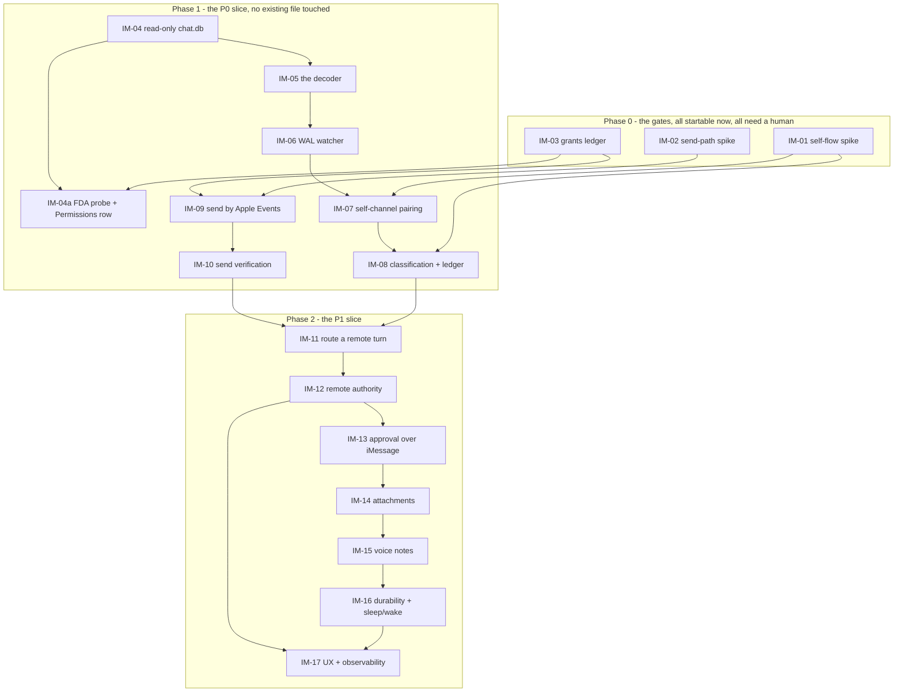

# Next Notes iMessage Remote Access: start here

**2026-10-02 current dependency update:** P6-03 is committed `1c68d3e` with37
installed actual journal/tool/approval cases and owner isolation green. P6-04a-1 held/strict-read foundation is committed `6f50e07` (56 installed cases, 12 related flags and owner isolation green); P6-04a-2 SQL authority migration is committed `5de382a` and installed (authority54/recovery56/durability37, all13 targeted flags green; parent open). P3-06a remains
open: bounded foundation `5ecc7e6` passes scripted capture/output/replay with
zero observed disagreements; physical/full-suite coverage remains open. The cited CORE15/18 is historical 2026-10-01 evidence, not a current core rerun.
Bounded typed-local attempt/receipt admission and normal typed ACP attempt admission
are now verified. ACP receipt startup admission (`e946ecd`: original65 RED9 → fixed66
worker731), completion admission (`404725b`: original67 RED4 → fixed68 worker764),
and permission selected/cancelled encoding (`4f37916`: original69 RED3 → fixed70
permission22/origin68/worker764) pass; app70 all20 focused flags pass. Those focused
checks are not CORE or model evaluations. Remote origin/attempt authority, live
lease/session/current-client authority, receipt reconciliation, crash recovery/retry,
TaskBridge, OutputScheduler and durable delivery remain open; IM-16 stays blocked.
Parent Phase6 and the unchanged quick9/full/owner/latency gates remain open.

**Model alignment, 2026-09-30:** follow the
[independent-role/shared-file contract](../SHARED-BRAIN/00-README.md).
Remote requests continue to use the Agent role and its source-scoped consent;
this does not make meetingNotes or dictation cleanup follow that role. Reuse the
existing exact artifact if needed; no iMessage-specific copy/runtime or model download.

This folder is an implementation roadmap for a native iMessage transport into the app's existing
Agent. It is meant to be executed task by task by a coding agent with **no access to the
conversation that produced it**. Everything you need is in these files, in the repo, and in the
roadmap it depends on.

Read this file completely before you touch any task. Then read `AGENTS.md` at the repo root. Its
rules override your habits.

---

## 1. What this is

A paired self-conversation in the user's own Messages, watched from the Mac, answering through the
**same** agent that answers voice and typed turns. No BlueBubbles, no Sendblue, no tunnel, no cloud
relay, no Node, no SIP, no code injection into Messages.

```text
iPhone → Apple iMessage → Messages.app on the Mac → Next Notes
                                            ↓
                              same agent as voice and text
                                            ↓
                       Action Runtime → verified result → Messages.app
```

**The Mac remains the execution environment.** If the Mac is asleep, iMessage holds the message and
Next processes it on wake. There is no cloud-side agent, and this feature must never become one.

## 2. Why this folder is in `roadmap/in-progress/`

**Moved 2026-09-25.** It was written into `roadmap/todo/` because its first three tasks cannot be
done by an agent — they need a human, an iPhone, and System Settings.

**That reason turned out to be half the picture, and the other half moved the folder up.** IM-04 was
split (see §8.1) and now has **no dependency at all**: the read-only SQLite layer, the capability
probes and `PRAGMA query_only` need a *fixture*, not a grant. IM-05 and IM-06 follow it. **So code
lands here, and a roadmap where code lands belongs in `in-progress/`** — that is what the directory
means, and `AGENT-OVERHAUL` has held a `blocked` row (`P0-10`) for a month without that being a
problem.

**What being in `in-progress/` does and does not mean here:**

| It means | It does **not** mean |
|---|---|
| This folder has a ledger, a workflow, ids, phase gates and reports — the `in-progress/` contract | The gates are closed. **G1–G3 are all still open** and the Gates table in `STATUS.md` is how that is tracked |
| **Phase 1's foundation is done (2026-09-26)**, and it is not the same as Phase 1 being complete | IM-04/IM-04a/IM-04c, IM-05/IM-05b/c/d/e, IM-06, IM-08a, IM-08b and IM-17c are all shipped and green. **IM-07, IM-08c, IM-08d, IM-09 and IM-10 are still `todo`**, and every one of them traces back to a human: IM-07 and IM-08c on IM-01 and IM-02, IM-09 and IM-10 on IM-02 and IM-03. Phase 2 is a strict chain — IM-11 → IM-12 → IM-13 → IM-14 → IM-15 → IM-16 → IM-17 — whose entry point IM-11 depends on IM-08 and IM-10. **This roadmap cannot advance further without the three spikes below.** |
| An executor can be pointed at this folder cold | An executor can start any task. Read `STATUS.md`'s ledger for what is actually runnable |

**The three gates stay open, and they stay visible.** `STATUS.md` has a Gates table with a `State`
and a `Date` per row for exactly this: a gate with no date is a hope, not a gate. When G1 closes,
IM-01's report is committed and **no folder move is needed** — the ledger row is what changes.

Compare `Phone-Calls`, which is still in `todo/`: all four of its Phase 0 tasks need a human, and its
first code task (PH-07) additionally waits on AGENT-OVERHAUL's `P1-03`. **No phone task is runnable
today**, so that folder has not moved.

So the folder is structured like `in-progress/` but sits in `todo/`. **When IM-01…IM-03 are done,
move the folder to `roadmap/in-progress/` and tick the gate row.** That is the only change.

## 3. The three gates. Start all three today; they are not code.

| Gate | What it needs | What it decides | Blocks |
|---|---|---|---|
| **G1 — the self-flow spike** (IM-01) | a human, an iPhone, Messages signed in, ~1 day | what an iPhone self-message looks like in `chat.db`, and whether it arrives as `is_from_me = 1` or `0` | IM-07, and every design decision that depends on the filter |
| **G2 — the send path** (IM-02) | a human, Contacts, ~half a day | how Messages is addressed on this macOS, and that a self-conversation can be addressed at all | IM-09 |
| **G3 — the grants** (IM-03) | a human, System Settings | whether Full Disk Access and the Messages Automation grant can be obtained, and whether ad-hoc signing makes IM-09 unmaintainable | IM-04a, IM-09 |

`chat.db` is Apple's, is undocumented, is TCC-protected, and changes between macOS releases. The
spike is not ceremony — the roadmap's own P0 is *"we can reliably distinguish a message sent by the
user from their iPhone vs. a message generated by Next Notes on the Mac, without relying on message
wording alone."*

## 4. What exists to build on (verified 2026-09-25 against `78cebc9`)

### 4.0 Read this first: two different kinds of "exists"

The table below was verified on 2026-09-25, and **a sub-agent audit on the same day found that part
of it was wrong.** The rows are split accordingly, and the distinction matters more than any other
line in this section:

| Kind | What it means | What happens if you get it wrong |
|---|---|---|
| **PRESENT** | the type is in `Sources/` today, re-grepped | nothing — read it |
| **PLANNED** | the type is a **named contract in `roadmap/in-progress/AGENT-OVERHAUL`**, on a row that is still `todo` | **you go looking for a channel that is not there, and then you build a second one** |

**Current dependency check, 2026-10-01:** `AgentCapabilityManifest` is present
(`Agent/AgentCapabilityManifest.swift`); its former “planned/comment only” claim
was a 2026-09-25 snapshot. TaskBridge, TaskRecord, TaskID, TaskEvent, TaskReceipt,
TaskDelivery, AgentDeliveryMode and OutputScheduler remain subsequent AO
contracts. Typed durability and the canonical SQLite mirror are committed as
P6-02a (`670bc35`): 18 installed cases and owner isolation pass, following
P6-01's baseline `ff40a93`. P6-03's journal is committed `1c68d3e`; P6-04a-1 held foundation is `6f50e07`. P6-04a-2 now has SQL primary authority and a retained tagged JSON export (authority54/recovery56/durability37, all13 targeted flags pass); parent remains open. P3-06a bounded shadow foundation `5ecc7e6` passes scripted comparisons; physical/full-suite coverage remains open; neither a mirror nor a draft
contract proves recovery or permits production hosting. No watcher→bridge→adapter host
has been added by this handoff. Read AO's current STATUS and IM-16's blocker,
not historical type counts, before claiming a dependency exists.

### 4.1 Historical foundation snapshot — 2026-09-25

The following table records the original foundation audit. Its counts and task
states are historical; current implementation evidence is in STATUS.md and §4.2.

| Need | Exists | Where |
|---|---|---|
| Read-only external SQLite | `WisprReader` — `SQLITE_OPEN_READONLY \| SQLITE_OPEN_URI` | `Transcription/WisprReader.swift:72` |
| Watching a file the app does not own | `FileIndexWatcher` | `Knowledge/Files/FileIndexWatcher.swift` |
| Canonical paths | `FileIndexStore.canonical`, `SkillScanner.canonicalPath` — **`realpath(3)`**, because `URL.resolvingSymlinksInPath()` strips `/private` while `FileManager.enumerator` reports it, so a prefix test matches nothing | `Knowledge/`, `Agent/Skills/` |
| The turn entry point | `RealtimeAgent.handle(_:source:)` | `Agent/RealtimeAgent.swift:262` |
| The source enum to extend | `AgentUtteranceSource { voice, text, meeting }` | `Agent/RealtimeAgent.swift:4-8` |
| **The memory gate** | `AgentSession.recordUser(_:source:)` | `Agent/RealtimeAgent.swift:1208` |
| The permission checklist, and the pattern for a grant with no read API | `Permissions` (4 rows) + `hasHeardSystemAudio`'s "one non-silent buffer is the only proof" | `Support/Permissions.swift:42` |
| The receipt that verifies a send | `ActionReceipt`, `ActionReceiptStore` → `action-receipts.json` | `Agent/ActionRuntime.swift:285, 329` |
| Store isolation | `SelfTestStoreGuard.fileNames` (13 entries) + `--selftest-store-isolation` | `Support/SelfTestStoreGuard.swift:24` |
| A Settings section, not a tab | `AgentSettingsTab` already holds `PersonaSection`, `ModelRoleSection`, `FastListeningSection`, `MemoriesSection`, `RemindersSection`, `KnowledgeSection` | `UI/Settings/AgentSettingsTab.swift` |
| The file worker an attachment joins | `FileIndex`, `FileIndexTools`, `FileCrawler` | `Knowledge/Files/` |
| A test fixture corpus for `chat.db` | **built 2026-09-25** — 13 sanitised cases, a `--degraded` mode, 17/17 byte-identical across runs, verified with `/usr/bin/sqlite3` and no build. `both-paths` added the same day; every `attributedBody` in it is a sentinel, so only the negative half runs until IM-01 | `Tests/Fixtures/chatdb/` |
| The read-only database layer | **IM-04 shipped 2026-09-25** (`1253959`) — 4 files, `IMESSAGE_DB_OK: 17 cases`, mutation-tested | `Sources/NextNotes/IMessage/Database/Messages*.swift` |
| The `attributedBody` decoder | **IM-05 shipped 2026-09-25** (`0a9257b`) — `IMessageEnvelope` with a `String?` text and a `decodeState`, a version gate that is data, and every failure a value. `IMESSAGE_DECODE_OK: 22 cases` with **5 assertions blocked on IM-01** | `Sources/NextNotes/IMessage/Database/MessagesDecoder*.swift` |
| The WAL watcher | **IM-06 shipped 2026-09-25** — `DispatchSourceFileSystemObject` on the `-wal` descriptor, 50–150 ms debounce, **two** idempotency mechanisms (row id *and* GUID), and a per-message settling deadline. `IMESSAGE_WATCH_OK: 14 cases`, CORE | `Sources/NextNotes/IMessage/Watcher/` |
| A design note for the `attributedBody` decoder | **written 2026-09-25** — settles hand-written-parser vs `NSUnarchiver` (**hand-written**: the system API has no throwing entry point, so a format change becomes a process exit), and lists what IM-01 must capture | `Sources/NextNotes/IMessage/Database/TYPEDSTREAM-NOTES.md` |
| Contacts, for sending to a self-conversation | **nothing** — `CNContact` appears nowhere in the tree. New framework, new TCC row, shared with `Phone-Calls` | — |
| Anything iMessage | **nothing** — `chat.db` 0 hits; `NSAppleScript` / `NSAppleEventDescriptor` 0 hits | — |

**One correction to the 2026-09-25 draft of this table:** it said the three `iMessage` hits in the
tree are "a formatting target for typing into Messages". There are **zero** `iMessage` hits in
`Sources/`. The claim was carried from an earlier reading and is not true of this tree.

### 4.2 Current AGENT-OVERHAUL dependencies — 2026-10-01

| Type | AO row | State | Needed for |
|---|---|---|---|
| `OutputScheduler` (+ `enqueue`, `OutputToken`, `AgentDeliveryMode`) | **P3-04a / P3-04b** | `todo` | IM-11, IM-16, IM-17 — every result leaving the app |
| `TaskBridge`, `TaskID`, `TaskEvent`, `TaskReceipt` | **P3-03a / P3-03b** | `todo` | IM-11 (routing), IM-13 (a task carries an approval) |
| `AgentCapabilityManifest` | **P1-03** | present in source | IM-11 — the tool authority a remote turn runs under |
| `AgentTask`/manager JSON→SQLite mirror and `TaskDurability` | **P6-01 and P6-02a done** | `ff40a93` / `670bc35`; 18 historical mirror cases; P6-04a-2 now passes54 authority cases and isolation, SQL primary/tagged JSON export | IM-16 foundation only; no recovery/delivery readiness |
| `TaskRecord`, `TaskDelivery` and recovery | **P3 task/delivery contracts; P6-03…P6-08** | subsequent work | IM-16 — durable delivery, sleep/wake backlog |
| `ActionOriginContext` | **IM-12 defines it** | here | IM-12 |
| `RemotePreparedAction` | **IM-13 defines it** | here | IM-13, and `Phone-Calls` PH-08 |

Read the phase files, not this table, for those contracts:
`roadmap/in-progress/AGENT-OVERHAUL/04-PHASE-3-FULL-DUPLEX.md` §2.5 and §2.6, and
`07-PHASE-6-DURABLE-JOBS.md`. A task that needs one of these is `blocked` — `STATUS.md` has the note
format. **IM-04 through IM-10 need none of them**, which is the point of Phase 1's shape.

## 5. What this roadmap must not become

- **Not an "iMessage agent."** One agent, three transports. The iMessage path is a transport
  adapter; the Interaction Agent does not care that a turn arrived through SQLite.
- **Not a second result channel.** Results go out through `OutputScheduler` / `TaskBridge`. There
  is no `AgentResultBus` and there must not be one — see `AGENT-OVERHAUL/07-PHASE-6-DURABLE-JOBS.md`.
- **Not a second permission model.** Remote authority is expressed through an
  `ActionOriginContext` **beside** `ActionAuthority`, not as a new case — `ActionAuthority` has a
  hand-written `Codable` pair encoding `scheduled(UUID)` as `"scheduled:<uuid>"`
  (`ActionRuntime.swift:20-30, 32-58`), and its strings are already persisted in
  `action-receipts.json`.
- **Not a Messages knowledge index.** The paired chat is a command channel. Broader Messages search
  is a separate, separately permissioned future feature.
- **Not a path into the user's whole message history.** The process will have Full Disk Access, so
  the *application layer* enforces paired-chat-only and IM-17 asserts it.

---

## 6. File map

| File | What it holds | Author status |
|---|---|---|
| `00-README.md` | This file: gates, workflow, rules, task ids, dependencies, glossary, limits | written 2026-09-25 |
| `STATUS.md` | The ledger. Update after every task | written 2026-09-25 |
| `01-PHASE-0-SELF-FLOW.md` | The three gates (IM-01…IM-03). **No code.** | written 2026-09-25 |
| `02-PHASE-1-P0-SLICE.md` | Read, decode, watch, pair, classify, send, verify (IM-04…IM-10) | written 2026-09-25 |
| `03-PHASE-2-P1-SLICE.md` | Route, authority, approve, attachments, voice, durability, UX (IM-11…IM-17) | written 2026-09-25 |
| `REVIEW-LOG.md` | The audit this was written from, what was checked, known open issues | written 2026-09-25 |

If a file name here does not match, run `ls roadmap/in-progress/NextNotes-iMessage/` and use what is
there. Inside a phase file, each task's **Depends on** line is authoritative; the graph in §8 is a
summary.

**The `roadmap/` folder is git-ignored. Never commit anything under it.** Never write roadmap or
plan files into `docs/`, which is the published website. Test reports go in `Tests/Reports/`.

The predecessor of this folder was `roadmap/todo/NextNotes_iMessage_Integration_Roadmap.md`, a
single 1,796-line prose roadmap. It is preserved in git history only as a draft and is now
**deleted**; the substance is here, and `REVIEW-LOG.md` §1 records what changed and why.

---

## 7. The per-task workflow (every task, every time)

Follow in order. Do not skip any step because a task "looks small".

1. **Read the task in full**, then every file it lists under *Files you will change* and
   *Read for context*.
2. **Re-verify every anchor.** Line numbers drift and another workstream commits to this tree
   daily. Grep the quoted symbol: `grep -n "func handle(_ text" Sources/NextNotes/Agent/RealtimeAgent.swift`.
   If the code no longer matches the task's *Current behaviour*, stop, read on, and either adapt
   the task and say so in `STATUS.md`, or write a `BLOCKED` note (§10).
3. **Write the red-first self-test.** Written *before* the fix, and it fails on today's behaviour.
   When the test needs a new API, add only the **seam**: the signature, with a body that
   reproduces today's behaviour. The test must compile against it and still fail. Register the flag
   in `NextNotesApp.runRequestedSelfTest` (:479), add it to the flag list in `AGENTS.md`, and add
   it to the right tier in `Scripts/acceptance.sh`.
4. **Build**: `make build`. On "input file was modified during the build", the iCloud sync touched
   a file — wait 5 s and retry, up to 3 times. Never bare `swift build`.
5. **Install**: `make install OPEN=0`. Never omit `OPEN=0`.
6. **Run the test and confirm it is RED.** The last line must be `<NAME>_FAILED: …`. If it is green
   before the fix, the test is wrong: fix the test, not the code. `_ABSENT` means a precondition is
   missing — record it, or write a `BLOCKED` note.
7. **Implement**, following the task's *Steps* and *Do not* lists.
8. **Build and install again** (steps 4–5 rules).
9. **Run the task's gate until GREEN.** The last line must be `<NAME>_OK`. Save output to
   `~/Library/Caches/NextNotesBuild/imessage/<ID>-green.txt`. **Never make a test green by
   special-casing the test, lowering a threshold, or skipping an assertion.**
10. **Run the task's regression flags** (listed under *Verify*). Each must end as it ended in the
    baseline, or better.
11. **Update `STATUS.md`**: state, date (`YYYY-MM-DD`), evidence (the final marker line plus
    measured numbers with units), commit hash.
12. **Commit.** One commit per task. `git add <paths>` — **never `git add -A`**, the tree carries
    two other workstreams' uncommitted work. Message is `IM-NN: <title>`, then a blank line, then
    a body naming the self-test and its result line. **Never push. Never amend or rebase someone
    else's commit. Never commit anything under `roadmap/`.** If `git status` shows files you did
    not touch as modified, leave them alone.

### Shared files, and who may touch them

`NextNotesApp.swift` (`runRequestedSelfTest`), `Scripts/acceptance.sh` and `AGENTS.md` are
**single-writer**: the orchestrator batches the registrations. A sub-agent adds the flag's
registration to its task's instructions and does not edit those three files itself. `AGENTS.md` also
has an uncommitted change from 2026-09-25 that P0-12 in AGENT-OVERHAUL owns; do not reset it.

### 8.2 The build lock — take it before any build, install, or self-test

**One SwiftPM scratch path, one `install.lock`, ~5 GB of build cache, and two other workstreams
building this same tree.** Concurrent `swift-build` runs into `~/Library/Caches/NextNotesBuild/scratch`
corrupt each other, and a self-test that starts while another workstream installs reports
`codesign verification failed` and looks like a code failure.

```bash
L=~/Library/Caches/NextNotesBuild/work.lock
until mkdir "$L" 2>/dev/null; do sleep 3; done   # mkdir is atomic on APFS
echo "holder: $$ started $(date +%T)" > "$L/owner"
# ... make build · make install OPEN=0 · Scripts/run-selftest.sh ... ...
rm -rf "$L"                                       # release
```

Rules that go with it:

- **Hold the lock for the shortest possible span**: take it, build, install, run the one test, release.
  Do not hold it across analysis, reading, or writing files.
- **Release it in a `trap`/`finally`**, so a crashed or timed-out agent does not wedge the queue.
- **Writing and reading files needs no lock.** Only build, install and self-test do. Parallel authoring
  in this folder's own `Sources/NextNotes/IMessage/` is safe.
- **`make build` is the only supported build.** Never bare `swift build`.
- On `codesign verification failed` from `run-selftest.sh`, the cause is almost always a concurrent
  install, not the code: re-run `make install OPEN=0` and re-run the test.
- If the lock has been held for more than 20 minutes, `cat` its `owner` file before assuming it is
  live. A killed agent leaves the directory behind.

**This lock only serialises parties that take it.** AGENT-OVERHAUL and DICTATION-MEETINGS-LIMITS must
be told to take it too, or it protects nothing. The lock file is `work.lock` beside the existing
`install.lock`; `install.lock` is taken by `make install` itself, and this one is for the whole
build-install-test cycle.

---

## 8. Task IDs and the dependency graph

**These ids are fixed. Never renumber them.** You may split a task into lettered subtasks
(`IM-08a`); record each as its own row in `STATUS.md`.

### Phase 0 — the three gates (`01-PHASE-0-SELF-FLOW.md`)

| ID | Title |
|---|---|
| IM-01 | Self-flow spike: what an iPhone self-message actually is in `chat.db` |
| IM-02 | Send-path spike: how Messages is addressed here, and can a self-conversation be addressed |
| IM-03 | The grants ledger: Full Disk Access, Automation, and what ad-hoc signing does to IM-09 |

### Phase 1 — the P0 slice (`02-PHASE-1-P0-SLICE.md`) — **foundation done 2026-09-26; five tasks still open**

**The three spikes that now own this roadmap's progress**, all of which need a person rather than an
agent. They are the only things standing between here and the whole feature:

| spike | what only a human can answer | why an agent cannot |
|---|---|---|
| **IM-01** | what an iPhone self-message actually is in `chat.db` — the pairing filter, and one real `attributedBody` with its header | needs an iPhone, a paired chat, and the Messages grant |
| **IM-02** | how Messages is addressed here, and whether a self-conversation can be addressed at all | needs the Automation grant and a live send |
| **IM-03** | the FDA and Automation ledger, and what ad-hoc re-signing does to IM-09's grant | needs the grants, which a coding agent cannot obtain |

IM-01's Q2 is worth doing first and is cheap: **one real `attributedBody` for a message whose text
you already know**, plus the `sw_vers` line. It unblocks IM-05's five blocked assertions on its own,
and `TYPEDSTREAM-NOTES.md` §3 says exactly what to capture and what *not* to go hunting for.

Text in, text out, loop-proofed, routed to the agent.

| ID | Title |
|---|---|
| IM-04 | Read-only `chat.db`: capability probes, `PRAGMA query_only`, the query actor |
| IM-04a | ↳ The Full Disk Access probe and the `Permissions` row. Split out 2026-09-25 — see §8.1 |
| IM-05 | The decoder: `attributedBody` typedstream, `payload_data`, and refusing cleanly |
| IM-06 | The WAL watcher: watermark, GUID dedup, ordered replay, the attachment settling race |
| IM-07 | Self-channel pairing, with the filter IM-01's answer chose |
| IM-08 | Classification and the outbound ledger — which gates **memory**, not only dispatch |
| IM-09 | Send through Messages.app by Apple Events in-process, addressed via Contacts |
| IM-10 | Send verification: watch for the row, and produce an `ActionReceipt` |

### Phase 2 — the P1 slice (`03-PHASE-2-P1-SLICE.md`)

| ID | Title |
|---|---|
| IM-11 | Route a remote turn: `.iMessage` on `AgentUtteranceSource` + the adapter |
| IM-12 | Remote authority: `ActionOriginContext` beside `ActionAuthority`, and the broker |
| IM-13 | Approval over iMessage: `RemotePreparedAction`, frozen, expiring, exact-match |
| IM-14 | Attachments: copy out, size limits, MIME, and never-execute |
| IM-15 | Voice notes: an attachment that is a file, not a duplex turn |
| IM-16 | Durable delivery, sleep/wake backlog, and crash-safety |
| IM-17 | Onboarding UX, observability, metrics, and the privacy assertion |



Soft dependencies, not edges: IM-11 needs AGENT-OVERHAUL **P3-03b** (the ledger) and **P1-03** (the
tool manifest); IM-16 needs **P6** (durable tasks). Coordinate on those; do not block on them to
start Phase 1, which touches no existing file outside `Sources/NextNotes/IMessage/`.

### 8.1 Why IM-04 was split (2026-09-25)

IM-04 originally depended on **IM-03**, which is a human task about obtaining Full Disk Access. That
was too tight, and it put **the two highest-risk tasks in this roadmap behind a half-day someone has
to be at a Mac for.**

What IM-04 actually needs the grant for is ~20 lines: the health probe and the `Permissions` row.
Everything else — `sqlite3_open_v2(READONLY)`, `PRAGMA query_only`, the capability probes, the
queries, the actor — **needs no grant at all. It needs a fixture**, and a fixture is a file.

So:

- **IM-04 has no dependency.** Open read-only, assert the pragma, probe capabilities, query a
  fixture. Runnable now.
- **IM-04a** carries the FDA probe, `Permissions.hasMessagesAccess` and the UI row, and depends on
  IM-03.

IM-07 and IM-08 still genuinely wait on IM-01: the pairing filter and the trust rule are different
questions from the storage layer, and IM-01's Q1 answer is what decides the filter.

**The honest cost, recorded so nobody is surprised:** IM-05 built now is a decoder written against
**synthetic** typedstream, because IM-01's real bytes do not exist yet. The first thing IM-01 does
with them is **replace the synthetic fixtures**. That is how the task starts, and the replacement is a
deliberate act rather than a surprise.

---

## 9. Self-test flags

Every **new** flag is registered in `NextNotesApp.runRequestedSelfTest`, added to the AGENTS.md
flag list, and added to the tier shown. A flag several tasks extend keeps **one** final marker;
each task adds cases, never a second marker. Per-failure diagnostic lines (`…_WRONG: …`) are not
final markers.

| Flag | Created by (extended by) | File | Final marker | Tier |
|---|---|---|---|---|
| `--selftest-imessage-db` | IM-04 (IM-04a adds the probe cases, IM-10 adds the verification cases) | `IMessage/Database/MessagesDatabaseSelfTest.swift` | `IMESSAGE_DB_OK: <n> cases` / `IMESSAGE_DB_FAILED: <reason>` | INTEGRATION |
| `--selftest-imessage-decode` | IM-05 | `IMessage/Database/MessagesDecoderSelfTest.swift` | `IMESSAGE_DECODE_OK: <n> cases` / `IMESSAGE_DECODE_FAILED: <case>: <reason>` | INTEGRATION |
| `--selftest-imessage-watch` | IM-06 | `IMessage/Watcher/MessagesWatcherSelfTest.swift` | `IMESSAGE_WATCH_OK` / `IMESSAGE_WATCH_FAILED: <reason>` | CORE |
| `--selftest-imessage-pairing` | IM-07 | `IMessage/Pairing/SelfChannelSelfTest.swift` | `IMESSAGE_PAIRING_OK` / `IMESSAGE_PAIRING_FAILED: <reason>` | INTEGRATION |
| `--selftest-imessage-loop` | IM-08 (`IM-08b` and `IM-08d` — the store and the bridge; **CORRECTED 2026-09-27**: the design's preamble said IM-08b would write its cases into `--selftest-imessage-class`, while its own IM-08b section and this table named a separate flag. **The separate flag is what shipped and it is the right one** — the store needs a real SQLite file and `strings(1)`, the classifier needs neither, and one flag claiming a store assertion while running a pure function is the same lie in the other direction) | `IMessage/Sending/OutboundLedgerSelfTest.swift`, `IMessage/IMessageBridgeSelfTest.swift` | `IMESSAGE_LOOP_OK: <n> cases` / `IMESSAGE_LOOP_FAILED: <case>: <reason>`. **IM-08d changes this marker** to `IMESSAGE_LOOP_OK: 100 replies, <n> new memories` — the bridge is where the 100-reply, no-memory, no-session assertion lives, and that is the number this flag exists to print | CORE |
| `--selftest-imessage-class` | IM-08 (`IM-08a` and `IM-08c` — the two pure classification tables; one flag because two pure functions do not need two registrations) | `IMessage/Classify/IMessageClassSelfTest.swift` | `IMESSAGE_CLASS_OK: <n> cases` / `IMESSAGE_CLASS_FAILED: <case>: <reason>` | INTEGRATION |
| `--selftest-imessage-approval` | IM-13 (IM-12 adds the authority cases; IM-10's verifier cases land here) | `IMessage/Sending/IMessageActionVerifierSelfTest.swift` | `IMESSAGE_APPROVAL_OK` / `IMESSAGE_APPROVAL_FAILED: <case>: <reason>` | CORE |
| `--selftest-imessage-attachment` | IM-14 (IM-15 extends it) | `IMessage/Attachments/MessagesAttachmentSelfTest.swift` | `IMESSAGE_ATTACHMENT_OK` / `IMESSAGE_ATTACHMENT_FAILED: <reason>` | INTEGRATION |
| `--selftest-imessage-recovery` | IM-16 | `IMessage/IMessageRecoverySelfTest.swift` | `IMESSAGE_RECOVERY_OK` / `IMESSAGE_RECOVERY_FAILED: <case>: <reason>` | CORE |
| `--selftest-imessage-authority` | IM-12 *(optional split — fold into `--selftest-imessage-approval` if you prefer one flag)* | `IMessage/Agent/IMessageAuthoritySelfTest.swift` | `IMESSAGE_AUTHORITY_OK` / `IMESSAGE_AUTHORITY_FAILED: <band>: <reason>` | CORE |
| `--selftest-imessage-privacy` | IM-17 | `IMessage/IMessageSelfTest.swift` | `IMESSAGE_PRIVACY_OK` / `IMESSAGE_PRIVACY_FAILED: <what leaked>` | CORE |

**Two of these must fail when the thing they names did not happen**, and both assert a negative over
a *consequence* rather than a positive over a mechanism: `IMESSAGE_LOOP` sends 100 replies through
the bridge and then asserts **no new memory entry and no new session row** — asserting only "the
agent did not respond to them" passes while memory is still poisoned. `IMESSAGE_PRIVACY` reads the
guard, then queries with a non-paired chat and asserts the result is empty — a privacy claim with no
assertion behind it is a comment.

Not self-tests, by design:

- **`--imessage-report [--imessage-days N] [--imessage-chat <guid>]`** (IM-17) is a read-only
  diagnostic in the `--usage-report` shape. It reads the **real** `imessage-outbound.sqlite` and
  `chat.db`, so it runs before `SelfTest.isRunning` swaps the stores, and ends
  `IMESSAGE_REPORT_OK …` or `IMESSAGE_REPORT_EMPTY`. Under the harness it would report a green
  answer about a question nobody asked.
- **`--selftest-imessage-send`** is a *physical* test. It needs a paired conversation and the
  Automation grant, so it is a `via-open` entry and is not in the automatic tiers. Run it by hand.

---

## 10. When you are stuck

Write a `BLOCKED` note in `STATUS.md`, newest first:

```
### IM-NN — blocked <YYYY-MM-DD>
Tried: …
Failing line: `<NAME>_FAILED: …` (output at ~/Library/Caches/NextNotesBuild/imessage/IM-NN-….txt)
Missing: <model | grant | device | owner decision | other agent's uncommitted work>
Next step when unblocked: …
```

The likely causes here are a **missing precondition** (no iPhone, no paired conversation, no grant)
and **another workstream's uncommitted work**. The tree is shared with AGENT-OVERHAUL and
DICTATION-MEETINGS-LIMITS. `NextNotesApp.swift`, `Support/Usage/` and `Meetings/` are all in active
use. Never resolve a conflict by reverting a file you did not change.

---

## 11. Rules you must never break

These are consolidated from `AGENTS.md`; the full reasoning is there.

**What every change is judged by**
- Efficiency, speed and full-duplex conversation come first. The full statement is AGENTS.md
  "What we optimize for"; read it again before a task changes a path the user waits on.
- Do not add a sequential await, a fixed sleep, a debounce or a second confirmation to a path
  the user's turn sits on, and do not serialise audio and interaction — "it is safer" is not a
  reason. A task that needs an exception says so in its commit and `STATUS.md`.
- Do not add a store, ledger, queue, channel or tool manifest. Prefer the existing seam and the
  smaller diff; the single-owner paragraph in AGENTS.md is the check before adding a layer.
- Safety lives at the irreversible boundary, not in the path of everything: a read runs itself,
  a write waits for one approval. More ceremony than that makes the app feel slow, not safe.
- The person using this is not technical: no flow may ask for an API key, a terminal command or
  a config file when the app can do it for them, and copy stays in the user's own words
  (`--selftest-ui-strings` is the floor, not the goal).

**Building and running**
- `make build` only, never bare `swift build`. `make test` for the vectors. The repo is in iCloud.
- `make install OPEN=0`, always. Never launch the GUI as a side effect of install.
- Self-tests only through `Scripts/run-selftest.sh --selftest-…`, foreground, one at a time.
- `--via-open` **only** for a test needing a TCC grant, and never in a loop. TCC keys a grant to the
  *responsible* process, so a terminal launch is denied a grant the app itself holds.
- Never bare-invoke `/Applications/Next Notes.app/Contents/MacOS/NextNotes`.
- Never run the `.app` from the repo folder. Use `/usr/bin/log`, not `log`.
- `install.lock` is shared with `make install`. A `codesign verification failed` from
  `run-selftest.sh` usually means another workstream installed mid-swap: re-run `make install OPEN=0`.

**Self-tests**
- Last line is `<NAME>_OK` or `<NAME>_FAILED: <reason>`. A missing precondition prints
  `<NAME>_ABSENT: <what is missing>`, **never OK**.
- A self-test **must fail when the thing it names did not happen**. A probe that passes without its
  grant, its device or its model is worse than none.
- A self-test **never writes the owner's stores**: add its new filenames to
  `SelfTestStoreGuard.fileNames` **in the same commit that creates them**, and give every store a
  root URL plus an `isolated()` seam (the `MeetingStore.isolated()` pattern).
- A flag is never another flag's value. `SelfTest.value(after:)` refuses a value starting with `--`.
- A self-test cannot hang: the watchdog prints `SELFTEST_TIMEOUT`. Give a slow test its own budget
  the way `--selftest-cleanup` does.
- `roadmap/` is git-ignored. Nothing under it is ever committed.

**Data and safety**
- **The trust decision is the ledger match, not `is_from_me`.** A `from-me` row that matches a
  pending outbound is ours; everything else is a user command. This gates `AgentSession.recordUser`,
  so a matched row can never become a memory. See `AGENT-OVERHAUL/REVIEW-LOG.md` §6.2 for the
  rejected `AgentJob` and the one log rule.
- **Never write to any Apple database or attachment.** Open read-only, `PRAGMA query_only = ON`, and
  assert the pragma in a self-test.
- **Resolve paths with `realpath(3)`.** `URL.resolvingSymlinksInPath()` disagrees with
  `FileManager.enumerator` about `/private`, and `~/Library/Messages/Attachments/` is exactly that
  shape. `FileIndexStore.canonical` is the pattern.
- **The Agent's name is never written into a prompt.** It reaches prompts through `AgentGrounding`
  and `agent-identity.json`; the "Next ·" prefix in this roadmap's examples is the sample identity.
  `--selftest-persona` fails a hardcoded one.
- **Read Apple data, never mutate it.** Sending is Apple Events in-process, never a write to
  `chat.db`, and never `osascript` — the app already lists `osascript` on
  `Shell/ShellExecutor.swift:7`'s `privilegedPrefixes`, so a send through it would demand approval
  on every message.
- **No new dependency without checking the licence** (BSD, MIT, Apache-2.0, ISC or OFL) and updating
  `THIRD-PARTY-NOTICES.md`. This roadmap needs none: `SQLite3` is already linked in 11 files.
- If you touch correction behaviour, `shared/dictionary-test-vectors.json` is the specification.
  This roadmap does not.

**UI**
- Views contain no literal colours, sizes, radii or durations. Every value comes from a `DS` token
  in `UI/DesignSystem.swift`; add a token rather than inlining.
- Red means recording, and nothing else. No developer words in user-visible strings —
  `--selftest-ui-strings` fails per offender, and it bans `artifact`, raw tool ids and schema keys.
  **Never** put "SQLite", "chat.db", "WAL" or "attributedBody" in a Settings string.
- One animating orb per screen. iMessage has no orb of its own; a result reuses the existing
  `searching` state and the avatar's `browsing` state.
- Settings lives as a **section** in `AgentSettingsTab`, not a thirteenth `SettingsTab` case. A
  section is one file and one line in the tab's body.

---

## 12. Limits we keep on purpose

Each of these is a limit, not a default to tidy. A task that needs to change one must say so in
its own text, cite evidence, and record it in `STATUS.md` "Decisions and deviations".

| Area | Limit | Where | Why it stays |
|---|---|---|---|
| Watermark | both `lastProcessedRowID` **and** `processedMessageGUIDs` | IM-06 | the GUID cache protects against schema and join races, and against replay during recovery; the row id alone does not |
| Watcher | debounce 50–150 ms; never `SELECT` on a timer | IM-06 | one file event is not one message, and a 500 ms poll is the thing this replaces |
| Settling race | 8 retries, 2 s total, **per message** | IM-06 | a message row can precede its attachment join rows; per-message deadlines stop one slow attachment stalling a queue of text commands |
| Decoder | a refusal, not a guess | IM-05 | an unparsed `attributedBody` must tell the user the message arrived; silent emptiness is indistinguishable from silence |
| Privacy | paired chat only, at the application layer | IM-17 | the process has Full Disk Access and could read everything; the claim is only true if code enforces it |
| Remote authority | a remote origin may **lower** what policy permits, never raise it | IM-12 | a remote turn must not widen its own authority |
| Approval | expires, frozen payload, exact-match, paired channel only | IM-13 | "send" while two approvals are live must be a clarification, not a coin flip |
| Rate | >5 agent-authored messages in 10 s with no confirmed user row → suspend sending | IM-08 | the circuit breaker for a loop-breaker failure |
| Content | message contents are never in telemetry | IM-17 | every metric row goes through `UsageLog.sanitise`, which strips quoted content, addresses, URLs, paths and digit runs |

---

## 13. Glossary

| Term | Meaning in this roadmap |
|---|---|
| **paired chat** | the one `chat.guid` that is a command channel. Everything else is normal Messages data |
| **self-conversation** | Messages' own conversation with yourself. V1 restricts pairing to a direct one; a group is decoded but not pairable (IM-09 cannot address it) |
| **the ledger** | `OutboundMessageLedger` in `imessage-outbound.sqlite`. The match against it is the trust decision |
| **envelope** | `IMessageEnvelope` — the normalised record. **Raw SQLite rows never reach the agent layer** |
| **direction** | `.user` / `.otherParticipant` / `.nextNotes`. Not `is_from_me`: that is a column, not a direction |
| **attributedBody** | Apple's typedstream blob holding the body of an iMessage. Undocumented; the format changes between releases |
| **Apple Events** | the in-process `NSAppleEventDescriptor` path to Messages. The only send mechanism |
| **remote origin** | `ActionOriginContext` — the transport beside `ActionAuthority`, never a new authority case |
| **FOA** | Full Disk Access. A grant with **no read API**: the only honest probe is opening `chat.db` and reading a row |
| **paused** | remote processing suspended by `stop remote access`. Re-enabling needs local confirmation |

---

## 14. Sizing

| Slice | Prod | Test | Fixtures | Note |
|---|---|---|---|---|
| Phase 0 (three spikes) | 200 | 100 | — | human time: ~1.5 days plus the reports |
| Phase 1 — the P0 slice | 4,200 | 2,400 | 400 | the decoder is the largest single risk |
| Phase 2 — the P1 slice | 3,400 | 1,900 | — | voice notes and UX are small |
| **Total** | **~7,800** | **~4,400** | **400** | **~12,600 lines, 7% of the tree** |

Phase 1's **core** tasks (IM-04…IM-06) touch nothing outside `Sources/NextNotes/IMessage/`, which
is why they can run alongside the two live workstreams. **Corrected 2026-09-25:** the earlier claim
that the whole phase touches no existing file was false — IM-04a edits `Support/Permissions.swift`
and `UI/Settings/AgentSettingsTab.swift`, and IM-07/IM-08 edit `Support/SelfTestStoreGuard.swift`.
`roadmap/BUILD-ORDER.md` finding **C3** records that `AgentSettingsTab.swift` has **five**
writers across the roadmaps, so those three are the ones that need a named owner.

---

## 15. Definition of done

A nontechnical user can install Next Notes, open Settings → Agent → iMessage, grant access, send
`Hi Next` to themselves from their iPhone, see `Connected`, walk away with the phone, ask what's on
their calendar, and get a correct answer from the same agent that answers voice. They can then
compare two proposals, keep messaging while the work runs, receive the result, approve an email by
replying `send`, and be told `Sent.`

And the twenty-two conditions in the predecessor roadmap's §47 still hold, of which five are the
ones that matter most and are each pinned by a flag:

- The reply `Sent.` is **never** interpreted as a new command — and never written to memory.
  (`--selftest-imessage-loop`, CORE)
- Restarting does not replay old commands. (IM-16)
- Sleeping and waking does not duplicate jobs. (IM-16)
- Only the paired conversation is ever read for agent control. (`--selftest-imessage-privacy`, CORE)
- A consequential action is approved over iMessage against a **frozen** payload, and the receipt
  says it landed. (`--selftest-imessage-approval` + `--selftest-imessage-send`, CORE)
