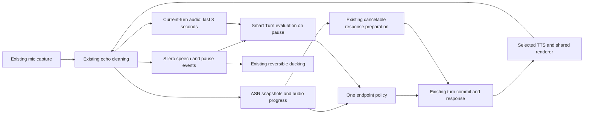

# Silero VAD + Smart Turn: voice turn detection roadmap

Owner request: 22 October 2026. Status: **planning and benchmark tooling only; product integration not started**.

Give Next Notes prompt replies at genuine sentence endings, patience during thinking pauses,
and reversible interruption while the assistant speaks. Reuse the existing capture, ASR,
conversation coordinator, renderer, model library and telemetry. Keep microphone, model
and speaker concurrent.

## Read this plan

| Document | Purpose |
|---|---|
| [Implementation](01-IMPLEMENTATION.md) | Architecture, state contracts, ordered tasks, file boundaries and failure handling |
| [Benchmarks](02-BENCHMARKS.md) | Ground truth, reproducible latency/pause corpus, engine matrix, metrics and acceptance |
| [ASR/TTS alignment](03-ASR-TTS-ALIGNMENT.md) | Direct coordination with the two engine agents, adapter contracts and ownership |
| [TTS audible-start follow-up](04-TTS-AUDIBLE-ALIGNMENT.md) | New native component results, rendered/presentation/physical timing boundaries and collector requirements |
| [Status](STATUS.md) | Execution ledger; planning never implies native acceptance |
| [Benchmark tools](benchmark/README.md) | Executable offline trace scorer and machine-readable case recipes |

This is the detailed execution companion for **AGENT-OVERHAUL P2-04**, plus the required
P2-05 interruption and P2-07 lifecycle integration. The parent
[STATUS](../AGENT-OVERHAUL/STATUS.md) remains authoritative for those task IDs. VTD tasks
below decompose the work; they do not independently mark a parent task complete. This
roadmap's documentation/benchmark-tooling work is active; its product tasks remain todo.

## Verified starting point

Source inspected 22 October 2026 at HEAD `6cf744cc4a27ed4a57bd3fea2c233ea999506fc0`,
with pre-existing working-tree changes and concurrent ASR/TTS changes. HEAD alone does
not identify the inspected source. Pin actual source hashes again before implementation
or a benchmark. No installed-binary equivalence is claimed.

| Area | Present in current source | Gap |
|---|---|---|
| Capture | `AudioCaptureHub` delivers owned Float32/16 kHz/mono chunks and capture host time | Keep exact sample/time continuity through adapters |
| Echo | `AcousticEchoProcessor` cleans input using rendered playback reference; transcript echo filters remain | Physical-route qualification, including new voices |
| Silero | `CaptureVoiceActivityInput` loads FluidAudio CoreML VAD; bounded window and retained inference task | Scores currently require active output generation; no listening-time speech/pause events |
| Ducking | Two qualifying probabilities >=0.6 plus echo evidence lower real output gain to 0.3; quiet can restore gain | Cold 200 ms target remains failed |
| ASR | Apple engine plus Parakeet streaming EOU; local decoder may own partial/final text once caught up | No provider-neutral per-turn processed-audio watermark |
| EOU | Parakeet 160 ms chunks / 320 ms debounce, immediate callback evaluation | Independent Smart Turn audio classifier missing |
| Fallback | `tick` checks 2.5 s quiet when EOU ready; otherwise 0.9 s, plus transcript stability 0.35 s | These conditions overlap; do not add their numbers into a claimed measured latency |
| Speculation | `prepareResponseForRecognizedSpeech` and coordinator prepare/cancel/reuse work before commit | Preserve this head start while replacing endpoint authority |
| Playback | Existing provisional duck/pause/resume and committed stop, generation ownership, streamed clauses | Qualify every voice; output capability differs by engine |
| Metrics | `VoiceLatencyTimeline` and existing usage/metrics sinks | `smartTurn` is only a declared mark, not an inference integration |

Source map: [Capture](../../../Sources/NextNotes/Activation/AgentCaptureController.swift),
[Parakeet](../../../Sources/NextNotes/Activation/LocalVoiceTurnDetector.swift),
[ASR contract](../../../Sources/NextNotes/Transcription/TranscriptionEngine.swift),
[audio session](../../../Sources/NextNotes/Agent/RealtimeAudioSession.swift),
[speculation](../../../Sources/NextNotes/Agent/VoiceConversationCoordinator.swift),
[timeline](../../../Sources/NextNotes/Agent/Voice/VoiceLatencyTimeline.swift).

## Decisions

1. Keep a single cleaned capture stream. Fan out its owned audio to the existing ASR,
   Silero and a bounded current-turn context buffer. Do not open another microphone.
2. Use **Smart Turn v3.2 CoreML** for the initial macOS implementation. Keep exact artifact
   identity separate from runtime/ASR/TTS identity. No Python/Pipecat server is required.
3. Keep Parakeet's transcription/EOU path initially. Smart Turn judges completion; it
   cannot replace words, assign a speaker or authorize a tool action.
4. One endpoint policy combines fresh audio evidence, transcript readiness and completion
   decisions. Do not stack Smart Turn after an obligatory Parakeet debounce.
5. Speech resumption invalidates prior completion immediately. A previous turn, output
   generation or input revision cannot commit the current turn.
6. Never make a known incomplete thought complete merely because 800 ms passed. The older
   P2-04 draft's 0.8 s override contradicts its 0.9 s protected pause fixture. Calibrate
   fallback separately and count every fallback cutoff in the benchmark.
7. Benchmark transcript completeness, premature replies and latency together. Faster
   answers caused by losing the final words fail acceptance.
8. Preserve selected ASR/TTS providers and module choices. Agent endpointing is the first
   integration scope; push-to-talk release and meeting segmentation keep their own authority.
9. Continue the existing local-first data and action-approval boundaries. Benchmarks use
   authored/consented audio, isolated stores and no real tool effects.

## Intended flow

## Milestones and dependency order

| ID | Deliverable | Depends on | Exit evidence |
|---|---|---|---|
| VTD-00 | Freeze contracts, source pins, original baseline and ownership | ASR/TTS alignment | Same-input baseline; capabilities table; truthful unavailable cells |
| VTD-01 | Pinned Smart Turn files, verified loader, CoreML wrapper | VTD-00 | Artifact, padding/output parity, cancellation/load-failure checks |
| VTD-02 | All-session Silero events; resolve 256 ms window limit | VTD-00 | Native speech/pause/noise/echo and cold/warm onset measurements |
| VTD-03 | Turn buffer, audio revision and ASR progress contract | VTD-00; ASR contract sign-off | No lost tail, discontinuity/stale-revision regression proofs |
| VTD-04 | Smart Turn endpoint policy and Capture integration | VTD-01/02/03 | Mid-pause original fails, fixed passes; complete questions remain prompt |
| VTD-05 | Speculation, playback, fallback and lifecycle integration | VTD-04; TTS contract sign-off | Exactly-once turn/effects; pause/resume/stop and session races |
| VTD-06 | Native replay harness plus benchmark report integration | VTD-00; can develop alongside 01–03 | Wall/sample clocks distinguished; scorer positive/negative controls |
| VTD-07 | Held-out calibration and ASR x TTS qualification | VTD-05/06; available native adapters | Paired baseline/candidate report, accuracy and latency jointly pass |
| VTD-08 | Physical routes, contention/soak, rollout and rollback | VTD-07 | Reference-machine acceptance, safe fallback and owner-flow evidence |

Estimate: **10–15 engineering days**, excluding unavailable SDK fixes, adapter delivery and
physical test scheduling. This is a planning range, not a completion promise. Model wrapper
and corpus work can proceed independently; shared Capture edits and native heavy runs are
serialized with the existing agent-relay claims. Do not serialize product audio/model work.

## Targets and promotion

Inherited reference: 16 GB / 256 GB M2–M3 MacBook Air with ASR and voice running.
Follow [PERFORMANCE-STANDARDS](../../../PERFORMANCE-STANDARDS.md). M3 results cannot be
reported as M2 results. No performance claim follows from an M5 model-card timing.

- Warm speech-end to **first audible response**: inherited target <=900 ms. This plan
  operationalizes it as p95 <=900 ms on the defined reference corpus; report median/p90/p95/max.
- Proposed speech-end to commit budget: p95 <=450 ms for completed clean utterances.
- Inherited onset-to-real-duck target: <=200 ms; require p95 <=200 ms and report every
  excursion. Cold and warm runs are separate required cells; current cold path fails.
- Core protected-pause corpus: zero early commits, early audible replies or tool effects;
  every expected final clause must survive transcription and commitment.
- Natural held-out corpus: proposed premature-commit rate <=1%, with sample count and
  95% confidence interval; detailed statistical gate is in the benchmark spec.
- No fabricated metrics, missing-stage zeros, unsupported-provider passes, dropped slow
  trials, new capture losses or unbounded queues. Existing quick/full/owner gates remain.

Threshold proposals must be frozen before held-out testing. Failure leads to a producer
repair or an explicitly unqualified provider/path, never easier fixtures or retroactive bars.

## Evidence and sources

- [Existing P2-04/P2-05 plan](../AGENT-OVERHAUL/03-PHASE-2-LATENCY.md#p2-04--smart-turn-v32-coreml-as-the-end-of-turn-arbiter-lower-debounce-and-fallbacks).
- [Native ducking evidence](../../../Tests/Reports/agent-overhaul-progress/p2-vad-duck/verification.md): cold 593 ms; warm replay ~146 ms sample time; physical acceptance open.
- [Silero residency evidence](../../../Tests/Reports/agent-overhaul-progress/p2-resident-silero/verification.md): 4096 samples plus two 800-sample-hop probes imply roughly 310 ms cold fill/confirmation on 10 ms feeds; residency alone does not fix it.
- [Upstream Smart Turn](https://github.com/pipecat-ai/smart-turn),
  [upstream weights](https://huggingface.co/pipecat-ai/smart-turn-v3),
  [CoreML export](https://huggingface.co/aufklarer/Smart-Turn-v3.2-CoreML),
  [Silero](https://github.com/snakers4/silero-vad),
  [Pipecat reference behavior](https://docs.pipecat.ai/api-reference/server/utilities/turn-detection/smart-turn-overview).
- JOSIE's [public README](https://github.com/Goekdeniz-Guelmez/JOSIE-Voice#how-it-works) describes the
  pairing, but its app source is private. This plan is based on Next Notes' producers and
  open model contracts, not a claim to reproduce JOSIE's implementation.
  The imported reference copy was inspected for the original plan; it was no longer
  present during the later same-day link check, so the source link uses the public repository.
